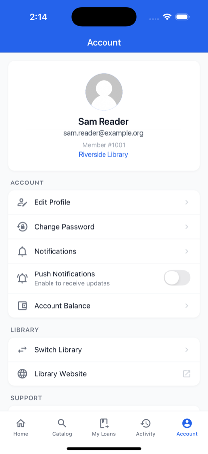
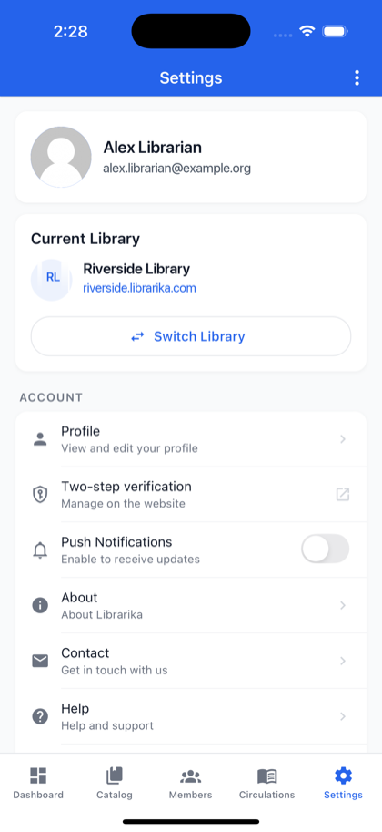

# Account settings in the app

**Who this is for:** everyone who uses the Librarika app.

**What you can do here:** change your profile, email address and password, choose how you sign in, and find two-step verification.

These settings belong to your **Librarika account**, so they apply in every library and on the website too.

* **Members:** the **Account** tab. Under **Account**: `Edit Profile`, `Change Password`, `Two-step verification`, `Notifications`, `Push Notifications` and `Account Balance`. Under **Library**: `Switch Library` and `Library Website`. Then help links, `Sign Out` and `Delete Account`.
* **Staff:** the **Settings** tab. A **Current Library** card with `Switch Library`, then `Profile`, `Two-step verification`, `Push Notifications`, help links and `Logout`. `Delete Account` is on the member **Account** tab only. If you are staff only, delete your account on the website (see [Remove your account](signing-in.md#remove-your-account)).

 

The settings also have a `Two-step verification` row (it isn't in the member picture).

---

## Profile

Open `Edit Profile` (members) or `Profile` (staff, **My Profile**). Tap `Edit` under **Personal Information** to change your **Full Name**, **Email**, **Bio** and **Timezone**, then tap `Save Changes`. Tap the photo to upload a new one from the camera or gallery.

## Change your email address

1. In your profile, tap `Edit`, change **Email** and tap `Save Changes`.
2. The app asks for your password: *"Enter your password to change your email"*. Enter your **Current password** and tap `Continue`.
3. You see **Confirm your new email**: *"We sent a confirmation link to … Your email address changes when you open that link."*
4. Your profile shows *"Pending: … — check your inbox"* until you open the link in the email at the **new** address.

Until then, your old address stays in use. See [Change your email address](signing-in.md#change-your-email-address).

* **No password?** (you sign in with Google, Apple or SSO): tap `No password? Change your email on the website`.
* *"Your current password is incorrect."* -- try again. After too many tries you see *"Too many attempts. Please try again later."*

## Change your password

1. Open `Change Password` (members: **Account** tab; staff: `Profile` > `Change Password`).
2. Enter your **Current Password**, then **New Password** and **Confirm New Password**, and tap `Change Password`.

The same rules apply as on the website: at least 15 characters (12 with two-step verification, or more if your library asks), not a common or breached password, and not containing your name or the library's name. Under **New Password** the app shows a hint about these rules. If the password is refused, you see **Password not changed** with the reason. See [What makes a good password](passwords.md#what-makes-a-good-password).

Changing your password signs out your other devices.

## Two-step verification

The settings show **Two-step verification** -- *Manage on the website*. Tap it to open the two-step verification page on the website, where you turn it on or off, see your recovery codes count and set up a new phone. See [Two-step verification](two-step-verification.md).

## Sign-in methods and SSO

In your profile:

* **Sign-in methods** (*"Let this account sign in with:"*): switches for **Sign in with Google** and **Sign in with Apple**, when they are available.
* **Single sign-on (SSO)** (*"A library's SSO can sign you in only if it is switched on here."*): one switch per library that uses SSO.

These are the same settings as on the website (see [Your sign-in settings](signing-in.md#your-sign-in-settings)). If a change isn't allowed, for example because you signed in with SSO, you see **Not changed**.

## Notifications

Turn `Push Notifications` on to get library notices on your phone. If notifications are turned off in your phone's settings, the app shows **Notifications Disabled** and asks you to turn them on there.

To turn them off, tap the switch: the app says *"To turn off notifications, please go to your device Settings."* Tap `Open Settings` and turn off notifications for Librarika there.

## Delete your account (members)

`Account` > `Delete Account`. Enter your password, type `delete` and tap `Permanently Delete Account`, then confirm with `Delete My Account`. This closes your Librarika account for good, in every library. See [Remove your account](signing-in.md#remove-your-account).

* **No password?** (you use Google, Apple or SSO): delete your account on the website, where you can ask for a confirmation link by email (see [Remove your account](signing-in.md#remove-your-account)).
* **Signed in with SSO?** You see *"You signed in with SSO. Sign in with your password or Google to do this."* Sign out and sign in with your password or Google first.
* **The only admin of a library?** You see *"Cannot delete this account. You are the only administrator of … Please add another admin first."* Add another admin first.
