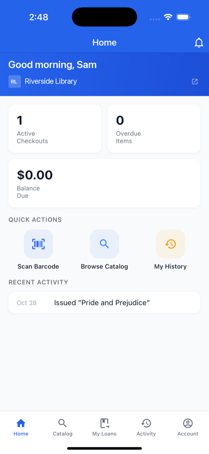
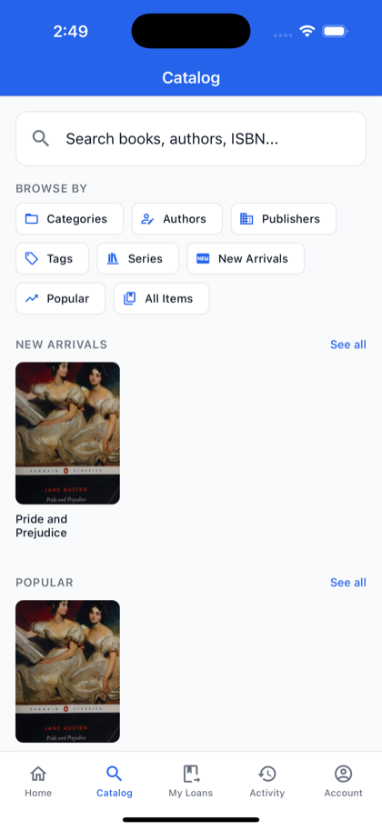
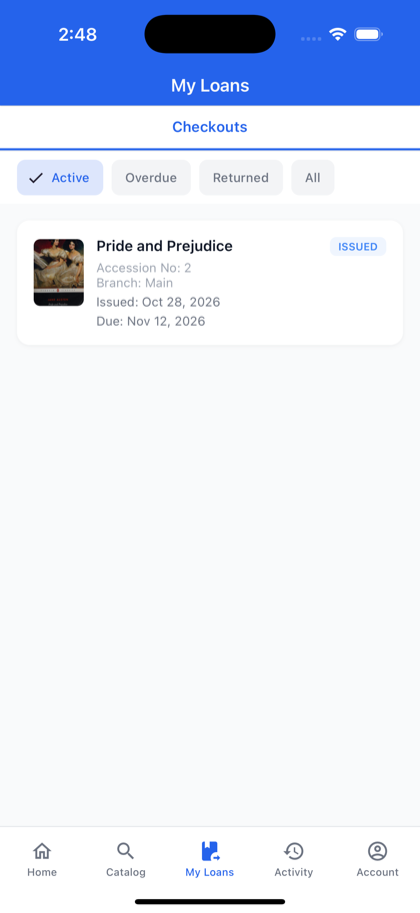

# For members in the app

**Who this is for:** library members who use the Librarika app.

**What you can do here:** find your way around the member screens: the catalog, your loans and holds, self-checkout, your balance and notifications.

You get these screens when you open a library from **Access as Member** (see [Choose a library](mobile-app.md#choose-a-library)). The tabs at the bottom are **Home**, **Catalog**, **My Loans**, **Activity** and **Account**.

Some features depend on your library's settings: holds, item requests (reservations) and self-checkout appear only if your library allows them.

---

## Home

* **Active Checkouts**, **Overdue Items**, **Holds Waiting** (if your library uses holds) and **Balance Due**.
* **Ready for Pickup**: holds waiting for you at the library.
* **Quick Actions**: `Scan Barcode`, `Browse Catalog` and `My History`.
* **Recent Activity**: your latest loans and returns.
* The bell at the top opens your **Notifications**.

## Catalog

* Search with **Search books, authors, ISBN...**, or browse by **All Items**, **Categories**, **Authors**, **Publishers**, **Series** and **Tags**.
* **New Arrivals**, **Popular** and **Recently Viewed** lists.
* Tap a title to see **Item Details**: its copies and availability. From there, if your library allows it:
	* `Self Checkout` in the action bar, or `Checkout` next to an available copy: borrow it yourself. `Check In` appears next to a copy you have out.
	* `Place Hold` when every copy is out, or `Hold` next to one checked-out copy, then `Place Hold` in the **Place a Hold** dialog: *"Join the waiting queue for this item. You'll be notified when a copy becomes available for pickup."* Choose **Title-level hold (any copy)** or **Copy-level hold (specific copy)**, when your library offers both.
	* `Request`: choose a copy, **Start Date** and **Return Date**, then `Submit Request` (*"Reserve a specific copy for a date range. The library will set it aside for you to pick up."*).
	* `Write Review` (or `Edit` if you already reviewed it).

See [Member area: My holds](member-area.md#my-holds) for how holds work.

## My Loans

* **Checkouts**: what you have borrowed and when it is due. Filter by **Active**, **Overdue**, **Returned** or **All**.
* **Holds** (if your library uses holds): cancel a hold, suspend it until a date, or make it active again.
* **Reservations** (if your library allows requests): cancel a request.

### Check out and return items yourself

If your library allows [self-service](self-service.md), the barcode button on **My Loans** opens **Self Checkout**:

1. Under **SCAN OR ENTER ACCESSION NUMBER**, scan the barcode with the scan icon in the field, or type the accession number, and tap `Look Up`.
2. Check the **Due Date**; tap it to change it, up to your library's maximum.
3. Tap `Confirm Checkout`. You see *"Checked out successfully! Due: …"*

To return an item yourself (if your library allows it), tap ⋮ next to the item under **Checkouts** and choose `Return Item`, or use `Check In` on the item's details. **Self Check-In** opens: add **Notes (optional)** if you like, tap `Confirm Return`, then `Return`. You see *"Returned! Thank you for returning …"*. Your library may not allow returning overdue items this way.

`Scan Barcode` on **Home** offers `Search Catalog`, `Check Out`, `Return Item` and `My Loans` (checkout and return only if your library allows them).

If you see *"Copy not found. Please check the accession number."*, check the number on the label, or ask at the desk.

## Activity

**Recently Viewed** titles and your **Reviews**. `My History` on **Home** opens it too.

## Balance

`Account` > `Account Balance` shows your **Current Balance** and **Outstanding Fines**. You can't pay in the app: *"Contact the library to pay your balance."* See [Member area](member-area.md).

## Notifications

* The bell on **Home** opens **Notifications** from your account and your library.
* To get notifications on your phone, turn on `Push Notifications` in the **Account** tab. If notifications are off in your phone's settings, the app asks you to turn them on there.
* To turn them off, tap the switch and then `Open Settings`, and turn off notifications for Librarika there.

## Account

Your profile, password, two-step verification, `Switch Library`, `Library Website`, help links, `Sign Out` and `Delete Account`. See [Account settings in the app](app-account-settings.md).
