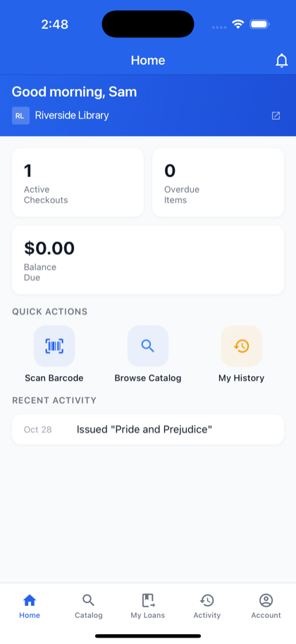
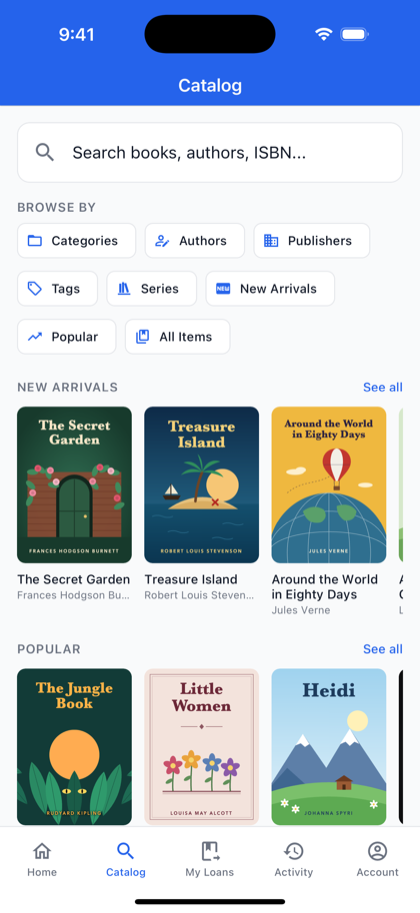
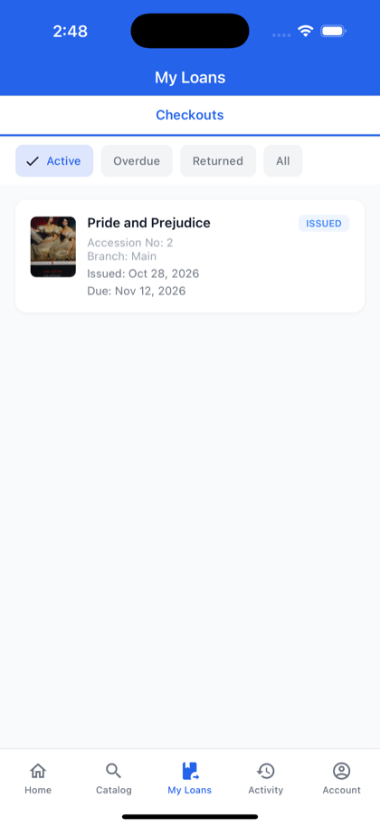

# For members in the app

**Who this is for:** library members who use the Librarika app.

**What you can do here:** find your way around the member screens: the catalog, your loans and holds, self-checkout, your balance and notifications.

You get these screens when you open a library from **Access as Member** (see [Choose a library](mobile-app.md#choose-a-library)). The tabs at the bottom are **Home**, **Catalog**, **My Loans**, **Activity** and **Account**.

Some features depend on your library's settings: renewals, holds, item requests (reservations) and self-checkout appear only if your library allows them. Don't see a feature your library offers on the website? Close the app completely and open it again to load the latest update (see [App updates](mobile-app.md#app-updates)).

---

## Home

* **Active Checkouts**, **Overdue Items**, **Holds Waiting** (if your library uses holds) and **Balance Due**.
* **Ready for Pickup**: holds waiting for you at the library.
* **Quick Actions**: `Scan Barcode`, `Browse Catalog` and `My History`.
* **Recent Activity**: your latest loans and returns.
* The bell at the top opens your **Notifications**.

## Catalog

* Search with **Search books, authors, ISBN...**, or browse by **All Items**, **Categories**, **Authors**, **Publishers**, **Series** and **Tags**.
* **New Arrivals**, **Popular** and **Recently Viewed** lists.
* Tap a title to see **Item Details**: its copies and availability (**Available**, **Checked Out**, or **Checked Out (You)**). From there, if your library allows it:
	* `Self Checkout` in the action bar, or `Check Out` on an available copy: borrow it yourself. `Check In` appears on a copy you have out.
	* `Place Hold` in the action bar, or `Place Hold` on one copy. Each copy shows at most two buttons; more are under its ⋮ menu.
	* `Request`: choose a copy, **Start Date** and **Return Date**, then `Submit Request` (*"Reserve a specific copy for a date range. The library will set it aside for you to pick up."*).
	* `Write Review` (or `Edit` if you already reviewed it).

### Place a hold

You can place a hold on a title when every copy is checked out and, unless your library has turned it off, when a copy is on the shelf: the library takes the copy from the shelf, sets it aside for you and tells you when it is ready for pickup.

* With a copy on the shelf, **Item Details** says *"A copy is on the shelf. Place a hold and we'll set it aside for you, or borrow it now."* (with the branch, when your library has more than one). If your library doesn't allow holds on items on the shelf, it says *"A copy is on the shelf. You can borrow it now."* instead.
* Tap `Place Hold`. In the **Place Hold** dialog (*"Join the waiting queue for this item. You'll be notified when a copy becomes available for pickup."*), choose **Title-level hold (any copy)** or **Copy-level hold (specific copy)** when your library offers both, then tap `Place Hold`.
* You see *"Hold placed. We'll tell you when it is ready for pickup. You are #1 in the queue."*, or *"Your hold is ready for pickup."* with the date to collect it by.
* If you already hold the title, you see *"You already have a hold on this title."* and `View your holds`. There is no `Place Hold` on a title you have on loan.

See [Member area: My holds](member-area.md#my-holds) for how holds work.

## My Loans

* **Checkouts**: what you have borrowed and when it is due. Filter by **Active**, **Overdue**, **Returned** or **All**.
* **Holds** (if your library uses holds): see [Your holds](#your-holds).
* **Reservations** (if your library allows requests): cancel a request.

### Renew your loans

If your library allows renewals for your membership, a loan that can be renewed has a `Renew` button.

* Tap `Renew`. The **Renewal** sheet shows *"Renewed. New due date: …"*, or why the loan wasn't renewed. Tap `Done`.
* When loans can be renewed, a bar above the list says, for example, *"3 loans can be renewed"*, with `Renew All`. Tap it, confirm `Renew`, and the **Renewal** sheet lists each loan: *"Renewed 2 of 3."*, then the new due date, or the reason, for each.
* After a renewal the loan shows **Renewed 1 of 2**: how many times it has been renewed, out of the most your library allows.
* Overdue items can be renewed only if your library allows it. The app asks first, for example *"Renew …? Renewing adds $1.50 to your balance (late fee so far: $1.50)."* The late fee up to that day is added to your account.

When a loan can't be renewed, the reason is under it, for example *"Another member is waiting for this item."*, *"This item has been renewed the maximum number of times."*, *"This item cannot be renewed yet. Renewable from: …"*, *"Sorry, member has reached the maximum dues limit."* or *"This item is overdue. Please return it to the library."* No `Renew` button and no reason? Your library has not turned on renewals, or not for your membership. Ask at the desk.

Renewals follow the same rules as on the website: see [Renew your loans](member-area.md#renew-your-loans).

### Your holds

The **Holds** tab lists your holds, ready ones first. Filter by **Active** (all of them), **Waiting**, **Ready** or **Suspended**.

* Each hold shows its **Hold type** (Title or Copy), your **Queue position**, and when it was **Placed**.
* A hold that is **READY FOR PICKUP** shows *"Ready for pickup at …"* (the branch, when your library has more than one) and **Pickup by:**, the last day to collect it.
* Tap ⋮ on a hold:
	* `Suspend` (a waiting hold): enter **Suspend until (YYYY-MM-DD)**, tap `Suspend Hold`, then confirm `Suspend`. You keep your place in the queue but may be skipped while it is suspended.
	* `Activate` (a suspended hold): it goes back in the queue.
	* `Cancel Hold`, then `Cancel hold` to confirm. You lose your place in the queue; for a ready hold, the copy goes to the next member.

See [Suspend, activate, and cancel holds](member-area.md#suspend-activate-and-cancel-holds).

### Check out and return items yourself

If your library allows [self-service](self-service.md), the barcode button on **My Loans** opens **Self Checkout**:

1. Under **SCAN OR ENTER ACCESSION NUMBER**, scan the barcode with the scan icon in the field, or type the accession number, and tap `Look Up`.
2. Check the **Due Date**; tap it to change it, up to your library's maximum.
3. Tap `Confirm Checkout`. You see *"Checked out successfully! Due: …"*

To return an item yourself (if your library allows it), tap ⋮ next to the item under **Checkouts** and choose `Return Item`, or use `Check In` on the item's details. **Self Check-In** opens: add **Notes (optional)** if you like, tap `Confirm Return`, then `Return`. You see *"Returned! Thank you for returning …"*. Your library may not allow returning overdue items this way.

`Scan Barcode` on **Home** offers `Search Catalog`, `Check Out`, `Return Item` and `My Loans` (checkout and return only if your library allows them).

If you see *"Copy not found. Please check the accession number."*, check the number on the label, or ask at the desk.

## Activity

**Recently Viewed** titles and your **Reviews**. `My History` on **Home** opens it too.

## Balance

`Account` > `Account Balance` shows your **Current Balance** and, under **CHARGES** (or **CHARGES AND PAYMENTS**), each line behind it, newest first: what it is for (the book, for a late fee), the date and the amount. Payments and credits are shown in green with a minus sign. If you have many lines, the app shows only the latest (*Latest … of …*). With nothing owed you see *"No charges on your account."*

You can't pay in the app: *"Contact the library to pay your balance."* See [Fees & payments](fees-payments.md#member-balances).

## Notifications

* The bell on **Home** opens **Notifications** from your account and your library.
* To get notifications on your phone, turn on `Push Notifications` in the **Account** tab. If notifications are off in your phone's settings, the app asks you to turn them on there.
* To turn them off, tap the switch and then `Open Settings`, and turn off notifications for Librarika there.

## Account

Your profile, password, two-step verification, `Switch Library`, `Library Website`, help links, `Sign Out` and `Delete Account`. See [Account settings in the app](app-account-settings.md).
