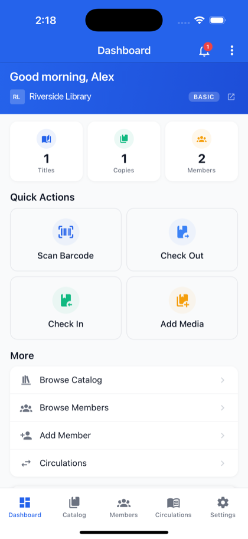
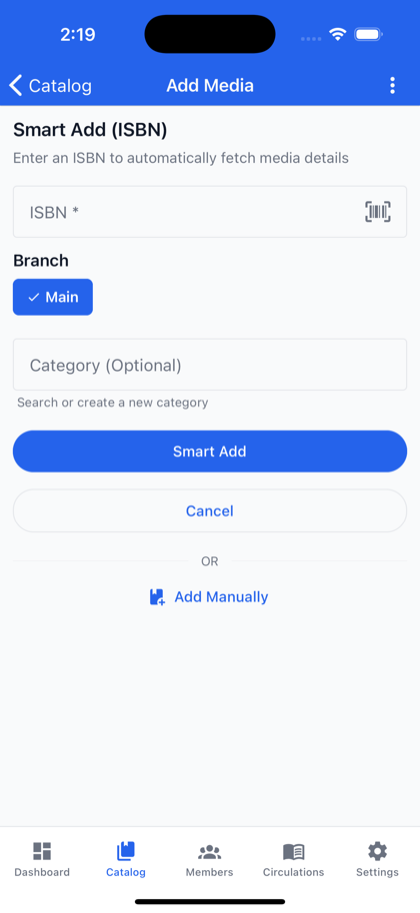
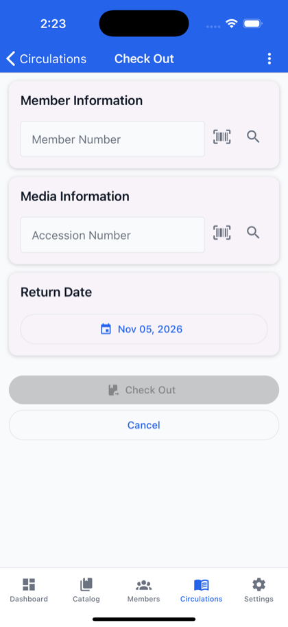

# For library staff in the app

**Who this is for:** library admins, staff and assistants who use the Librarika app.

**What you can do here:** find your way around the staff screens: scanning, adding titles and cover photos, members and circulation.

You get these screens when you open a library from **Manage as Librarian** (see [Choose a library](mobile-app.md#choose-a-library)). The tabs at the bottom are **Dashboard**, **Catalog**, **Members**, **Circulations** and **Settings**. The ⋮ menu at the top of every staff screen has shortcuts: `Quick Checkout`, `Quick Check-in`, `Add Media`, `Add Member`, `Switch Library` and `Logout`.

**Permissions:** the app shows the same screens to library admins, staff and assistants. What each person may actually change is decided by Librarika, as on the website: if your role doesn't allow an action, Librarika refuses it. Your role is shown on your profile (**Library Admin**, **Library Staff** or **Library Assistant**). See [Users & roles](users.md).

**Website only:** holds, fees and payments, barcode labels, reports, bulk actions, batch update and Preferences are only on the website.

---

## Dashboard

* Counts of **Titles**, **Copies** and **Members**, and **Library Traffic** for the last 14 days.
* **Quick Actions**: `Scan Barcode`, `Check Out`, `Check In` and `Add Media`.
* **More**: `Browse Catalog`, `Browse Members`, `Add Member` and `Circulations`.
* The bell at the top opens notifications.

## Scan barcodes

Tap `Scan Barcode` and point the camera at the barcode. Then choose what to do with it: `Search Catalog`, `Smart Add`, `Check Out`, `Check In`, `Search Members` or `Circulations`. The first time, allow camera access; if you refused it, you see *"Camera permission is required to scan barcodes"* and a `Grant Permission` button.

## Catalog

* Search the catalog with **Search catalog** and open a title's **Media Details**.
* **Add a title by ISBN** (`Add Media`, **Smart Add (ISBN)**): *"Enter an ISBN to automatically fetch media details"*. Enter or scan the **ISBN**, choose the **Branch** and optionally a **Category**, and tap `Smart Add`. Librarika fills in the details and adds a copy; you see **Media Added** with `View Details`, `Add Copy`, `Add Another` and `Done`. If the title is already in your catalog you see **Media Already Exists**.

	

* **Add a title by hand**: tap `Add Manually` for the full form.
* Open a title's **Media Details**: `Upload Cover`, `Edit Media`, `Add Copy`, or `Delete Media` (deletes the whole title). Each copy's ⋮ menu has `Edit`, `Check In` or `Checkout`, and `Delete`.
* Manage **Categories** (**Add Category**).

See [Cataloging](cataloging.md) for what each field means.

### Add a cover photo

1. Open the title's **Media Details** and tap `Upload Cover`.
2. Take a photo with the camera or pick one from the gallery.
3. In **Crop Ratio**, choose **Book Cover (2:3)**, **Square (1:1)**, **DVD/Blu-ray (3:4)** or **Free-form**, tap `Crop`, then adjust and confirm.

You see *"Cover photo updated"*.

## Members

* Search with **Search members** and open **Member Details**.
* **Add Member**: photo, **First Name**, **Last Name**, **Member Number**, **Allow Login** and more. Set **Allow Login** to `Yes` and enter the member's **Email** (without it you see *"Please enter email address for member login."*): Librarika emails them an invitation (see [Members](members.md#member-area-access)). **Member Details** shows *Invited* until they join, then *Joined*.
* **Edit Member** and **Delete Member**.

## Circulations

* **Check Out**: enter or scan the **Member Number** and **Accession Number**, check the **Return Date** and tap `Check Out`.

	

* **Check In**: enter or scan the **Accession No / ISBN**, with optional **Remarks**.
* **Circulation History**: search *by member or title*, see **Active Loans** and **Overdue**, and edit a loan (**Edit Circulation**).

The same rules apply as at the desk. See [Circulation](circulations.md).

## Settings

Your profile, two-step verification, push notifications, `Switch Library`, help links and `Logout`. See [Account settings in the app](app-account-settings.md).
