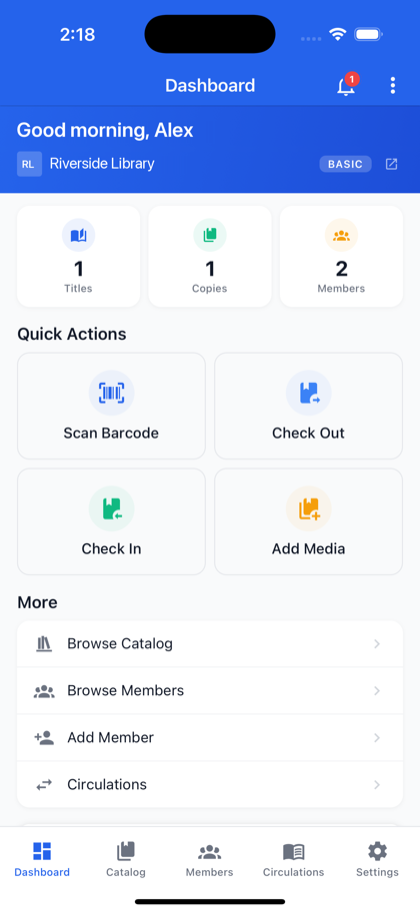
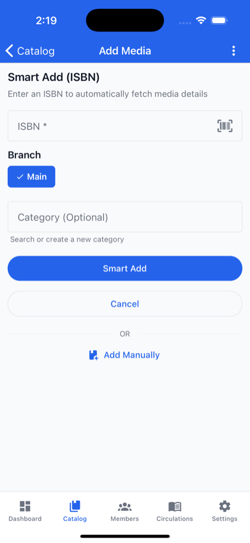
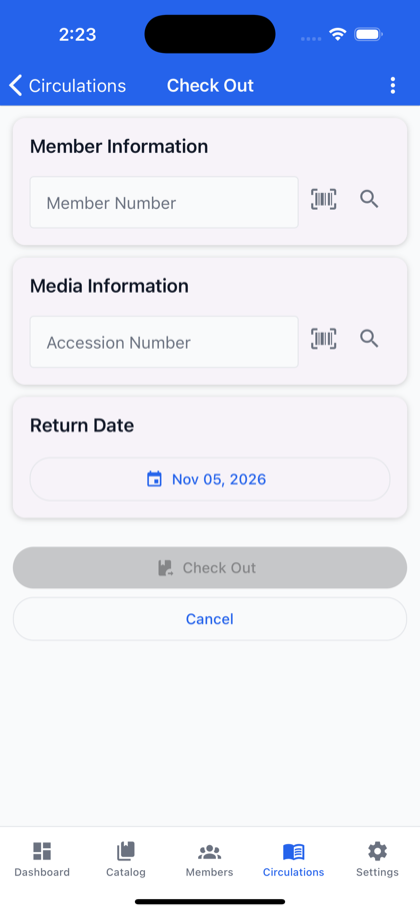

# For library staff in the app

**Who this is for:** library admins, staff and assistants who use the Librarika app.

**What you can do here:** find your way around the staff screens: scanning, adding titles and cover photos, members, circulation, renewals and holds.

You get these screens when you open a library from **Manage as Librarian** (see [Choose a library](mobile-app.md#choose-a-library)). The tabs at the bottom are **Dashboard**, **Catalog**, **Members**, **Circulations** and **Settings**. The ⋮ menu at the top of every staff screen has shortcuts: `Quick Checkout`, `Quick Check-in`, `Add Media`, `Add Member`, `Switch Library` and `Logout`.

**Permissions:** the app shows the same screens to library admins, staff and assistants. What each person may actually change is decided by Librarika, as on the website: if your role doesn't allow an action, Librarika refuses it. Your role is shown on your profile (**Library Admin**, **Library Staff** or **Library Assistant**). See [Users & roles](users.md).

**Renewals and holds** appear only when your library has them turned on (see [Renewal settings](self-service.md#renewal-settings) and [Enable hold queue](hold-queue.md#enable-hold-queue)) and your role allows circulation. If you don't see them, close the app completely and open it again to load the latest update (see [App updates](mobile-app.md#app-updates)).

**Website only:** hold queue settings, hold details, fees and payments, barcode labels, reports, bulk actions, batch update and Preferences are only on the website.

---

## Dashboard

* Counts of **Titles**, **Copies** and **Members**, and **Library Traffic** for the last 14 days.
* **Quick Actions**: `Scan Barcode`, `Check Out`, `Check In` and `Add Media`.
* **More**: `Browse Catalog`, `Browse Members`, `Add Member` and `Circulations`.
* The bell at the top opens notifications.

## Scan barcodes

Tap `Scan Barcode` and point the camera at the barcode. Then choose what to do with it: `Search Catalog`, `Smart Add`, `Check Out`, `Check In`, `Search Members` or `Circulations`. The first time, allow camera access; if you refused it, you see *"Camera permission is required to scan barcodes"* and a `Grant Permission` button.

## Catalog

* Search the catalog with **Search catalog** and open a title's **Media Details**.
* **Add a title by ISBN** (`Add Media`, **Smart Add (ISBN)**): *"Enter an ISBN to automatically fetch media details"*. Enter or scan the **ISBN**, choose the **Branch** and optionally a **Category**, and tap `Smart Add`. Librarika fills in the details and adds a copy; you see **Media Added** with `View Details`, `Add Copy`, `Add Another` and `Done`. If the title is already in your catalog you see **Media Already Exists**.

	

* **Add a title by hand**: tap `Add Manually` for the full form.
* Open a title's **Media Details**: `Upload Cover`, `Edit Media`, `Add Copy`, or `Delete Media` (deletes the whole title). Each copy's ⋮ menu has `Edit`, `Check In` or `Checkout`, and `Delete`.
* Manage **Categories** (**Add Category**).

See [Cataloging](cataloging.md) for what each field means.

### Add a cover photo

1. Open the title's **Media Details** and tap `Upload Cover`.
2. Take a photo with the camera or pick one from the gallery.
3. In **Crop Ratio**, choose **Book Cover (2:3)**, **Square (1:1)**, **DVD/Blu-ray (3:4)** or **Free-form**, tap `Crop`, then adjust and confirm.

You see *"Cover photo updated"*.

## Members

* Search with **Search members** and open **Member Details**. It also shows the member's loans and holds: see [A member's loans and holds](#a-members-loans-and-holds).
* **Add Member**: photo, **First Name**, **Last Name**, **Member Number**, **Allow Login** and more. Set **Allow Login** to `Yes` and enter the member's **Email** (without it you see *"Please enter email address for member login."*): Librarika emails them an invitation (see [Members](members.md#member-area-access)). **Member Details** shows *Invited* until they join, then *Joined*.
* **Edit Member** and **Delete Member**.

### A member's loans and holds

**Member Details** shows the member's loans when your library has renewals on, and their holds when it uses holds.

* **LOANS**: each loan with its due date and, for example, **Renewed 0 of 2**. Tap `Renew` on a loan, or `Renew All` to renew every loan that can be renewed (confirm `Renew` when asked). The **Renew all** screen lists each loan as **Renewed** with its new due date, or **Not renewed** with the reason; tap `Done`. A loan that can't be renewed says why (*"Not renewable: …"*). Renewing an overdue loan asks first and says what it adds to the member's balance. See [Renew a loan](circulations.md#renew-a-loan).
* **HOLDS**: each hold with its status, its type and its branch (when your library has more than one). `Cancel Hold`, then `Cancel hold` to confirm.
* `Place a Hold`: search by **Title, ISBN or call no.**, pick the title, then choose **Any copy** (*the first copy that comes free*) or a specific copy (**On loan** or **On the shelf**), and tap `Place Hold`. If a copy on the shelf can fill it at once, **Hold placed** tells you to put that copy on the hold shelf for the member. See [Place hold (staff)](hold-queue.md#place-hold-staff).

## Circulations

* **Check Out**: enter or scan the **Member Number** and **Accession Number**, check the **Return Date** and tap `Check Out`.

	

	If another member's hold keeps that copy, you see **Item on hold** with the reason. Tap `Lend anyway` to check it out all the same, or `Cancel`. When the checkout fills a hold or moves one, **Checked out: hold shelf** tells you what to do with the copy. See [When a copy is kept for a hold](hold-queue.md#when-a-copy-is-kept-for-a-hold).

* **Check In**: enter or scan the **Accession No / ISBN**, with optional **Remarks**. If the item now goes to a member who is waiting for it, you see **Put on the hold shelf**: *"Another member is waiting for this item — put it on the hold shelf."*
* **Circulation History**: search *by member or title*, see **Active Loans** and **Overdue**, and edit a loan (**Edit Circulation**).
* **Holds** (if your library uses holds): see [Holds](#holds).

The same rules apply as at the desk. See [Circulation](circulations.md).

### Holds

The **Holds** tile on `Circulations` shows how many holds are *to pull*, *ready for pickup* and *overdue to pull*. Tap it to open **Holds**, with three tabs:

* **To Pull**: holds that a copy on the shelf can fill now (the web [Holds to Pull](hold-queue.md#holds-to-pull)), overdue ones first. Each shows the title, the copy to fetch (accession number, call number, branch), the member and when the hold was placed, and **Overdue to pull** when it has waited longer than your **Pickup Window**.
	1. Take the copy from the shelf.
	2. Tap `Mark Ready` on the hold, or tap `Scan to Pull` and scan the copy's barcode. To type it, tap `Type an accession number instead`, enter the **Accession number** and tap `Pull`.
	3. The result says **Ready for …** and *"Put it on the hold shelf."*, whether the member has been told, and the pickup date. Tap `Scan Next` or `Done`. If the copy can't be set aside, **Not set aside** says why (for example *"No hold is waiting for this copy."*).
	4. Wrong member or copy? Tap `Undo` on the result and confirm `Put back`: the hold is waiting again in its place in the queue, and the copy goes back on the shelf.
* **Hold Shelf**: holds that are ready, with the copy, the member and **Pickup by** (the branch too, when your library has more than one).
	* `Check Out` opens **Check Out** with the member and copy filled in. See [Fulfil a hold](hold-queue.md#fulfill-hold-checkout).
	* `Cancel`, then `Cancel hold` to confirm: the copy goes to the next member.
	* Past its pickup date the hold shows **Pickup expired** and `Cancel and Pass On`: confirm `Cancel and pass on` to give the copy to the next member, or put it back on the shelf if no one else is waiting.
	* ⋮ > `Undo ready` puts a hold you marked ready by mistake back to waiting (confirm `Put back`).
* **All**: every open hold, with its status (for example **Waiting · 1st**, **Ready**, **Suspended until …**) and whether it is a title or copy hold.

See [Hold queue](hold-queue.md) and [Hold shelf](hold-queue.md#hold-shelf).

## Settings

Your profile, two-step verification, push notifications, `Switch Library`, help links and `Logout`. See [Account settings in the app](app-account-settings.md).
