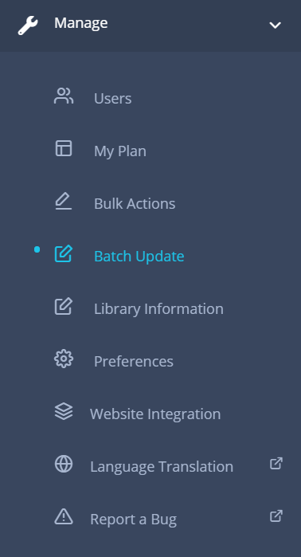
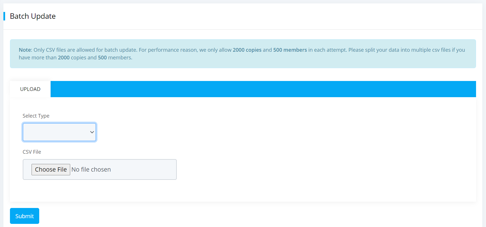
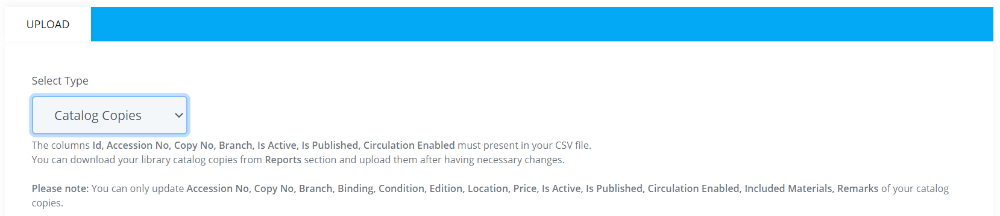
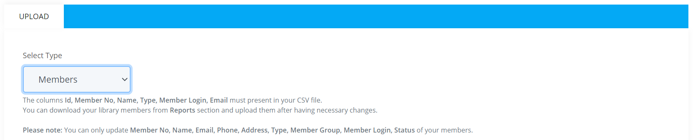

# Batch update

Batch update method is used to edit mass amount of data at once and batch update them. For now batch update is only applicable to the catalog item copies and members of the library. Only CSV files are allowed for batch updating. Also, batch update feature is only available to paid libraries.

**Tips:** Export copies from `Reports -> Catalog Reports -> Export all copies` and members from `Reports -> Member Reports -> Export all members`. Edit those files and keep the `Id` column: Batch update matches rows on it.

To access this section, please follow the below steps:

* Please go to `Dashboard -> Manage -> Batch Update` section.

	

* Click on the `Batch Update` menu and a page will be appeared like below.

	

* Now you can select either the catalog copies or members and update their  information according to your need.

## Update catalog copies

You can use the batch update method to update all the catalog copies information of your library. It is useful to those who wants to update multiple fields at a time like accession no, copy no, branch, location and many more altogether.

To do so, please follow the below steps:

* Select `Catalog Copies` from the select type dropdown like below.

	

* After selecting catalog copies option you will see some text hints, please read them carefully.
* Before uploading catalog copies CSV file please make sure that **Id, Accession No, Copy No, Branch, Is Active, Is Published and Circulation Enabled** columns must be present in your file, because these fields are required.
* Moreover, you can only update the **Accession No, Copy No, Branch, Binding, Condition, Edition, Location, Price, Is Active, Is Published, Circulation Enabled, Included Materials, Remarks** of your catalog copies file.
* An **Accession No** must be a number of at most 18 digits. It must be unique: it can't appear twice in your file, or belong to another copy of your library that is not in the file. You can swap accession numbers between copies that are both in the file.
* **Copy No** must be a number too.
* One file can hold up to 2,000 copies.
* Choose your edited file and click `Submit`.
* Check the review page. If it lists errors, fix the file and upload it again.
* Click `Update Now`. Your copies are updated.

## Update members

Using the batch update method you can update your library members information in bulk. Which means you can update multiple fields data at once like member no, name, email, phone etc. You can edit those data in your CSV file and then upload them into your library.

To do so, please follow the below steps:

* Select `Members` from the select type dropdown like below.

	

* After selecting the members option you will see some text hints. please read them carefully.
* Before uploading the members CSV file please make sure that **Id, Member No, Name, Type, Member Login and Email** columns must be present in your file, because these fields are required.
* Moreover, you can only update the **Member No, Name, Email, Phone, Booking Quota, Address, Type, Member Group, Member Login, Status, Remarks** of your members CSV file.
* **Booking Quota** can't be more than 99999. An empty Booking Quota or Remarks cell clears the value.
* One file can hold up to 500 members.
* Choose your edited file and click `Submit`.
* Check the review page: each row is marked Ok or shows its errors. Rows with errors are skipped.
* Click `Update N member(s)` (N is the number of Ok rows). Those members are updated.

## FAQ

**Which plans can use Batch Update?**

Paid plans only (Basic Pro, Silver, Gold and above). On the free plan, Librarika shows "Please upgrade your plan first in order to modify your records using batch update." and opens the plan page.

**How many rows can I upload at once?**

Up to 2,000 catalog copies or 500 members per CSV file. A copies file with more rows is refused with "Too many records, please split them into multiple CSV files."; for members, only the first 500 rows are read, so split larger files yourself.

**Can I add new members or copies with Batch Update?**

No. Batch Update only changes records that already exist, matched by the `Id` column from your export, so do not change or remove the Id. To add new records, use [Import Members](members.md#import-members) or [Bulk Import](cataloging.md#bulk-import).

**Is anything changed before I confirm?**

No. After you upload, Librarika shows a review page first. Nothing is saved until you click `Update Now` (copies) or `Update ... member(s)` (members).

**What happens if some rows have errors?**

For copies, Librarika lists the errors and saves nothing until you fix them and upload again. For members, the review page marks each row as Ok or shows its errors; rows with errors are skipped and only the Ok rows are updated.

**What happens if I leave a cell empty?**

An empty cell clears that value, for example the phone number or the copy location (an empty Price becomes 0). For copies, a column you leave out completely is not changed; for members, keep every column from the export, because a missing column is treated as empty.

**Why do I get "Please provide a valid branch name."?**

The `Branch` value must exactly match the name of an existing branch in your library. For members, a `Member Group` name that does not exist yet is created as a new group, so check the spelling.

**Will members get an email?**

Yes, if you set `Member Login` to Yes for a member who does not have a login yet, Librarika sends them an invitation email. Setting it to No turns off sign-in for that member, so check this column before you upload.
