# Bulk actions

**Who this is for:** library staff who change many records at once.

**What you can do here:** select titles, copies or members by conditions, and update or delete them in one go.

The page is labelled `Bulk Actions (Beta)`. Bulk actions are processed in the background after you confirm them, so there can be a delay before the changes appear. Some operations also change or delete associated records, so proceed with caution.

Bulk actions method is used to update or delete your book, book copy or member records in bulk. You can use this option to partially or fully select records from your library and apply bulk update or delete operation to those records matching the criteria.

To do bulk actions, please follow the below steps:

* First, sign in to your library.
* Go to `Manage` > `Bulk Actions`.

    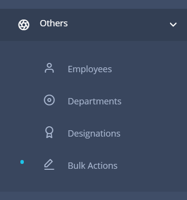

* After clicking on `Bulk Actions` a page will be appeared like below.
  
    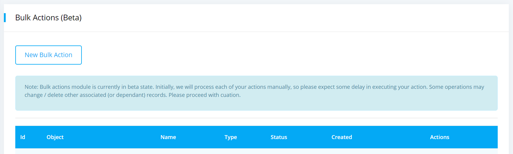

* Now if you click on `New Bulk Action` button then you can select the type of your bulk actions.

    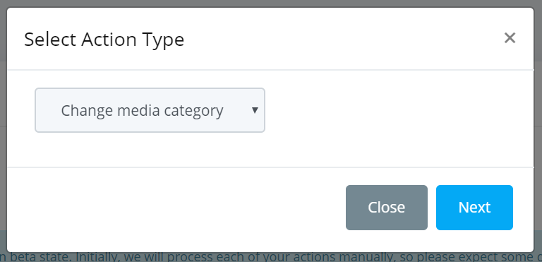

* Here `Change media category` is the default type. You can also select the other types of action per your need.

## Update medias

You can use bulk action method to update all the media information in your catalog such as category, tags, type, titles active flags etc.

To do so, please follow the below steps:

* Click on `New Bulk Action` button and a select action type form will be appeared.
* In this form various types of action are given like below.

    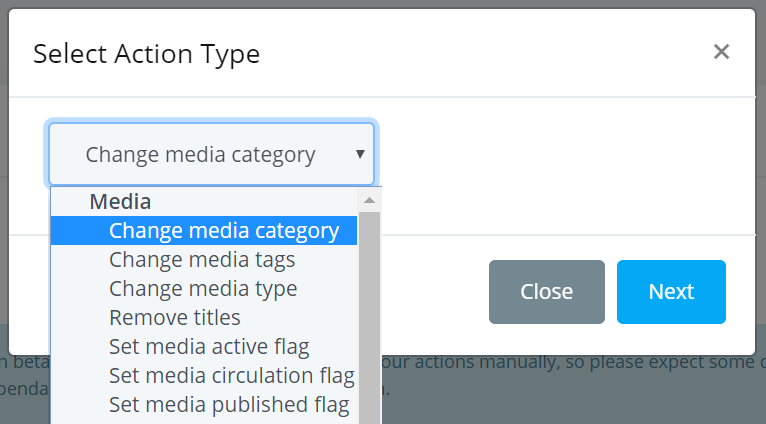

* You can select your preferred action type from which you wanted to update or delete your media.

### Change media category 

* If you select `Change media category` then a form will be appeared like below.

    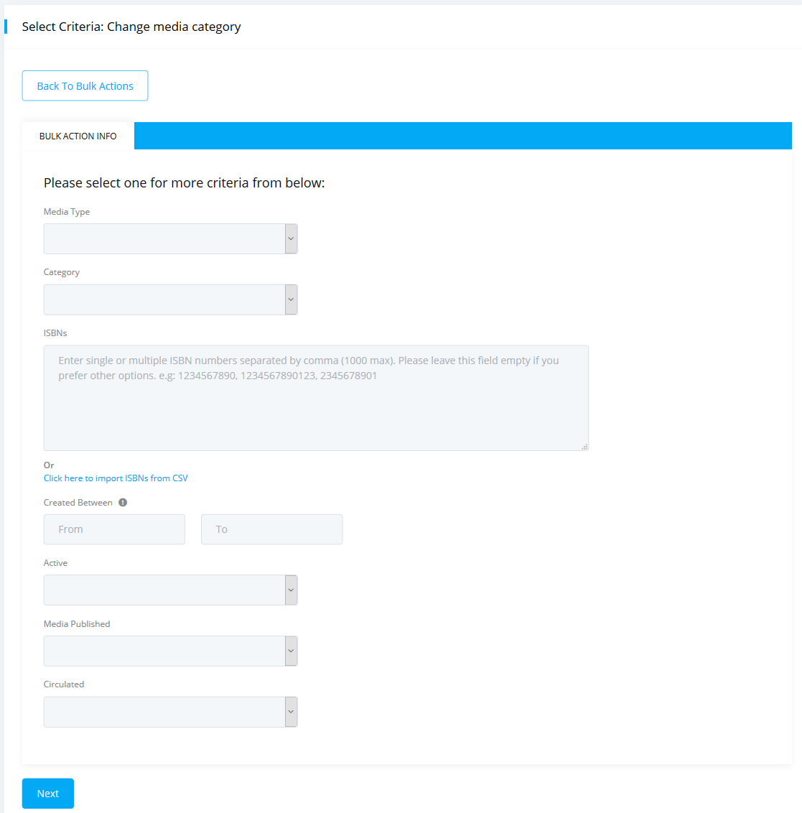

* Now you need to specify at least one condition based on which the records will be updated. You can specify more than one criteria to further narrow down the selection. 
    - The first option that you can see is the `Media Type` where you can select the types of media per your need.

        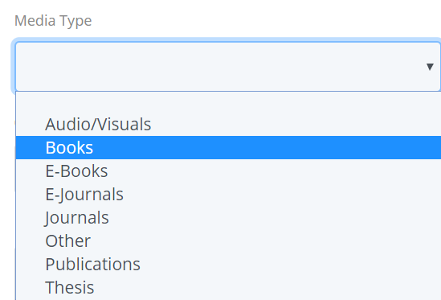 

    - Then you can select the `Category` option as shown below.

        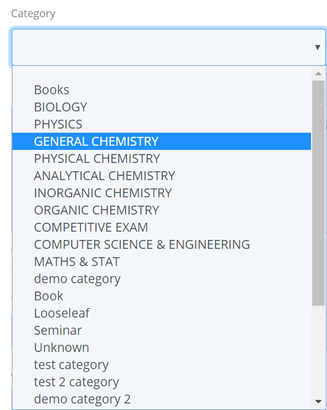 

    - The next one is the `ISBNs` where you can enter single or multiple ISBN numbers separated by a comma or you can import them from your CSV file. You can leave this field empty if you do not want to enter this criteria.

        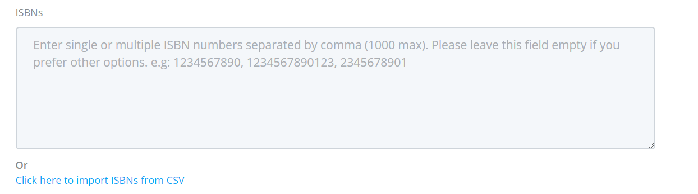 

    - Next is the `Created Between` option where you can give the date range for the medias.

        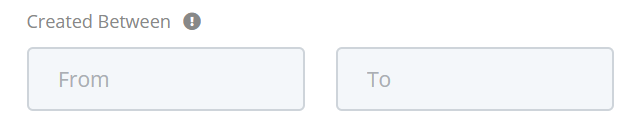

    - Then next one is the `Active` option where you can select if the media is active or not.

        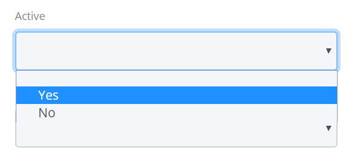

    - Then you can select the `Published` and `Circulated` option same as the `Active` option mentioned above.  

* Once you finished all the selection in the `Change media category` criteria, please click on the `NEXT` button and a page will be appeared like below.

    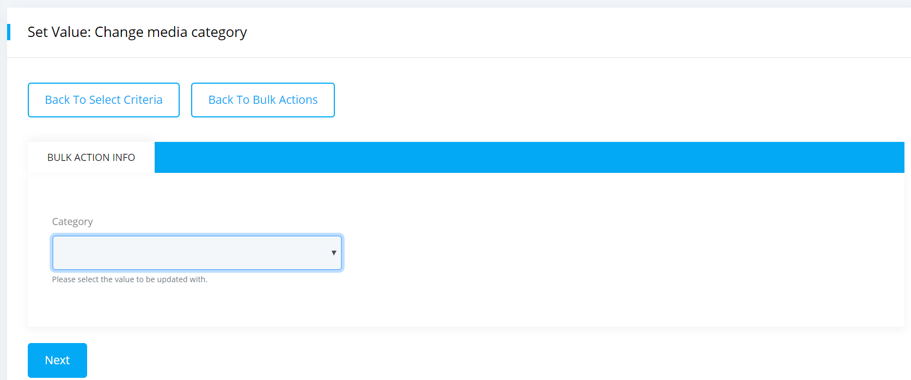 

* Here please select the `Category` from which you wanted to updated with. Otherwise an error message will be shown.

    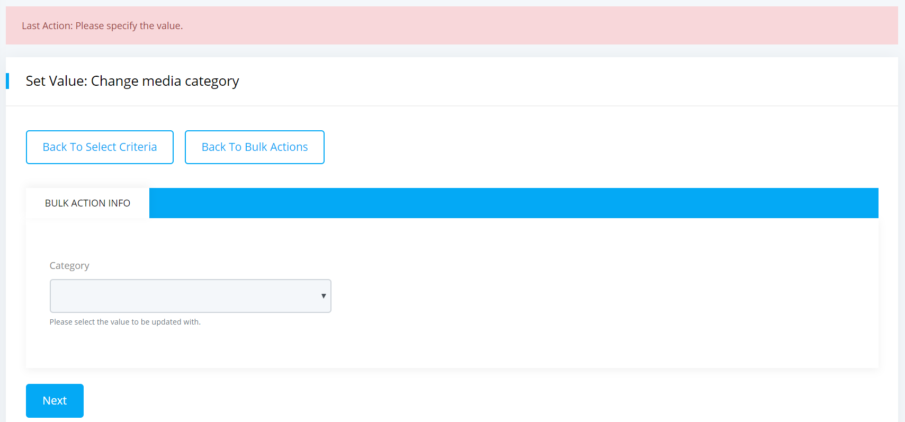

* After selecting the destination **Category** click on the `NEXT` button. Now you can review your changes like below.

        

* Click on `Confirm` button and your bulk actions will be saved.

    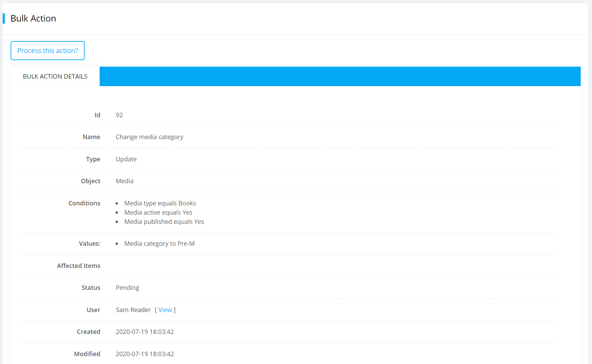

* The action is queued and processed in the background. Open it from the `Bulk Actions` list to see its status.

### Change media tags

To create a bulk action for changing media tags, please follow the bellow steps:

* Click on the `New Bulk Action` button and select `Change media tags` from the dropdown menu. 

    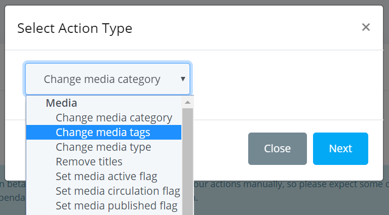 

* A **Select Criteria** form will appear same as **Change Media Category** section mention above and after selecting all the criteria click on the next button.
* Now enter your desired tags in the **Set Value** form and click on `NEXT` button when you are done.

    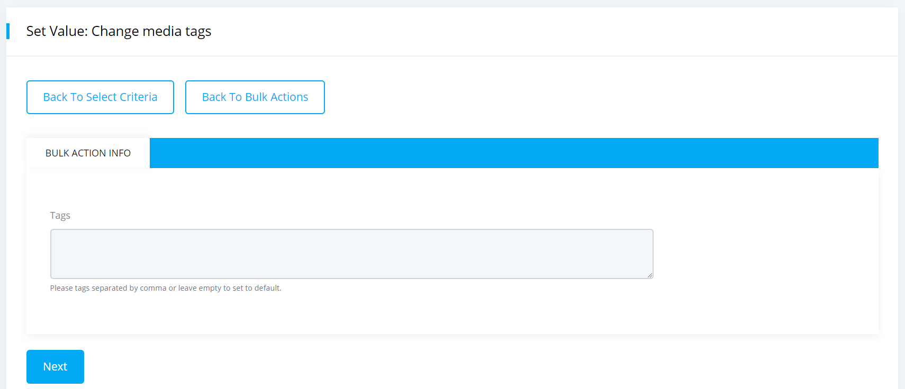 

* Now review your changes and click on the confirm button. Your bulk actions will be saved.
* The action is queued and processed in the background. Open it from the `Bulk Actions` list to see its status.

### Change media type

To create a bulk action for changing media type, please follow the below steps:

* Click on `New Bulk Action` button and select `Change media type` option from the dropdown menu. 

    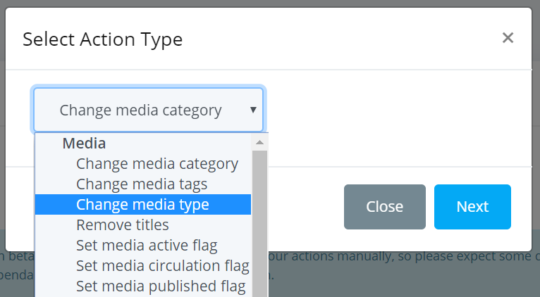

* A **Select Criteria** form will appear same as **Change Media Category** section mention above and after selecting all the criteria click on the next button.
* Now you must have to select your desired media type in the **Set Value** form otherwise it will shown an error message.
* You can select any types of media according to your need and click on the `NEXT` button when you are done.

    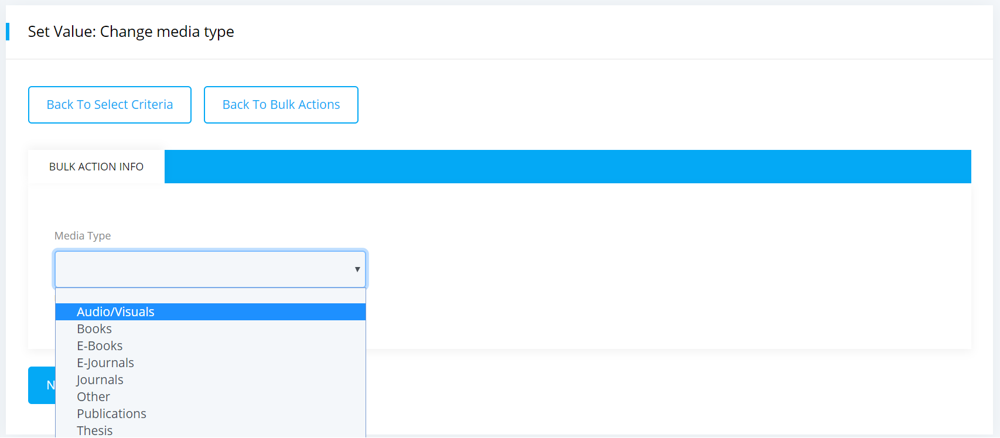

* Now review your changes and click on the confirm button. Once you confirm it your bulk actions will be saved. 
* The action is queued and processed in the background. Open it from the `Bulk Actions` list to see its status.

## Delete medias

You can delete media titles using the bulk action method. When you delete titles, all related child copies and media bookings will be deleted by default. You can also delete the authors, publishers and categories of the selected books.

To do so, please follow the below steps:

* Click on the `New Bulk Action` button and select the `Remove titles` option.

    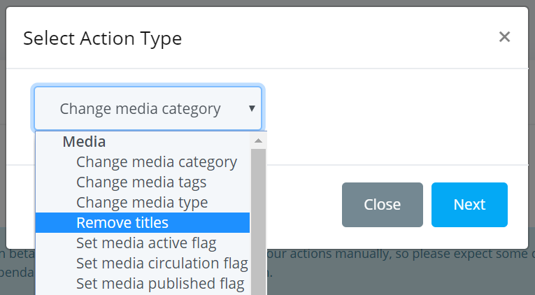 

* Select one or more criteria from the **Select Criteria** form like before.
* Then click on `NEXT` button and a form will be shown like below.

    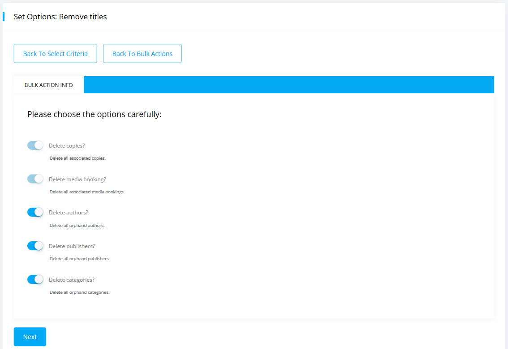

* You can also delete the related authors, publishers or categories if you want. Related copies and media bookings will be deleted by default. Please choose this options very carefully.

    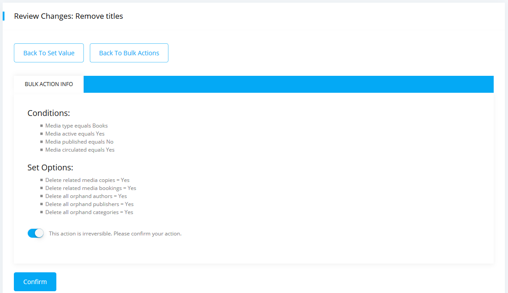

* Now review your changes and click on the confirm button. The action is queued and processed in the background.

### Set media active flag

To create a bulk action with the media active flag, please follow the below steps:

* Click on `New Bulk Action` button and select `Set media active flag` from the dropdown menu.

    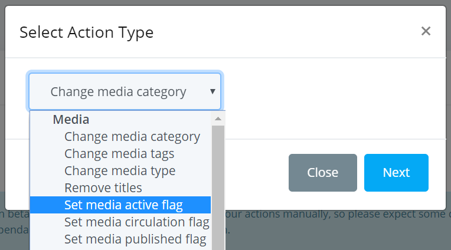 

* Select one or more criteria from the **Select Criteria** form like before and click on `NEXT` button.
* Now select the value for media active flag in the **Set Value** form and click on the next button when you are done.

    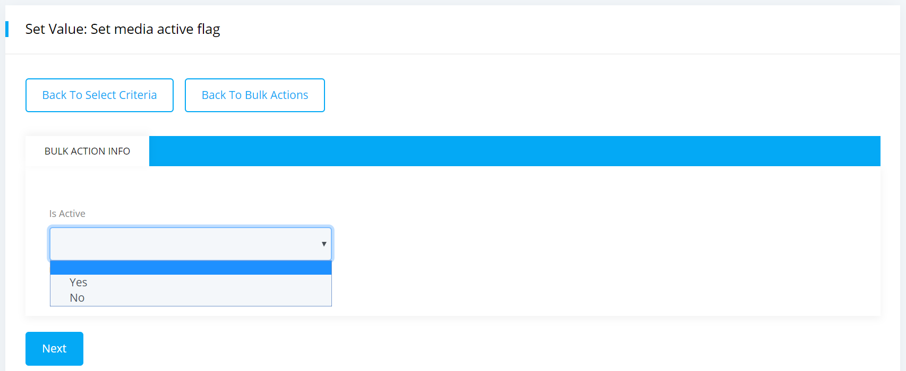

* Now review your changes that you have made and click on the confirm button. Your bulk actions will be saved. 
* The action is queued and processed in the background. Open it from the `Bulk Actions` list to see its status.

### Set media circulation flag

To create a bulk action with the media circulation flag, please follow the below steps:

* Click on `New Bulk Action` button and select `Set media circulation flag` like below.

    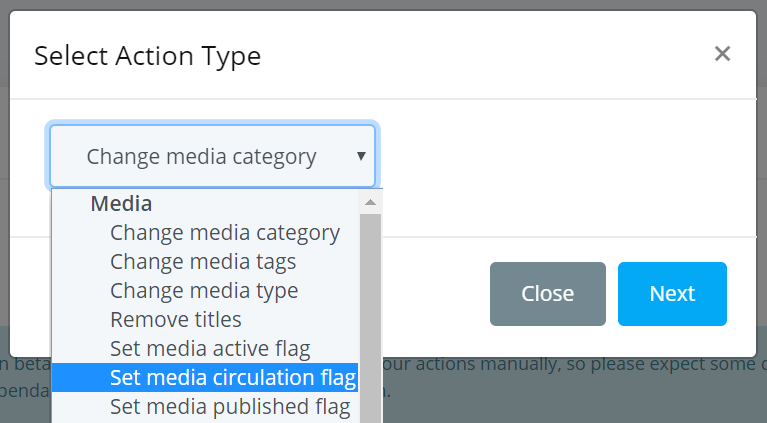

* Select one or more criteria from the **Select Criteria** form like before and click on `NEXT` button.
* Now select the value for media circulation flag in the **Set Value** form and click on the next button when you are done.

    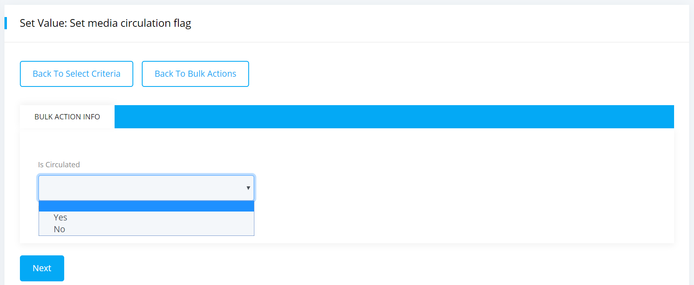 

* Now you can review your changes and click on the confirm button. Your bulk actions will be saved. 
* The action is queued and processed in the background. Open it from the `Bulk Actions` list to see its status.

### Set media published flag

To create a bulk action with the media published flag, please follow the below steps:

* Click on `New Bulk Action` button and select `Set media published flag` like below.

    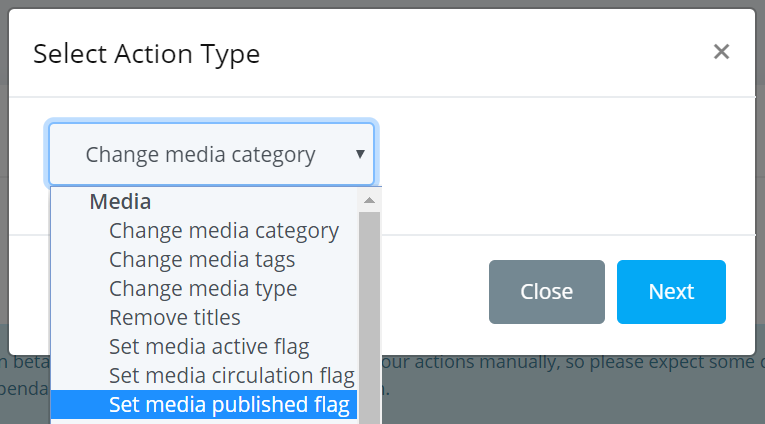

* Select one or more criteria from the **Select Criteria** form like before and click on `NEXT` button.
* Now set value for the media published flag in the **Set Value** form and click on the next button when you are done.

    

* Now you can review your changes and click on confirm button. Your bulk actions will be saved.
* The action is queued and processed in the background. Open it from the `Bulk Actions` list to see its status.

## Update copies

You can use bulk action method to update only the media copies information in your catalog such as branch, location, active flags etc.

To do so, please follow the below steps:

* Click on `New Bulk Action` button and you can see the **Media Copy** options like below.

    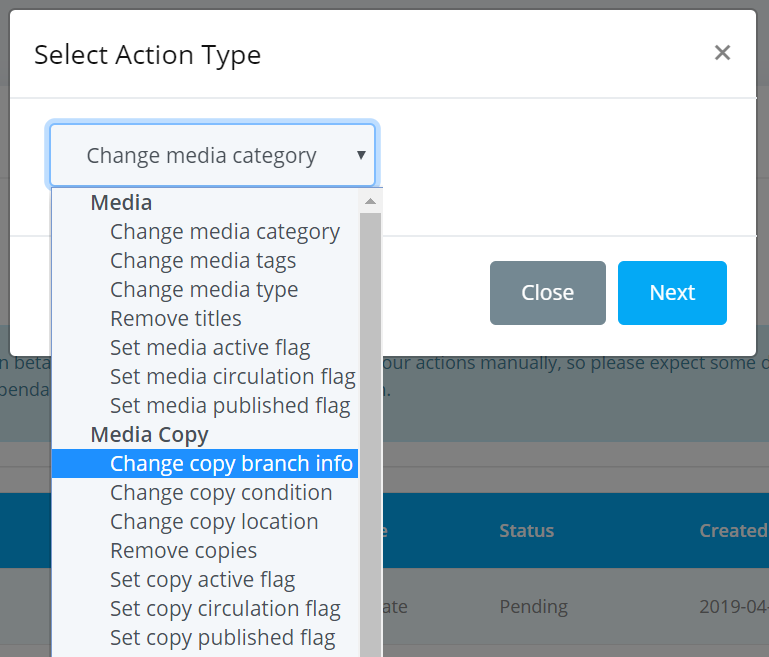

### Change media copy's branch info

To create a bulk action for changing media copy's branch information, please follow the below steps:

* If you select the `Change copy branch info` a page will be appeared like below.

    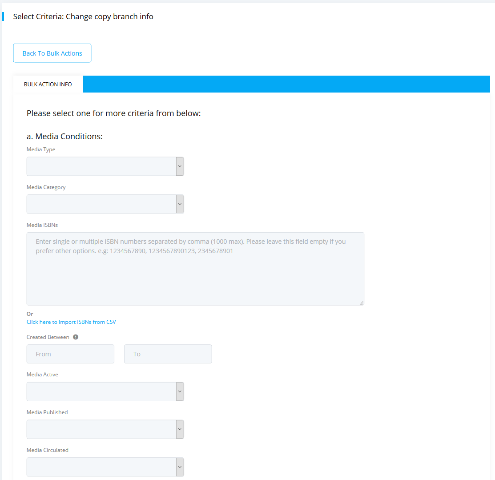
    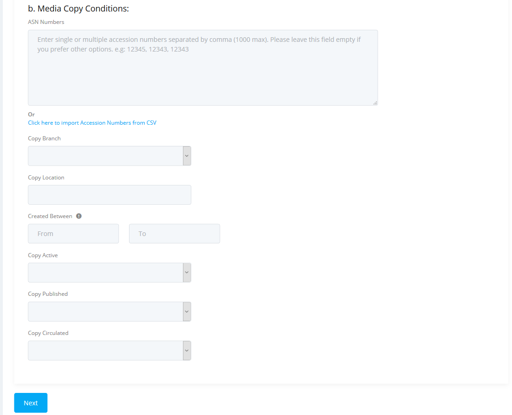

* In this page you can see that there are two types of conditions. The first one is the `Media Conditions` which is as same as the **Update Medias** section mentioned above. But here you also need to fulfill the second conditions which is the `Media Copy Conditions`

* In `Media Copy Conditions` you need to specify at least one condition based on which the records will be updated. You can specify more than one criteria to further narrow down the selection. 

    - The first one is the `ASN Numbers` where you can enter single or multiple accession numbers separated by a comma or you can import them from your CSV file. You can leave this field empty if you do not want to enter this criteria.

        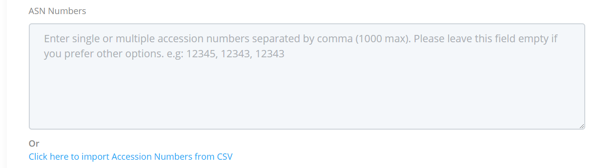

    - Then you can select the `Copy Branch` option as shown below.

        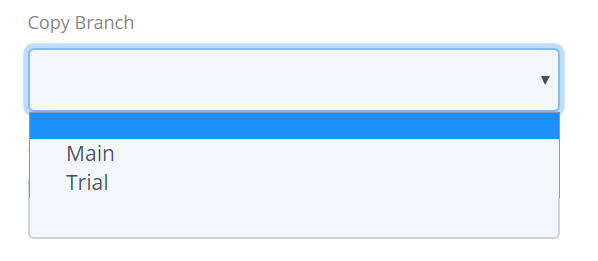

    - The next one is the `Copy Location` option where you can select the location of your media copies.

    - Next is the `Created Between` option where you can give the date range for the media copies.

        

    - Next one is the `Copy Active` option where you can select if the copy is active or not.

        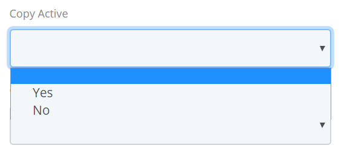

    - Then you can select the `Copy Published` and `Copy Circulted` option same as the **Copy Active** option.

* After selected one or more options click on the `NEXT` button and a page will be shown like below.

    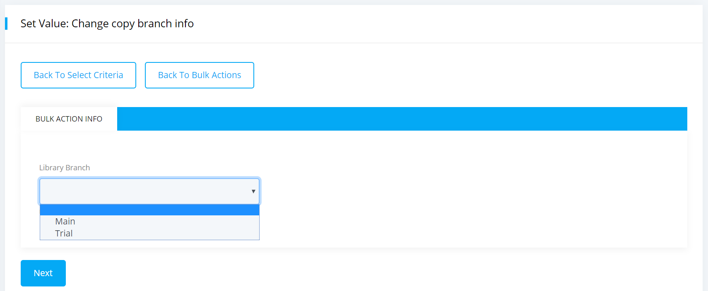

* Here select the `Library Branch` to which you wanted to updated with. Otherwise an error message will be shown.
* Click on `NEXT` button and you can review your changes like below.

    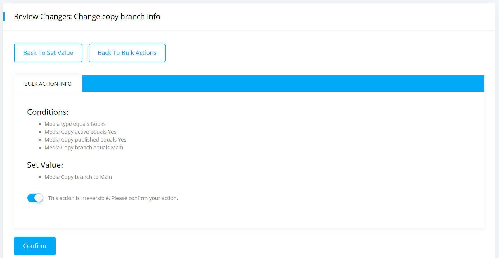

* Click on `Confirm` button and your bulk actions will be saved.
* The action is queued and processed in the background. Open it from the `Bulk Actions` list to see its status.

### Change media copy's condition

To create a bulk action for changing media copy's condition, please follow the below steps:

* Click on `New Bulk Action` button and select `Change copy condition` option from the dropdown menu. 

    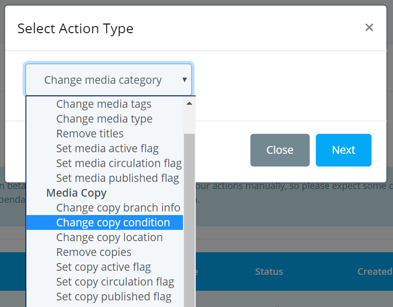

* A **Select Criteria** form will appear same as **Change Media Copy's Branch Info** section mention above and after selecting all the criteria click on the next button.
* Now enter your desired condition in the **Set Value** form and click on `NEXT` button when you are done.

    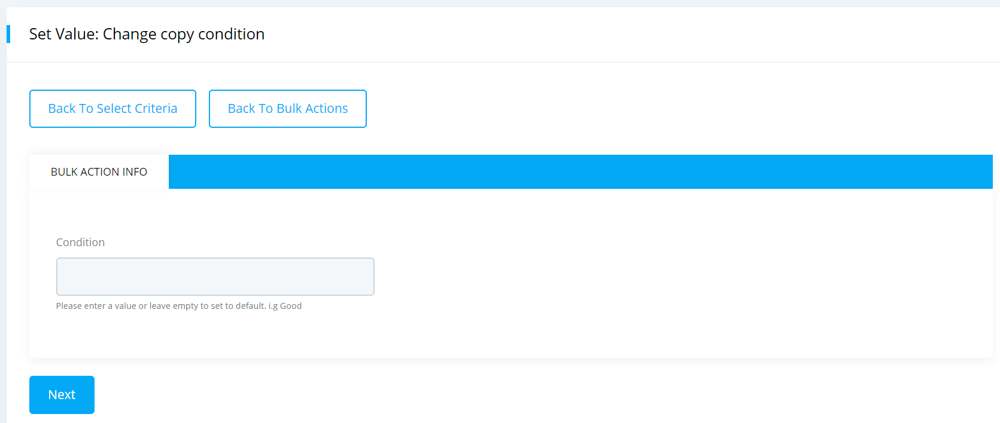    

* Now review your changes and click on the confirm button.

    

* Once you confirm it your bulk actions will be saved.
* The action is queued and processed in the background. Open it from the `Bulk Actions` list to see its status.

### Change media copy's location

To create a bulk action for changing media copy's location, please follow the below steps:

* Click on `New Bulk Action` button and select `Change copy location` option from the dropdown menu.

    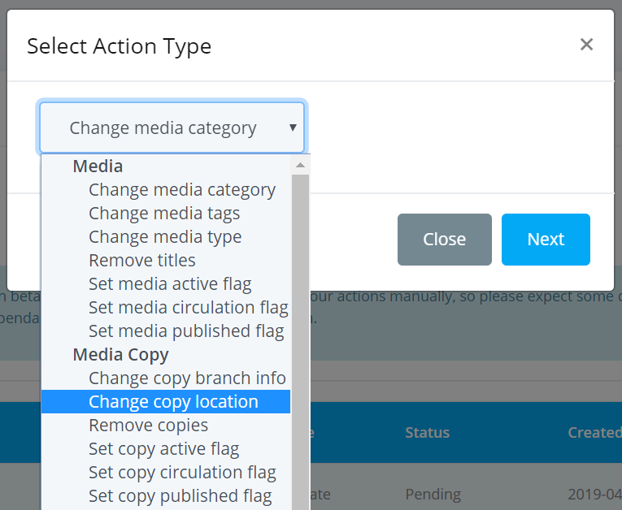

* A **Select Criteria** form will appear same as **Change Media Copy's Branch Info** section mention above and after selecting all the criteria click on `NEXT` button.
* Now you can set value for the media copy's location in the **Set Value** form and click on the next button when you are done.

    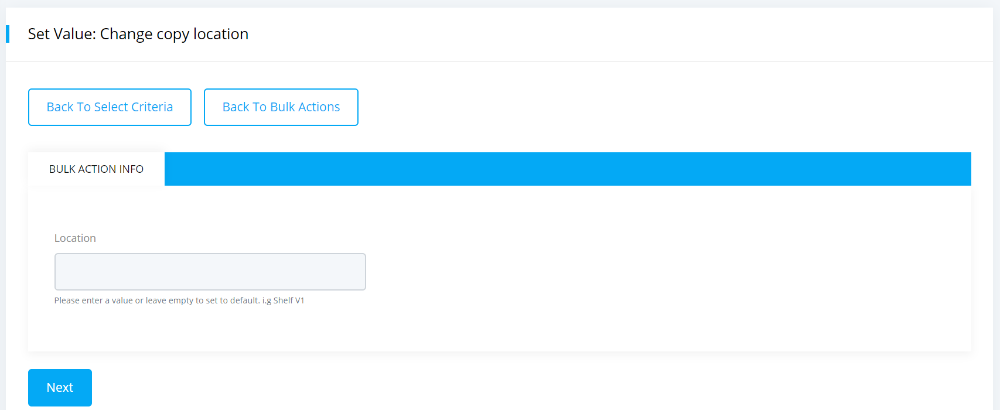

* Now you can review your changes and click on confirm button. Your bulk actions will be saved.
* The action is queued and processed in the background. Open it from the `Bulk Actions` list to see its status.

## Delete copies

You can delete media copies using the bulk action method. The media bookings of the deleted copies are always deleted too. You can also choose to delete the titles that are left with no copies and, with them, the authors, publishers and categories that are no longer used.

To do so, please follow the below steps:

* Click on `New Bulk Action` button and select the `Remove Copies` option.

    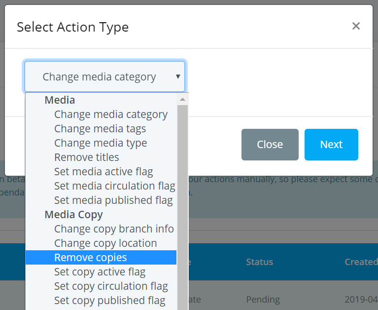 

* Select one or more criteria from the **Select Criteria** form like before and click on `NEXT` button. A form will be shown like below.

    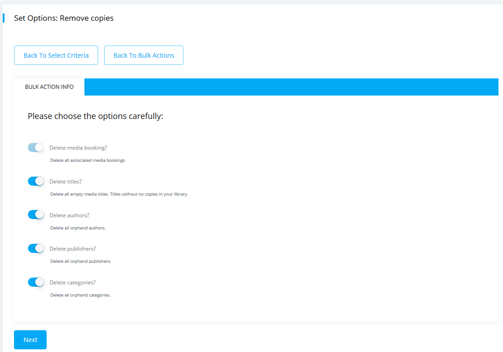   

* `Delete media booking?` is always on. `Delete titles?` deletes the titles that have no copies left. `Delete authors?`, `Delete publishers?` and `Delete categories?` apply only when `Delete titles?` is on, and delete the ones no longer used. Please choose these options very carefully.
* Click on the next button and a form will be appeared like below.

    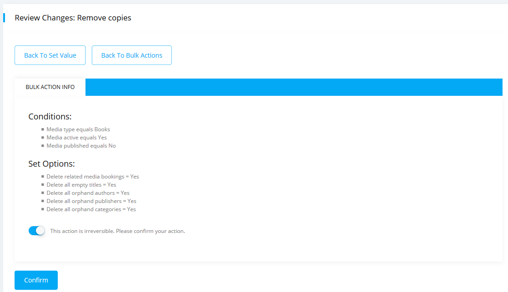

* Now review your changes and click on the confirm button.
* The action is queued and processed in the background. Open it from the `Bulk Actions` list to see its status.

### Set media copy's active flag

To create a bulk action with the media copy's active flag, please follow the below steps:

* Click on `New Bulk Action` button and select `Set copy active flag` from the dropdown menu.

    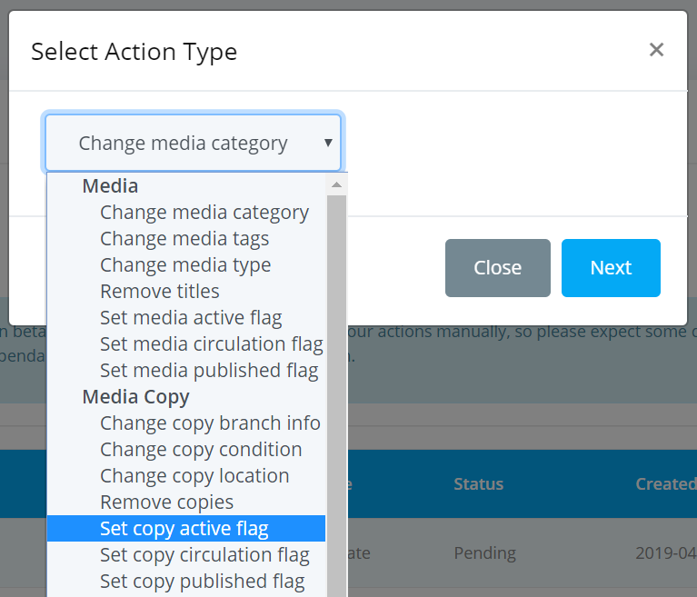 

* Select one or more criteria from the **Select Criteria** form like before and click on `NEXT` button.
* Now in the **Set Value** form please set the value for media copy's active flag and click on the next button when you are done.

    

* Now review your changes that you have made and click on the confirm button.
* The action is queued and processed in the background. Open it from the `Bulk Actions` list to see its status.

### Set media copy's circulation flag

To create a bulk action with the media copy's circulation flag, please follow the below steps:

* Click on `New Bulk Action` button and select `Set copy circulation flag` like below.

    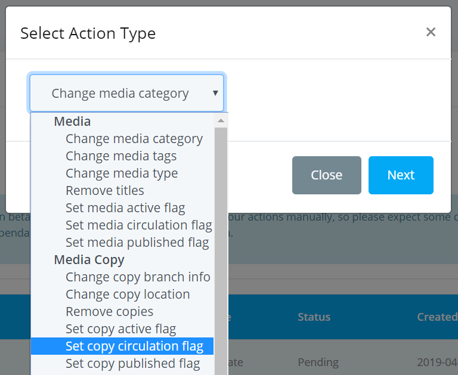

* Select one or more criteria from the **Select Criteria** form like before and click on `NEXT` button.
* Now set the value for media copy's circulation flag in the **Set Value** form and click on the next button when you are done.

    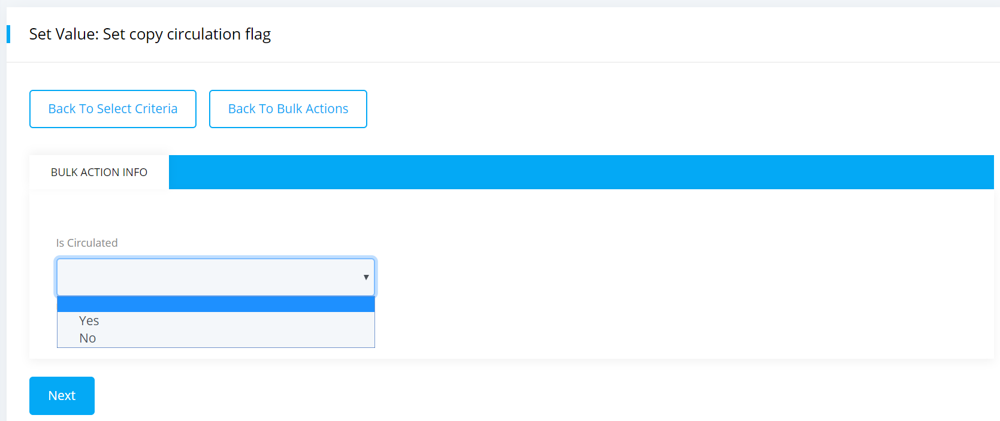 

* Now review your changes and click on the confirm button. Your bulk actions will be saved. The action is queued and processed in the background.

### Set media copy's published flag

To create a bulk action with the media copy's published flag, please follow the below steps:

* Click on `New Bulk Action` button and select `Set copy published flag` like below.

    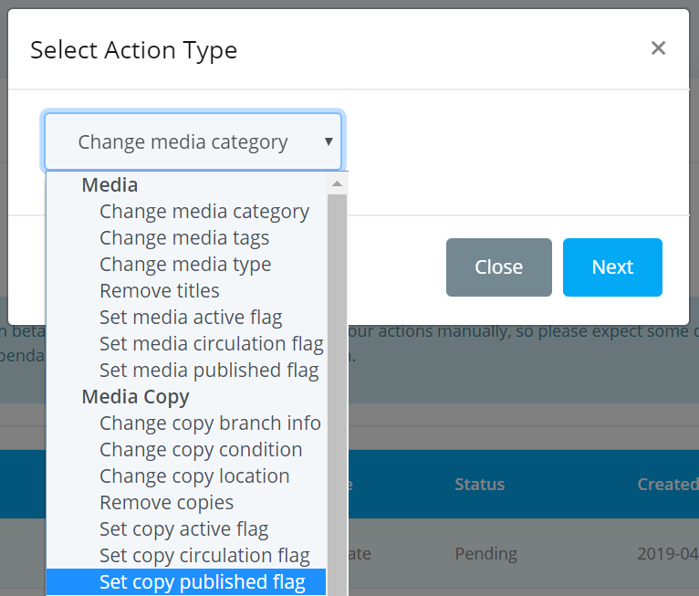

* Select one or more criteria from the **Select Criteria** form like before and click on `NEXT` button.
* Now set the value for media copy's published flag in the **Set Value** form and click on the next button when you are done.

    

* Now review your changes and click on the confirm button. The action is queued and processed in the background.

## Update members

You can use bulk action method to update the members information in your library such as booking quota, group, status, type etc.

To do so, please follow the below steps:

* Click on `New Bulk Action` button and you can see the **Member** options like below.

    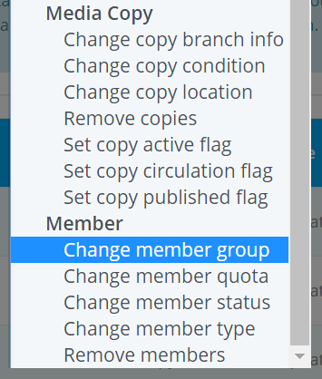

### Change member's group

To create a bulk action for changing member group, please follow the bellow steps:

* If you select the `Change member group` option then a page will be shown like below.

    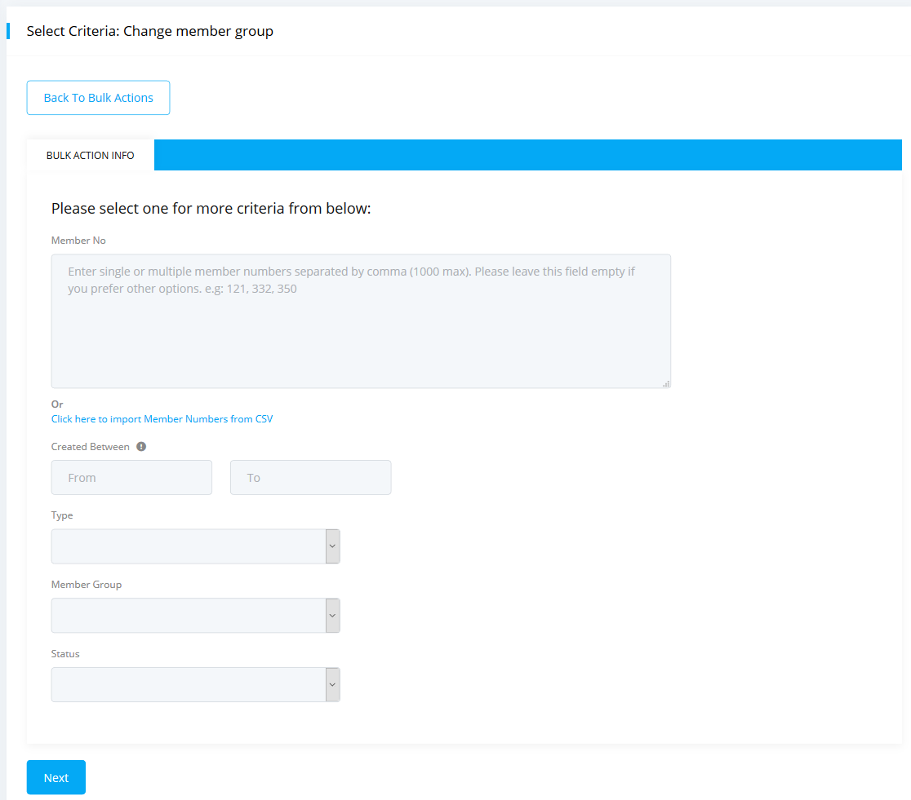

* Now you need to specify at least one condition based on which records will be updated. You can specify more than one criteria to further narrow down the selection.
    - The first option that you can see is the `Member No` where you can enter single or multiple member numbers separated by a comma or you can import them from your CSV file. You can leave this field empty if you do not want to enter this criteria.

        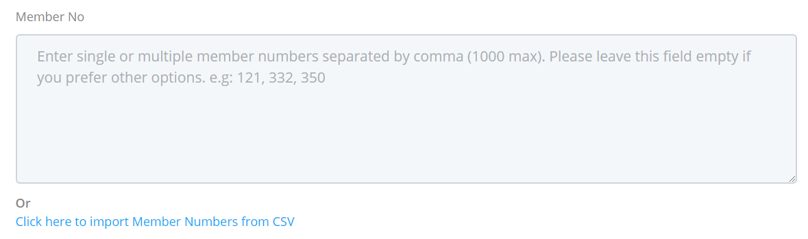 

    - Next is the `Created Between` option where you can give the date range for the members.

        

    - The next option that you can see is the `Type` where you can select your member type.

        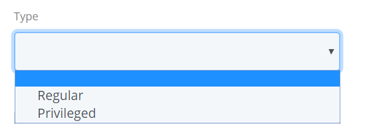 

    - Then you can select the group of your member from the `Member Group` dropdown menu.

    - The last one is the `Status` option where you can select if the status of your member is active or not.

        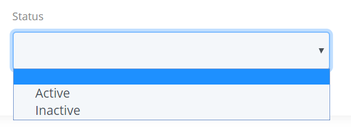

* Once you finished all the selection in the `Change member group` criteria please click on the `NEXT` button and a page will be shown like below.

    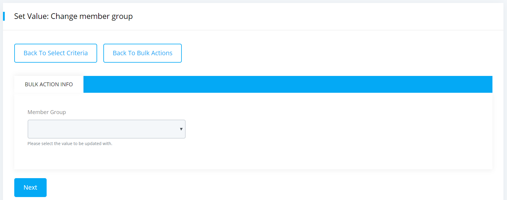 

* Now enter a specific value for the member group in the **Set Value** form. You can leave this field empty if you do not want to enter this criteria.
* After selecting the destination member group click on the `NEXT` button. Now you can review your changes like below.

        

* Click on `Confirm` button and your bulk actions will be saved.
* The action is queued and processed in the background. Open it from the `Bulk Actions` list to see its status.

### Change member's booking quota

To create a bulk action for changing member booking quota, please follow the below steps:

* Click on the `New Bulk Action` button and select `Change member quota` from the dropdown menu. 

     

* A **Select Criteria** form will appear same as **Change Member's Group** section mention above and after selecting all the criteria click on the `NEXT` button.
* Now enter the value for member booking quota in the **Set Value** form and click on the next button when you are done.

     

* After review your changes please click on the confirm button and your bulk actions will be saved.
* The action is queued and processed in the background. Open it from the `Bulk Actions` list to see its status.

### Change member's status

To create a bulk action for changing member status, please follow the below steps:

* Click on the `New Bulk Action` button and select `Change member status` from the dropdown menu. 

     

* A **Select Criteria** form will appear same as **Change Member's Group** section mention above and after selecting all the criteria click on the `NEXT` button.
* Now you must have to select a status in the **Set Value** form otherwise an error message will be shown.

     

* After selecting a status click on the next button.
* Now review your changes and click on the confirm button. Your bulk actions will be saved.
* The action is queued and processed in the background. Open it from the `Bulk Actions` list to see its status.

### Change member's type

To create a bulk action for changing member's type, please follow the below steps:

* Click on `New Bulk Action` button and select `Change member type` option from the dropdown menu. 

    

* A **Select Criteria** form will appear same as **Change Member's Group** section mention above and after selecting all the criteria click on the `NEXT` button.
* Now you must have to select your desired member type option in the **Set Value** form otherwise an error message will be shown.

    

* Click on the next button when you are done.
* Now review your changes and click on the confirm button. Once you confirm it your bulk actions will be saved.
* The action is queued and processed in the background. Open it from the `Bulk Actions` list to see its status.

## Delete members

You can delete your library members using the bulk action method. When you delete members, all associated media bookings including reservations, issued items, overdue items and all associated login access to members section will also be deleted by default. 

To do so, please follow the below steps:

* Click on `New Bulk Action` button and select the `Remove members` option.

     

* Select one or more criteria from the **Select Criteria** form like before and click on the `NEXT` button. A form will be shown like below.

       

* You can choose to delete related media bookings including reservations, issued items, overdue items. Related members with member access will also be deleted by default. Please choose this options very carefully.

    

* Now review your changes and click on the confirm button. Your bulk actions will be saved.
* The action is queued and processed in the background. Open it from the `Bulk Actions` list to see its status.

## FAQ

**Can I undo a bulk action?**

No. Once a bulk action has been processed, the changes are saved straight away and deleted records are removed permanently; the review page warns that the action is irreversible. Read the conditions on the review page carefully, and export a backup from [Reports](reports.md) before a large change or deletion.

**Can I cancel a bulk action after I click Confirm?**

There is no cancel button on your side. If the action still shows the status `Pending`, contact Librarika support straight away; a pending action can still be cancelled, but one that has been processed cannot.

**Why is my bulk action still Pending?**

Bulk Actions is in beta, and actions are processed in the background (some are checked and processed by Librarika), so there can be a delay. Open the action from the list to see its status; if you see the `Process this action?` button, you can click it to run the action yourself.

**How many ISBNs, accession numbers or member numbers can I enter?**

Up to 1,000 per field, typed in (separated by commas) or imported from a CSV file. If you enter more than 1,000, that list is ignored, so split it into several bulk actions and check that the list appears in the conditions on the review page.

**Why do I get the message "Please specify at least one criteria."?**

A bulk action needs at least one condition, so that you never change or delete your whole catalog or member list by accident. Fill in at least one field on the **Select Criteria** form.

**Will deleting titles also delete authors, publishers or categories that other books still use?**

No. These options only remove authors, publishers and categories that are no longer linked to any remaining title in your library.

**How can I see how many records were changed?**

Open the bulk action from the list (the eye icon). When the status is `Completed`, `Affected Items` shows how many records were updated or deleted.

**My account only has access to some branches. Which copies will a bulk action change?**

Copy actions only change copies in the branches you have access to, even if your conditions would match copies in other branches.
