# Circulation

**Who this is for:** library staff at the desk.

**What you can do here:** check items out and in, renew and extend loans, handle reservations and requests, and find overdue items.

The circulations section contains all the information regarding your checkouts, check-ins, reservation requests, overdue items etc.

## List checkouts

You can access the list of all circulations related entries in this section under different status filters such as Pending, Reserved, Issued, Overdue, Cancelled, Returned etc. 

* Go to `Circulations` > `Circulations`.
* Circulation records will be displayed as shown below:

	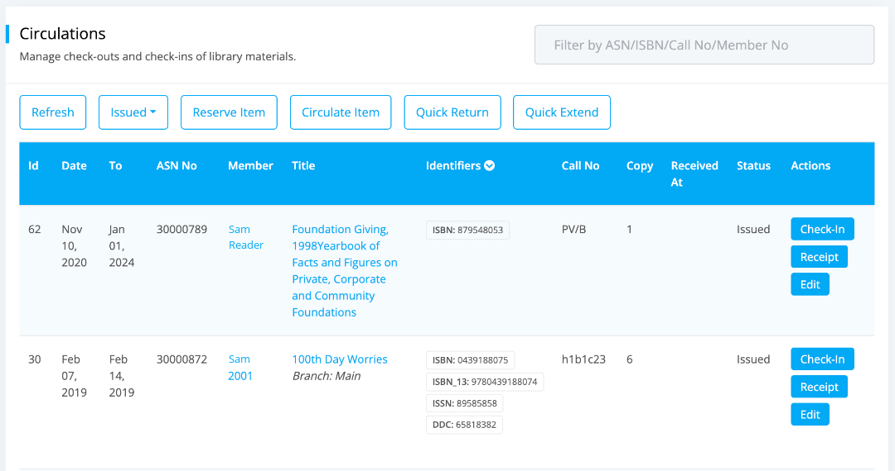

* Now you can view all the different status filters in the `All` dropdown menu.

	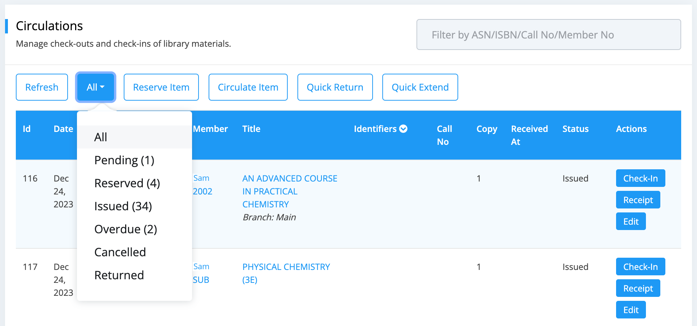

* If you click on the `Identifiers` column then you can sort the circulations using different types of identifier like isbn, isbn13, issn, asin and more.

	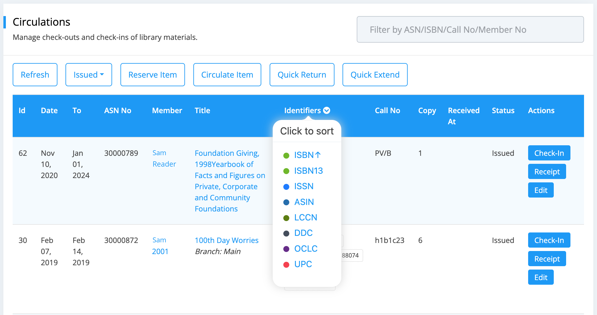

## Check out an item

To check out or lend an item to a member of your library, please follow the below steps:

* Go to `Circulations` > `Circulations`.
* Click on the `Circulate Item` button. The **Quick Circulation** form opens.

	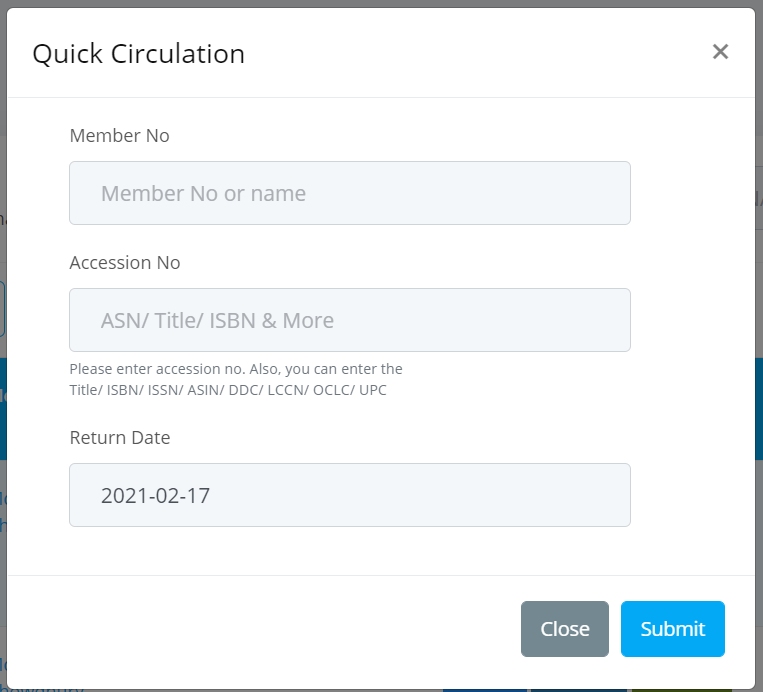

* First enter member number or member name. An auto-select list will appear, please select the member from the list.

	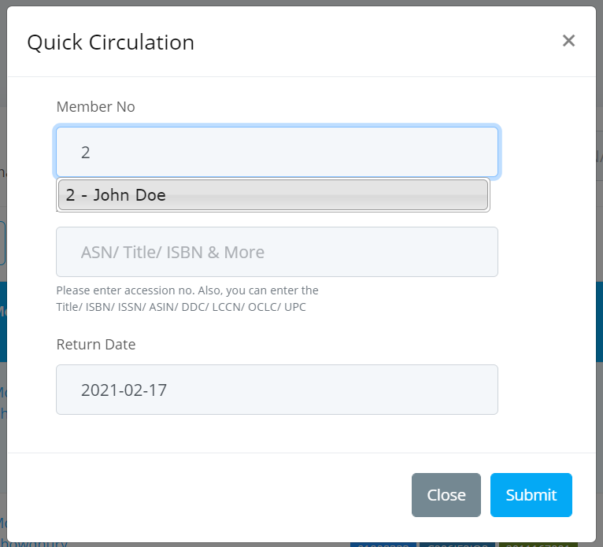
 
* Then enter accession number, book title or any identifier like isbn, asin, lccn and more. An auto-select list of up to 10 copies will appear with green / red indicator, please select the item with green indicator. Red indicator means, the item is not available for checkout. When checking out, available copies are listed first. To search by title, type at least 4 characters.

	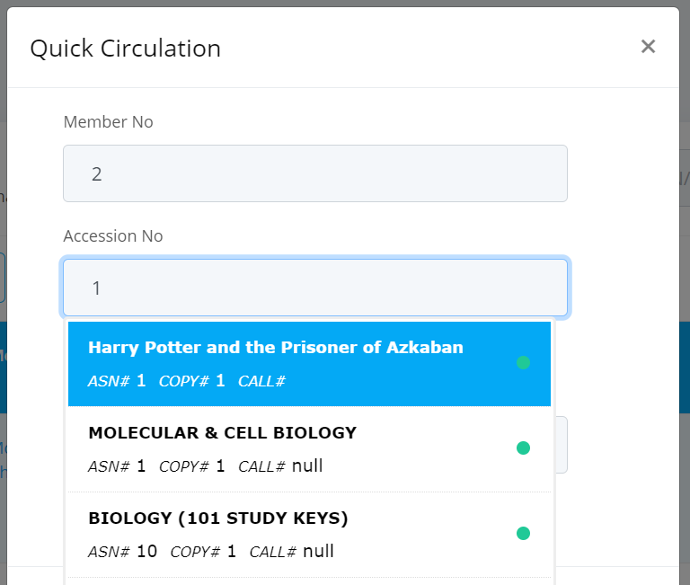

* Change the return date if you wish to.

	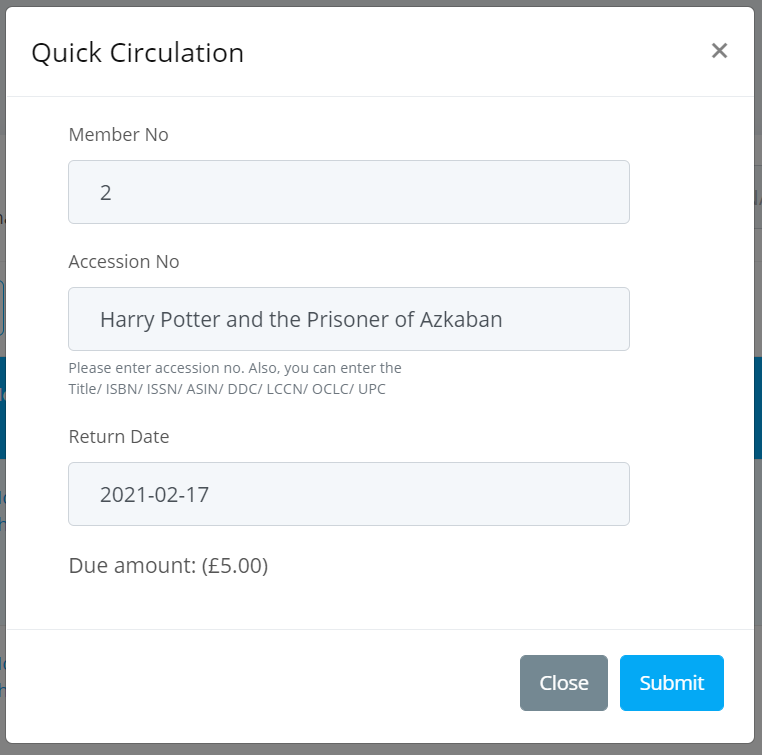

* Click on the `Submit` button when you are done.
* If the copy is on the hold shelf for another member, or is kept for members who are waiting for it, Librarika warns you first (*"Warning: This item is on the hold shelf for another member. Are you sure you want to proceed with checkout?"* or *"Warning: This item has active hold requests from other members. …"*). Continue only if you mean to. A copy is kept for waiting members only when there are not enough other copies on the shelf for them; see [When a copy is kept for a hold](hold-queue.md#when-a-copy-is-kept-for-a-hold).

## Check in an item

To check in or receive an item from a member, please follow the below steps:

* Go to `Circulations` > `Circulations`.
* Click on the `Quick Return` button.

* Enter the accession number, book title or any identifier of the item that you want to check-in. An auto-select list will appear with green / red indicators. Your item should have red indicator.

	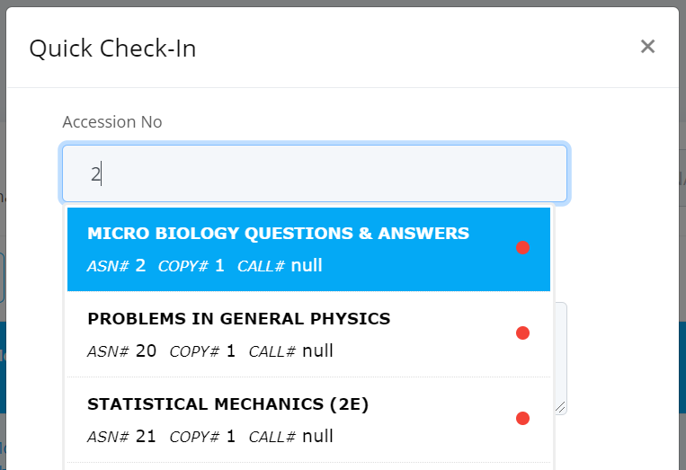

* Select the item from the list.

	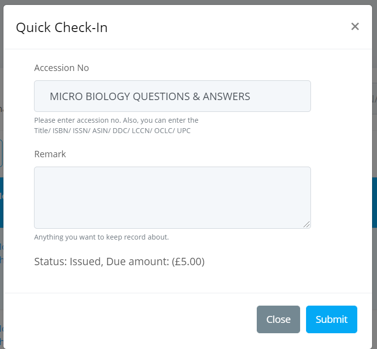

* Enter any remark note in the remark input box, if you want to.
* Click on the `Submit` button when you are done.
* If the message ends with **Hold assigned to next patron.**, don't put the item back on the shelf. Put it on the hold shelf; it now appears in [Hold Shelf](hold-queue.md#hold-shelf) for that member. See [Check in an item someone is waiting for](hold-queue.md#check-in-an-item-someone-is-waiting-for).

## Reserve item

To reserve an item on behalf of a member, please follow the below steps:

* Go to `Circulations` > `Circulations`.
* Click on the `Reserve Item` button.
* The Reserve Item form will be displayed as shown below.

	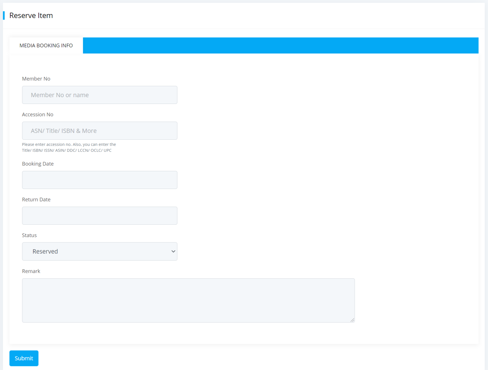

* Enter member number or member name for whom you want to reserve.
* Then enter the accession number, title or any identifier of the item that you want to reserve.
* Also enter booking date and return date of the item.
* Select status as **Reserved**.
* Click on the `Submit` button when you are done.

## Renew a loan

A renewal gives a loan a new due date by your library's renewal rules. Renewals are off until you turn on **Enable renewals** in `Manage` > `Preferences` > `Self Service` (see [Renewal settings](self-service.md#renewal-settings)). Once they are on, staff can renew in three places:

* **Member page** -- open the member (`Circulations` > `Members`, then the member's name). Each loan that can be renewed now has a `Renew` button. A greyed-out `Renew` means the loan can't be renewed; point at it to see why. When more than one loan can be renewed, `Renew all` renews them together.
* **Circulation list** -- in `Circulations` > `Circulations`, a loan that is out and has not reached **Maximum Renewals** has `Renew` in its **Actions** (an overdue loan only when **Renew overdue loans** is on). Librarika checks the rules when you click it and tells you if the loan can't be renewed.
* **Quick Renew** -- type the accession number, ISBN or title in the `Filter by ASN/ISBN/Call No/Member No` box at the top of the circulations page. For an item that is on loan, the list shows `Renew` next to `Check-In` and `Extend`. Click `Renew`: the **Quick Renew** window shows the title, member, **Due Date**, **Renewals** and the **New Due Date**. Click `Renew` to confirm.

A renewal follows the same rules as a new checkout. A loan is not renewed when:

* it has already been renewed the **Maximum Renewals** number of times;
* it is too early (**Renew From**), it was already renewed today, or the new due date would be no later than the current one (the **Checkout Limit** sets the latest date);
* the member is not active, has reached their booking quota, or their unpaid dues have reached the limit in [Fees & payments](fees-payments.md#suspend-borrowing-when-a-member-owes-too-much);
* another member is waiting for the item and there are not enough other copies on the shelf for them, or another member holds this very copy (*"Another member is waiting for this item."*);
* the copy is reserved for another member in the new loan period, or circulation is turned off for the item;
* it is overdue and **Renew overdue loans** is off (*"This item is overdue. Please return it to the library."*).

If **Renew overdue loans** is on and you renew an overdue loan, its late fee up to that day is charged to the member's account and kept, and the new due date counts from the day of the renewal.

After a loan has been renewed, the due date shows **Renewed 1/2** (renewals so far / **Maximum Renewals**). Click it to open the loan's **Renewal History**: the date of each renewal and Extend, who did it, the due date before and after, and any late fee that was settled.

Members can renew their own loans from `My Account` (see [Renew your loans](member-area.md#renew-your-loans)) and, at a Librarika Kiosk, from `My Items` (see [Using a kiosk](using-a-kiosk.md#renew-items)). Kiosk renewals follow the same rules.

## Change return date

`Quick Extend` lets you give a loan any new return date, outside the renewal rules. Use it when a member needs a different date from the one a renewal would give. An Extend does not count as a renewal, but it is listed in the loan's **Renewal History**.

To update or extend an item for a member, please follow the below steps:

* Go to `Circulations` > `Circulations`.
* Click on the `Quick Extend` button.
* Enter the accession number or isbn or title of the item you want to extend. An auto-select list will appear with red indicators.

	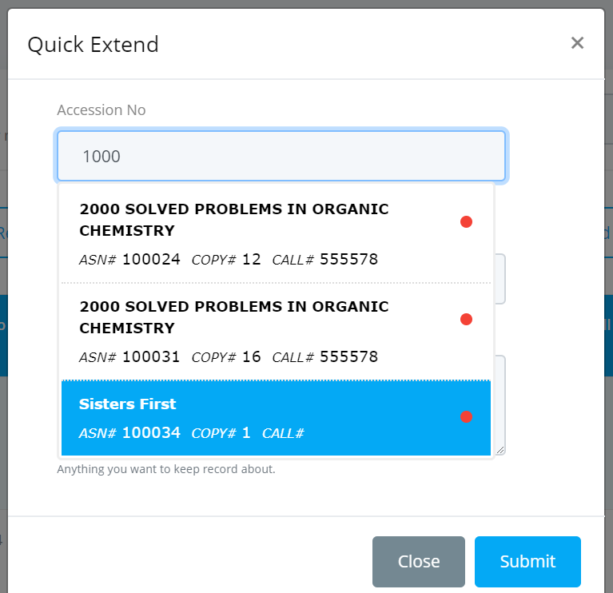

* Select the item from the list.
* Enter any remark note in the remark input box, if you want to.
* Click on the `Submit` button when you are done.

## Edit a checkout

You can edit any existing circulation entry, change return date, status etc from the circulations page.

To edit a circulation, please follow the below steps:

* Go to `Circulations` > `Circulations`.
* Locate the item you want to edit from your circulation records and click on the `Edit` button next to that item.

	

* An edit circulation form will be appeared as shown below.

	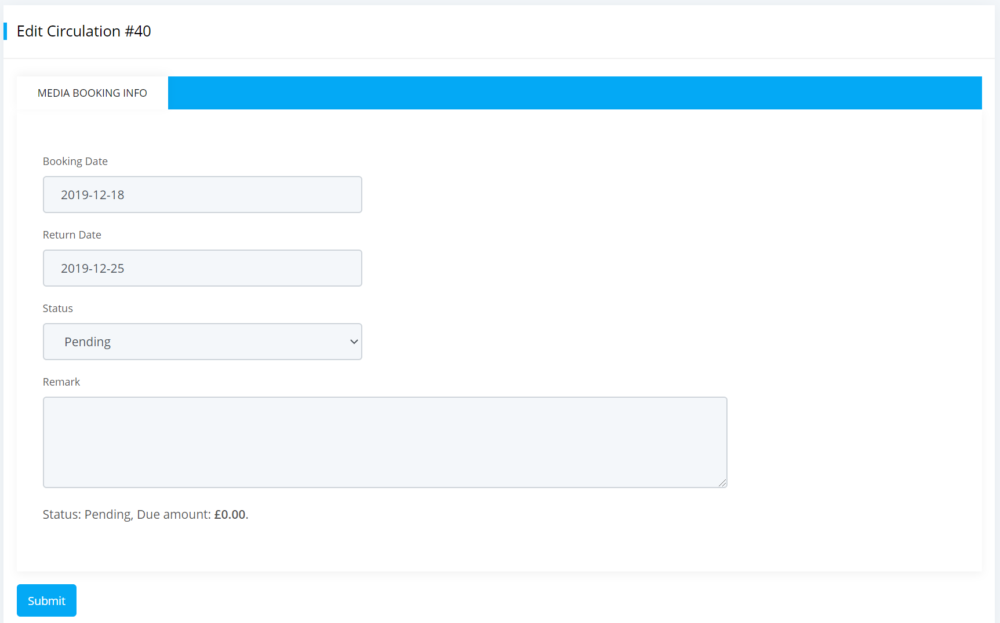

* Edit or update necessary information regarding the circulation.
* Click on the `Submit` button when you are done.

## Find a loan

If you have many circulation entries, use the filter box to find an entry quickly.

To use this functionality, please follow the below steps:

* Go to `Circulations` > `Circulations`.
* In the top corner of circulations page you can see a `Filter by ASN/ISBN/Call No/Member No` input box. Enter the accession number, ISBN or call number of the item, or the member number, in that box.
	
	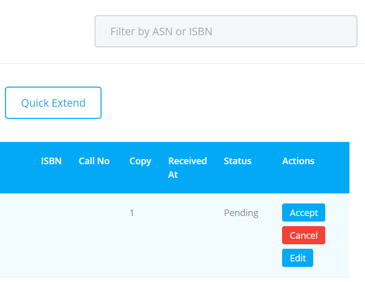

* An auto-select list will appear, select the item from the list. All related circulations of the selected item will appear as shown below.
	
	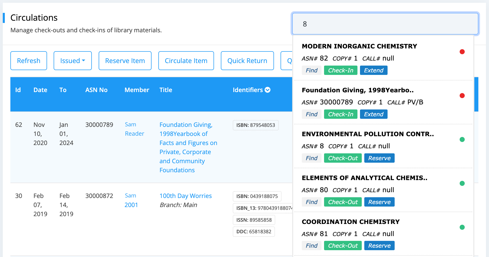

* Now you can perform any action regarding your needs for circulations.

---

## FAQ

**Why can't I check out an item to a member?**

The form shows the reason. The most common ones are: the member is not active, the item is already checked out, circulation is turned off for the item, the member has reached their booking quota, the member already has this copy, or the member's unpaid dues have reached the limit set in [Fees & payments](fees-payments.md).

**Why doesn't the book appear in the list when I type its title?**

The list shows at most 10 matches, and a title search starts only after you type at least 4 letters. Typing the accession number or ISBN is the quickest way to find the exact copy (the list never scrolls past the 10th match, even when you have more copies of the same book).

**How many items can a member borrow?**

Up to the `Booking Quota` set in Preferences, or the member's own quota if one is set on their record. The quota counts pending requests, reservations and checked-out (including overdue) items together. See [Change Preferences](libraries.md#change-preferences) and [Booking Quota](members.md#booking-quota).

**What is the default return date and how do I change it?**

It is today plus the `Booking Time` (in days) from the `Options` tab of Preferences. You can still pick a different return date for each checkout in the form.

**When does an item become Overdue?**

Automatically, once its return date has passed and it has not been checked in. You don't need to change the status yourself.

**Can I extend an item that is already overdue?**

Yes. Use `Quick Extend`, confirm that you want to extend the overdue item, and choose a new return date that is not in the past. The status changes back to Issued. The late fee up to that day stays on the member's account; extending does not remove it (waive it in [Fees & payments](fees-payments.md) if you want to). The extension is refused if the new dates overlap another booking of the same copy. If your library allows it, you can also [renew](#renew-a-loan) an overdue loan.

**What is the difference between Renew and Extend?**

`Renew` follows your library's renewal rules: the new due date is worked out for you, it counts towards **Maximum Renewals**, and it is refused when the member couldn't borrow the item today. `Extend` (`Quick Extend`) lets staff choose any date and does not count as a renewal. Both are listed in the loan's **Renewal History**.

**Why is there no Renew button?**

**Enable renewals** is off in `Preferences` > `Self Service`, the loan has reached **Maximum Renewals**, or the loan is overdue and **Renew overdue loans** is off. On the member page, a greyed-out `Renew` shows the reason when you point at it.

**Why was a renewal refused because of a hold?**

Another member is waiting for the title and there are not enough other copies on the shelf for them, or another member holds that exact copy. Holds that are suspended don't count.

**I checked in the wrong item. How do I undo it?**

Find the record in the circulations list, click `Edit`, set **Status** back to Issued and click `Submit`. The edit form changes only the dates, status and remark; to change the member or the item, create a new check-out instead.

**What do the Accept, Cancel and Issue buttons do?**

On a Pending request, `Accept` reserves the item and `Cancel` declines the request; members with a login account get an email either way. On a Reserved record, the `Issue` button appears from the booking date onwards and checks the item out to the member.
