# Circulation

**Who this is for:** library staff at the desk.

**What you can do here:** check items out and in, extend loans, handle reservations and requests, and find overdue items.

The circulations section contains all the information regarding your checkouts, check-ins, reservation requests, overdue items etc.

## List checkouts

You can access the list of all circulations related entries in this section under different status filters such as Pending, Reserved, Issued, Overdue, Cancelled, Returned etc. 

* Go to `Circulations` > `Circulations`.
* Circulation records will be displayed as shown below:

	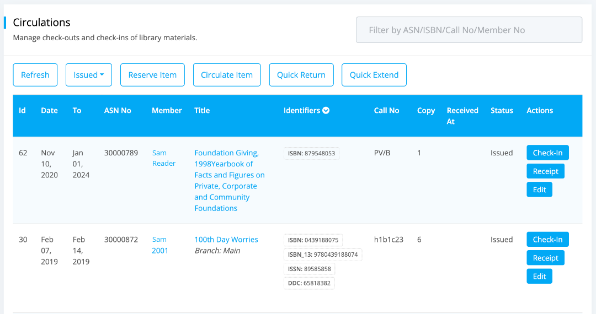

* Now you can view all the different status filters in the `All` dropdown menu.

	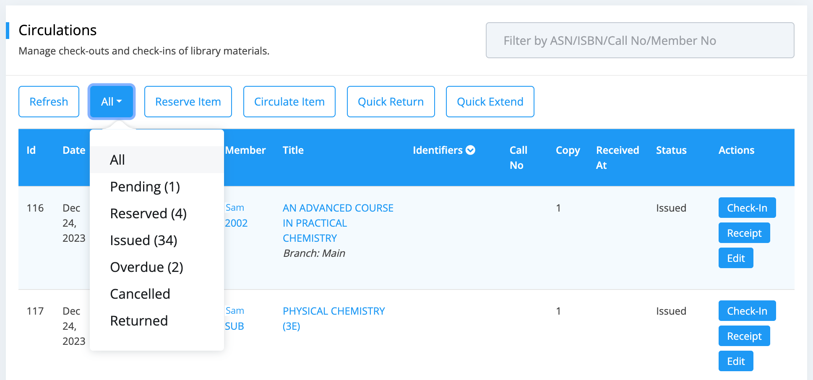

* If you click on the `Identifiers` column then you can sort the circulations using different types of identifier like isbn, isbn13, issn, asin and more.

	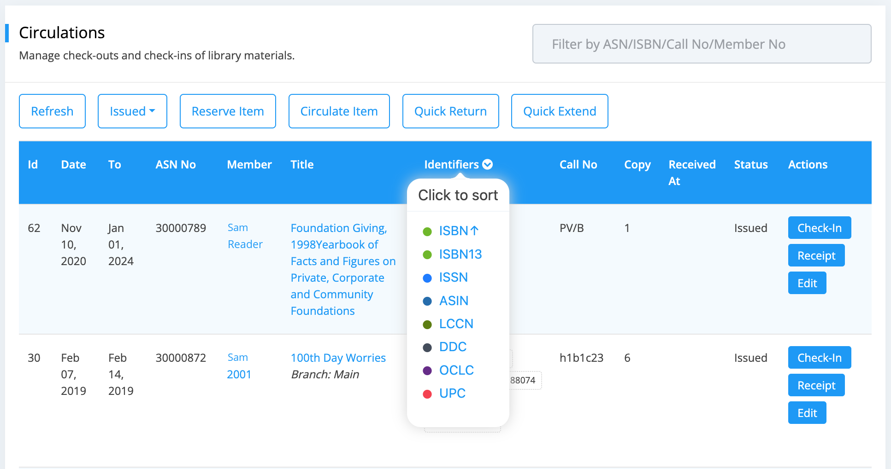

## Check out an item

To check out or lend an item to a member of your library, please follow the below steps:

* Go to `Circulations` > `Circulations`.
* Click on the `Circulate Item` button. The **Quick Circulation** form opens.

	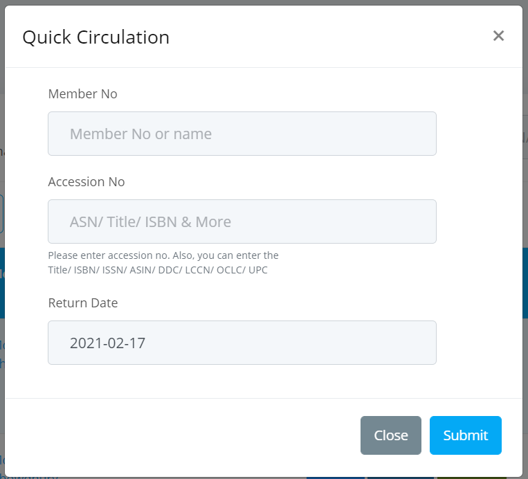

* First enter member number or member name. An auto-select list will appear, please select the member from the list.

	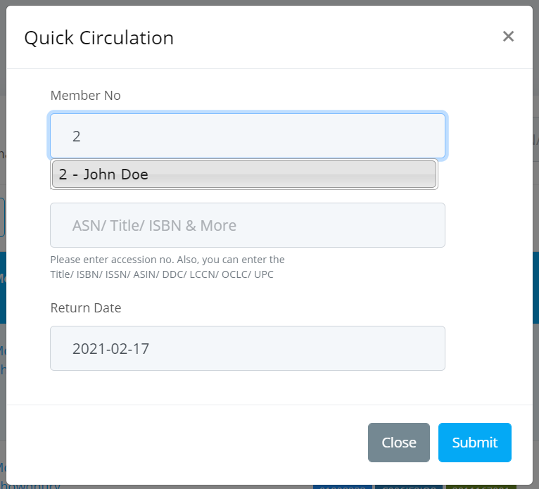
 
* Then enter accession number, book title or any identifier like isbn, asin, lccn and more. An auto-select list of up to 10 copies will appear with green / red indicator, please select the item with green indicator. Red indicator means, the item is not available for checkout. When checking out, available copies are listed first. To search by title, type at least 4 characters.

	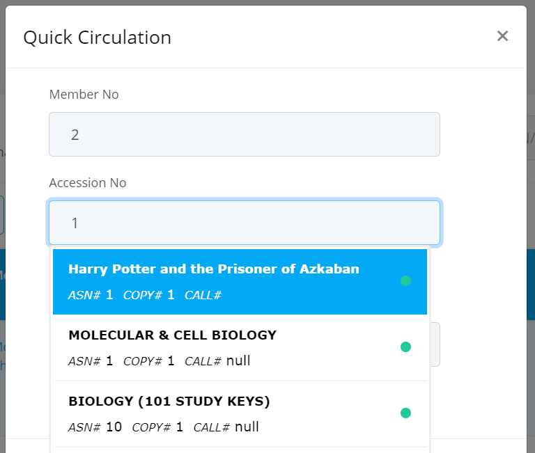

* Change the return date if you wish to.

	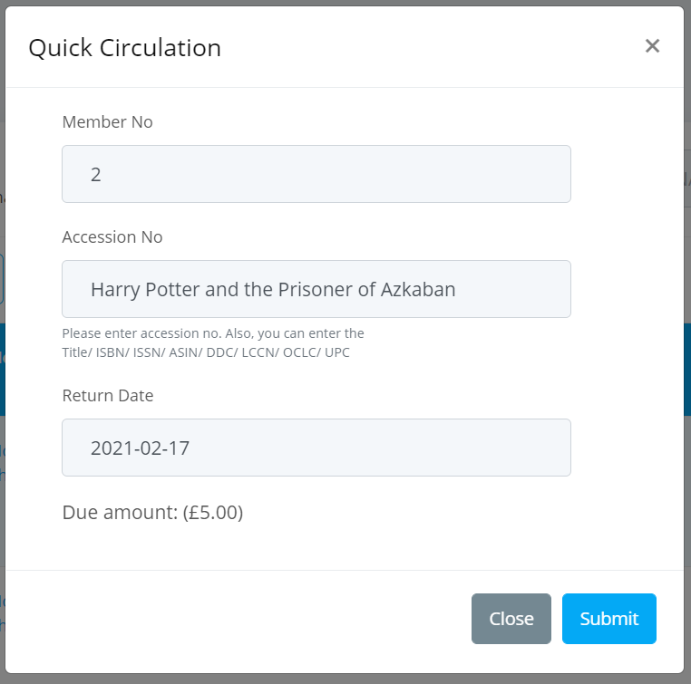

* Click on the `Submit` button when you are done.
* If the item is on the hold shelf for another member, or other members have holds on it, Librarika warns you first (*"Warning: This item is on the hold shelf for another member. Are you sure you want to proceed with checkout?"* or *"Warning: This item has active hold requests from other members. …"*). Continue only if you mean to; the other member's hold is not moved to another copy.

## Check in an item

To check in or receive an item from a member, please follow the below steps:

* Go to `Circulations` > `Circulations`.
* Click on the `Quick Return` button.

* Enter the accession number, book title or any identifier of the item that you want to check-in. An auto-select list will appear with green / red indicators. Your item should have red indicator.

	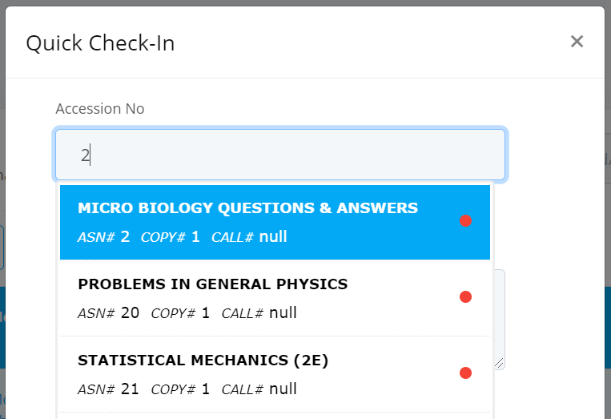

* Select the item from the list.

	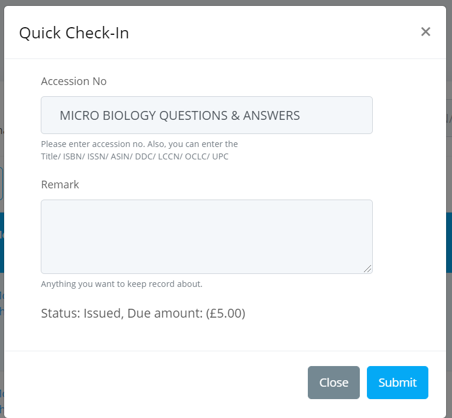

* Enter any remark note in the remark input box, if you want to.
* Click on the `Submit` button when you are done.
* If the message ends with **Hold assigned to next patron.**, don't put the item back on the shelf. Put it on the hold shelf; it now appears in [Hold Shelf](hold-queue.md#hold-shelf) for that member. See [Check in an item someone is waiting for](hold-queue.md#check-in-an-item-someone-is-waiting-for).

## Reserve item

To reserve an item on behalf of a member, please follow the below steps:

* Go to `Circulations` > `Circulations`.
* Click on the `Reserve Item` button.
* The Reserve Item form will be displayed as shown below.

	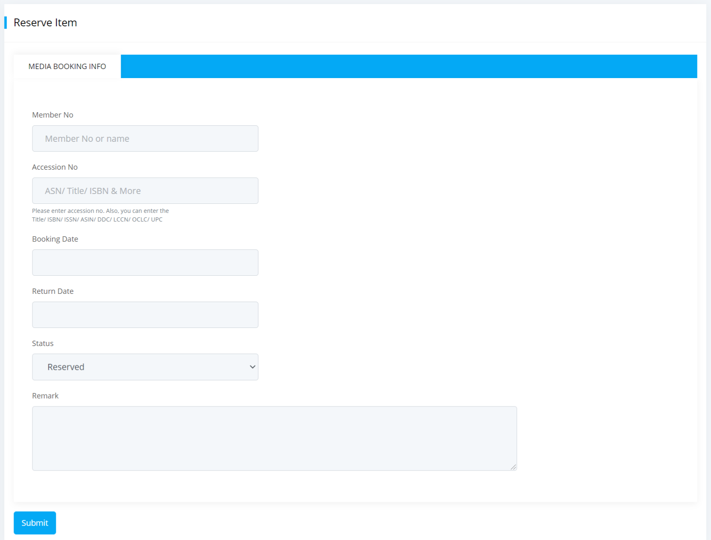

* Enter member number or member name for whom you want to reserve.
* Then enter the accession number, title or any identifier of the item that you want to reserve.
* Also enter booking date and return date of the item.
* Select status as **Reserved**.
* Click on the `Submit` button when you are done.

## Change return date

You can update / extend return date of any circulation record specially that has already been issued but not yet returned. 

To update or extend an item for a member, please follow the below steps:

* Go to `Circulations` > `Circulations`.
* Click on the `Quick Extend` button.
* Enter the accession number or isbn or title of the item you want to extend. An auto-select list will appear with red indicators.

	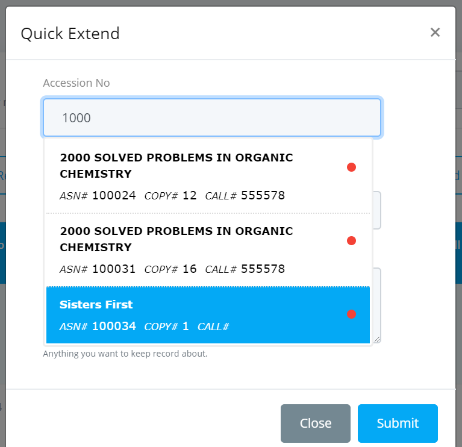

* Select the item from the list.
* Enter any remark note in the remark input box, if you want to.
* Click on the `Submit` button when you are done.

## Edit a checkout

You can edit any existing circulation entry, change return date, status etc from the circulations page.

To edit a circulation, please follow the below steps:

* Go to `Circulations` > `Circulations`.
* Locate the item you want to edit from your circulation records and click on the `Edit` button next to that item.

	

* An edit circulation form will be appeared as shown below.

	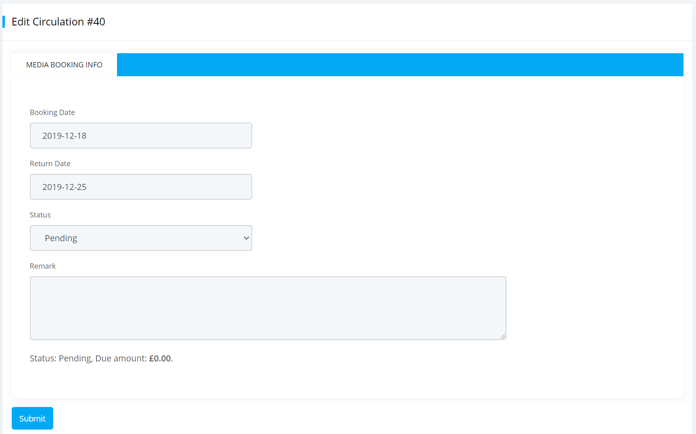

* Edit or update necessary information regarding the circulation.
* Click on the `Submit` button when you are done.

## Find a loan

If you have many circulation entries, use the filter box to find an entry quickly.

To use this functionality, please follow the below steps:

* Go to `Circulations` > `Circulations`.
* In the top corner of circulations page you can see a `Filter by ASN/ISBN/Call No/Member No` input box. Enter the accession number, ISBN or call number of the item, or the member number, in that box.
	
	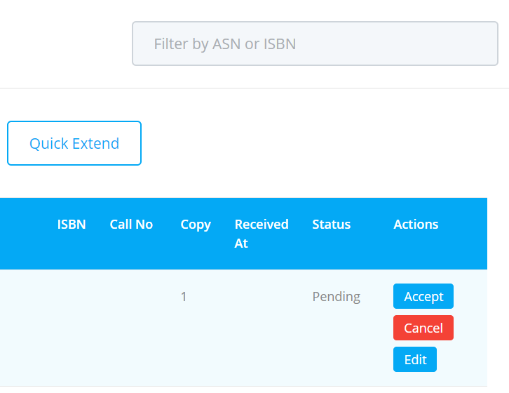

* An auto-select list will appear, select the item from the list. All related circulations of the selected item will appear as shown below.
	
	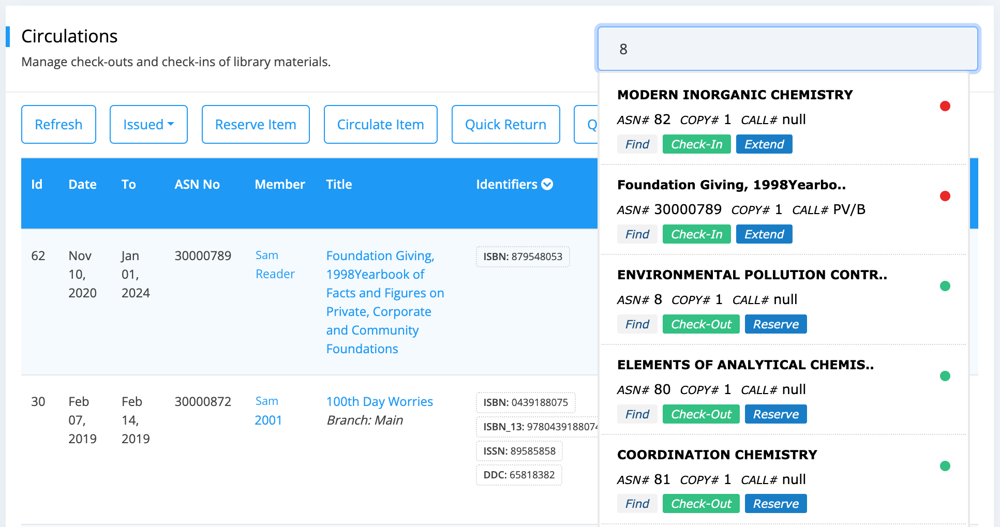

* Now you can perform any action regarding your needs for circulations.

---

## FAQ

**Why can't I check out an item to a member?**

The form shows the reason. The most common ones are: the member is not active, the item is already checked out, circulation is turned off for the item, the member has reached their booking quota, the member already has this copy, or the member's unpaid dues have reached the limit set in [Fees & payments](fees-payments.md).

**Why doesn't the book appear in the list when I type its title?**

The list shows at most 10 matches, and a title search starts only after you type at least 4 letters. Typing the accession number or ISBN is the quickest way to find the exact copy (the list never scrolls past the 10th match, even when you have more copies of the same book).

**How many items can a member borrow?**

Up to the `Booking Quota` set in Preferences, or the member's own quota if one is set on their record. The quota counts pending requests, reservations and checked-out (including overdue) items together. See [Change Preferences](libraries.md#change-preferences) and [Booking Quota](members.md#booking-quota).

**What is the default return date and how do I change it?**

It is today plus the `Booking Time` (in days) from the `Options` tab of Preferences. You can still pick a different return date for each checkout in the form.

**When does an item become Overdue?**

Automatically, once its return date has passed and it has not been checked in. You don't need to change the status yourself.

**Can I extend an item that is already overdue?**

Yes. Use `Quick Extend`, confirm that you want to extend the overdue item, and choose a new return date that is not in the past. The status changes back to Issued. The extension is refused if the new dates overlap another booking of the same copy.

**I checked in the wrong item. How do I undo it?**

Find the record in the circulations list, click `Edit`, set **Status** back to Issued and click `Submit`. The edit form changes only the dates, status and remark; to change the member or the item, create a new check-out instead.

**What do the Accept, Cancel and Issue buttons do?**

On a Pending request, `Accept` reserves the item and `Cancel` declines the request; members with a login account get an email either way. On a Reserved record, the `Issue` button appears from the booking date onwards and checks the item out to the member.
