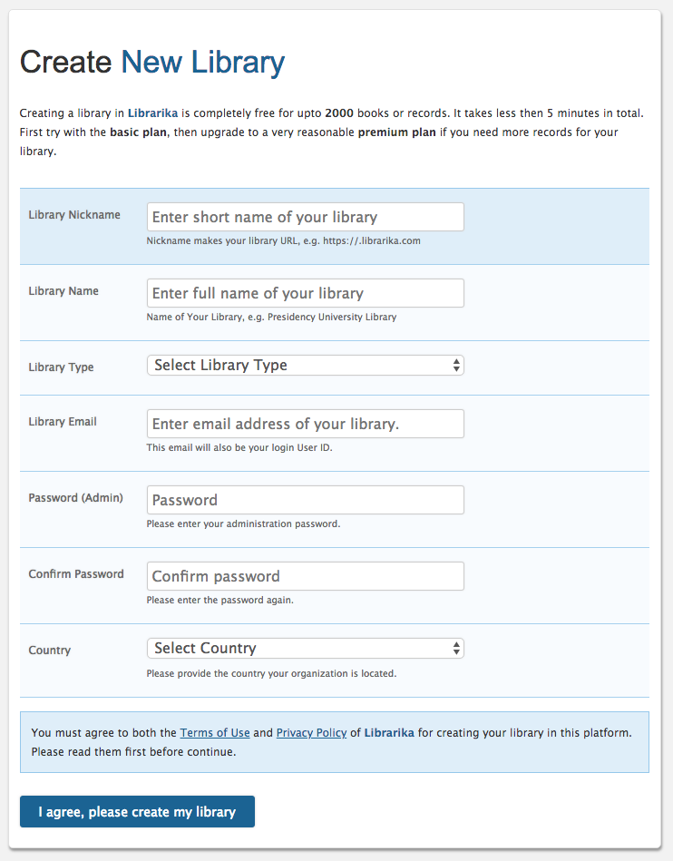
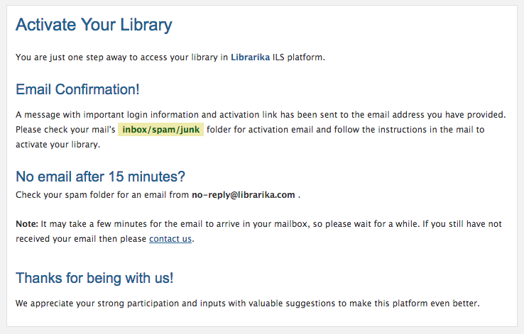
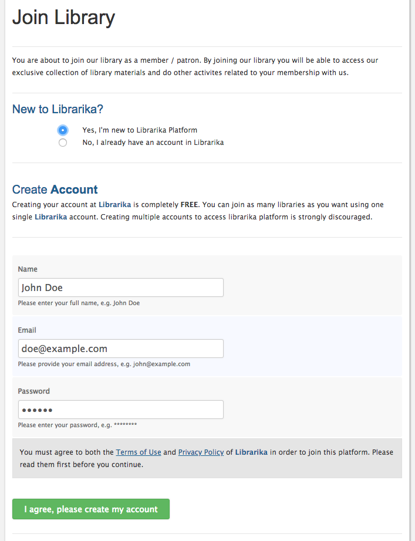

# Getting started

Getting started with Librarika is super easy. It only takes few minutes to start 
a new library in **Librarika**.

---

## Create new library

Both new to Librarika and existing users can open a new library in Librarika platform. If you are new to the platform, please proceed to the [new user](#new-user) section for a fresh start. 

For existing users, please follow [existing user](#existing-user) section first before you start a new library. 

### Existing user

* Follow the same instruction as the [new user](#new-user) section below, just enter your account email address.
* You will not be asked to enter password information as you are an existing user.
* And, if your account is already verified, your new library will be activated automatically. 

### New user

Create a new library for the first time.

* Go to [https://librarika.com][Librarika]
* Click on `Create Free Library` button 

	

* Enter information about your library in **Create New Library** form.
	*	**Library Nickname:**
	This is the single most important input for your library. Please keep it as short as possible, because this will be your library access URL. We prefer this to be less than 20 characters.

	*	**Library Name:**
	Enter full name of your library. Example: _The Liberty School Library_.
	
	*	**Library Email:**
	Enter your email address carefully. This email address will be used to log you into the library. 

		A verification email will be sent to this email address.

	*	**Password (Admin):**
	Enter a new password for your admin login and confirm the password. Please remember this password, as you will need it to sign in to your library. Use at least 15 characters; a few unrelated words make a strong password that is easy to remember. See [Your password](passwords.md).

* Select a library type and country from the dropdown list.
* Once, you are done, please click on the `I agree, please create my library` button.
* You will see a confirmation page, with instructions regarding the verification process.

	

#### Activate your library

Now you need to activate your library before you can start entering books. Open the activation email from Librarika and click the activation link. A page **Activate your library** opens (*"… is ready, it just needs activating."*). Click `Activate my library`.

* **New to Librarika:** you are then asked to choose the password for your account: *"Your library is activated. Please choose a password for your account to finish."* Enter it in **New password** and **Confirm new password** and click `Save new password`. This is the password you sign in with from now on.
* **Existing Librarika account:** your library is activated and your password doesn't change.

The page with the button is there so that a mail scanner opening the link can't activate the library for you. Once activated, you receive a welcome email and can sign in to your library.

**Note:** After activation, you will receive a few onboarding emails with tips to help you get started, such as reminders to catalog your first items. These emails are limited and will stop automatically after the initial setup period.

#### Have not received activation email yet?

Sometime, your mail server may reject the emails we sent from librarika. It mostly happens with corporate mail servers with custom domains. If that happens, please discuss with your system administrator to whitelist librarika.com domain for your organization.

Email communication is very important for a library admin, so please make sure you receive the emails sent from Librarika. 

Otherwise, you will miss important emails regarding your library.

#### Multiple libraries

It is ok to create multiple libraries under the same Librarika account.

---

## Join a library

You can join a library in two different ways.

* A library staff may invite you to join their library as a member.
* Or, you can sign up for a Librarika account on your own. Then submit a member access request to a specific library of your choice.

Both methods are covered in this section.

### a. Join from invitation email

This is the simplest way to join a library. Open the invitation email in your mail box. 

* It is very important that you first sign out of all Librarika libraries (if already signed in) before you proceed.
* Open the invitaion email and click on the **activation link** from the email.
* The Join Library form will be opened in your browser.
* For existing Librarika user:
	* Choose the `No, I already have an account in Librarika` option.

		

	* Enter login email address and password and click `Login`.
	* Then, click on the `Yes, please join me in.` button. You will then be joined to the library.

		

* For new Librarika user:
	* Choose the `Yes, I'm new to Librarika Platform` option.
		
		

	* Enter _name_, _email address_ and _password_ for a new account.
	* The password is a **new password for Librarika**, not your email account's password. It needs at least 15 characters (see [What makes a good password](passwords.md#what-makes-a-good-password)). If the library uses SSO, don't use your organisation's password here either: see [Your Librarika password and your organisation's password](signing-in.md#your-librarika-password-and-your-organisations-password).
	* Click on the `I agree, please create my account` button. A new account will be created and you will be signed in to it automatically.
	* Now click on `Yes, please join me in.` button. You will then be joined to the library.

		

* Once you join a library as a member, you can access the member only area of that library, browse library catalog (even if it is a private library), submit reservation request, see current check-out items, write reviews etc.	

### b. Ask a library to let you join

Without an invitation, you can ask a library to let you join: sign in on [librarika.com][Librarika], open **My Libraries**, click `Join a library`, enter the **Library address** under **Ask to join a library** and click `Send request`. The library reviews your request and gives you a member number, unless it accepts requests automatically. See [Member quick start](member-quick-start.md#no-invitation-ask-to-join) for the messages you may see.

---

## FAQ

**Can I create more than one library with the same account?**

Yes. See [Multiple Libraries](#multiple-libraries).

**I didn't receive the activation email. What now?**

Check your spam folder, and ask your IT team to allow emails from librarika.com. See [Have not received activation email yet?](#have-not-received-activation-email-yet)

**Can I sign up with Google or Apple?**

Not yet. Google and Apple sign you in to an existing Librarika account with the same email address. Create your account with an email and password first; afterwards you can use Google or Apple. See [Ways to sign in](signing-in.md#ways-to-sign-in).

**I was invited by a library. Do I need a new account?**

No, if you already have a Librarika account: choose `No, I already have an account in Librarika` on the join form and sign in. See [Join from invitation email](#a-join-from-invitation-email).

**Which password do I choose when I join?**

A new password for Librarika only. It's separate from your email password and from your school's or company's SSO password. Use at least 15 characters; see [What makes a good password](passwords.md#what-makes-a-good-password).

**Is my account tied to one library?**

No. Your Librarika account is yours: you use it on librarika.com, in every library you join, and in the mobile app.

[Librarika]: https://librarika.com/  "Librarika ILS - The Free Library Management System"
