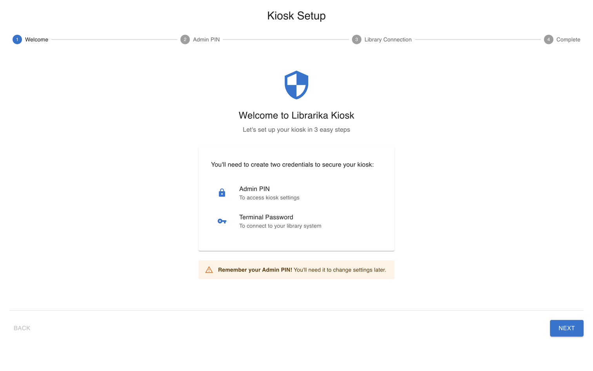
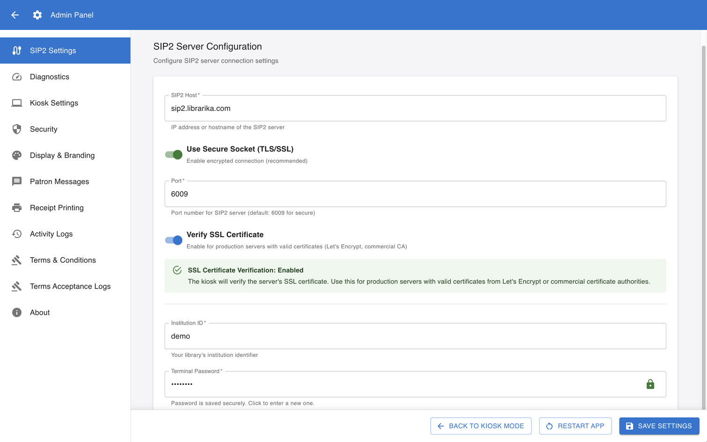

# Kiosk app: setup and management

**Who this is for:** library staff and administrators who run a self-checkout kiosk.

**What you can do here:** prepare a computer as a Librarika self-checkout kiosk, connect it to your library, set it up, keep it updated and fix common problems. For what members see at the kiosk, see [Using a kiosk](using-a-kiosk.md). For licences and connection details, see [SIP2 integration](sip2.md).

---

## What the kiosk app is

**Librarika Kiosk** is a desktop app that turns a computer into a self-checkout station. Members scan their library card, then borrow and return items by scanning barcodes. The app connects to Librarika through Librarika's SIP2 service, so each kiosk needs a [SIP2 terminal licence](sip2.md#licensing).

The app runs on Windows, macOS and Linux. Downloads are on the [Librarika Kiosk App](https://librarika.com/spages/librarika-kiosk-app) page.

## What you need

* **A computer** for the kiosk. A touchscreen is recommended.
* **A barcode scanner**, USB or Bluetooth, set to work like a keyboard and to send **Enter** after each scan.
* **A receipt printer** (optional): the kiosk prints on the computer's default printer, on 80 mm or 58 mm paper.
* **A permanent internet connection.** The kiosk has no offline mode: without a connection, members can't borrow or return.
* **A SIP2 terminal licence and a terminal account** for this kiosk, set up by Librarika support (see below).
* **Barcode labels** on your items and member cards: item barcodes must be the copies' **accession numbers**, and card barcodes the members' **Member No**. See [Barcode labels](barcode-labels.md).

## Get a terminal licence and account

Each kiosk signs in to your library with its **own terminal account**: a staff account that is used only by that kiosk. Librarika support licenses the account as a SIP2 terminal for your library.

1. Under **Users**, add a user for the kiosk with an email address the library can read, for example `kiosk1@yourschool.org`, and give it the **Library Assistant** role: that is all a kiosk needs (see [Users & roles](users.md#add-user)). Don't use a person's own login.
	* Accept the invitation from that mailbox and choose a password. It must meet your library's [password length](library-sign-in-security.md#password-length).
	* If your library requires two-step verification for staff, Librarika may ask this account to set it up when you first sign in with it on the website. Do so, and keep its recovery codes with your kiosk records. Once the account is licensed, the kiosk itself is never asked.
	* If your library limits staff to branches, a terminal account limited to a branch can lend only that branch's items.
2. Contact [Librarika support](https://librarika.com/spages/contact) with the account and the **public** internet (IP) address of the library's connection (open a browser on the kiosk and search *what is my IP*). Support can also allow a range, such as `203.0.113.0/24`. Support sets up the licence: its start and end dates (usually a year) and the allowed addresses. If your provider changes your address, the kiosk stops working until support updates it.
3. Support confirms when the terminal is licensed. You can see it under **Manage** > **Preferences** > `SIP2`: *"SIP2 terminals licensed for this library. To add, move or renew a terminal, contact Librarika support."*

**Why a licensed terminal account matters:** a kiosk can't type a two-step code or choose a new password. A **licensed** terminal account is therefore not asked for two-step verification or a new password, even if your library [requires two-step verification for staff](library-sign-in-security.md). Any account that Librarika support hasn't licensed as a terminal is asked: if a kiosk signs in with such an account and two-step verification is on (or a new password is due), the kiosk stops working. Always use the terminal account that Librarika support set up. The exemption covers only sign-ins from the kiosk; it also skips the check for leaked passwords.

Keep the terminal account for the kiosk only. Librarika may refuse it on the website and in the app with *"This account is a SIP2 terminal account: it can only be used by SIP2 terminals."* If you change its password, update **Terminal Password** on each kiosk that uses it.

## Install the app

1. Download the installer for your system from the [Librarika Kiosk App](https://librarika.com/spages/librarika-kiosk-app) page.
2. Install it:
	* **Windows:** run the installer. If Windows shows *Windows protected your PC*, click **More info** > **Run anyway**.
	* **macOS:** open the `.dmg` and drag the app to Applications. The first time, right-click the app and choose **Open**.
	* **Linux:** use the `.AppImage` package.

## First-run setup

The first time the app starts, the **Kiosk Setup** wizard opens. It has four steps: **Welcome**, **Admin PIN**, **Library Connection** and **Complete**.

1. **Admin PIN**: choose a PIN of **6 to 12 digits**. Staff use it to open the settings. Easy PINs (common ones, sequences such as `123456`, or repeats) are refused. Keep it safe.
2. **Library Connection**:
	* **Institution ID**: your library's subdomain, for example `mylibrary` if your library is at `mylibrary.librarika.com`.
	* **Terminal Password**: **type the account's email address, a colon and the password, for example `kiosk1@mylibrary.org:your-password`.** The field is labelled Terminal Password but needs both.
3. Click `Start Using Kiosk`.
4. Open the Admin Panel > **Kiosk Settings**, switch on **Start in Kiosk Mode** (and check that **Enable Kiosk Mode** is on), click `Save Settings`, then `Restart App`. Until you do this, the kiosk opens on the admin PIN screen every time it starts, for example after a power cut or a Windows update.

The app connects to Librarika's SIP2 server (`sip2.librarika.com`, port 6009, encrypted) by default. You only change this if Librarika support tells you to.

## Open and leave the settings

* To open the settings (**Admin Panel**), click the `Admin` button (gear) at the top of the start screen. It is hidden while a member is signed in. The **Ctrl+Shift+Alt+A** shortcut works only when **Enable Kiosk Mode** is off, because kiosk mode turns keyboard shortcuts off.
* Enter your **Admin PIN** and click `Unlock`. After **5 wrong PINs** the settings are locked for **15 minutes**.
* The admin session ends after 30 minutes: *"Session expired. Please re-enter admin PIN."*
* Each section has its own save button (`Save Settings`, `Save Library Hours`, `Save Messages` or `Save Configuration`). After changing **SIP2 Settings** or kiosk mode, click `Restart App`. `Back to Kiosk Mode` returns to the member screen.
* To close the app, click `Close App` and enter the admin PIN.

## Settings

The Admin Panel has these sections:

| Section | What you set |
|---|---|
| **SIP2 Settings** | **SIP2 Host**, **Port**, **Use Secure Socket (TLS/SSL)**, **Verify SSL Certificate**, **Institution ID** and **Terminal Password**. Restart the app after changing them. Keep TLS on: unencrypted connections are not allowed unless Librarika support has arranged it. |
| **Diagnostics** | `Run Diagnostics` checks that the kiosk can reach the SIP2 server. It doesn't check the terminal password or the licence. |
| **Kiosk Settings** | **Idle Timeout (milliseconds)** (default 300000, which is 5 minutes; from 10 seconds to 1 hour), **Enable Kiosk Mode** (full screen, shortcuts off), **Start in Kiosk Mode**, **Enable Virtual Keyboard**, **Date Format**, and library hours (below). Kiosk mode changes take effect after `Restart App`. |
| **Security** | Change the admin PIN. |
| **Display & Branding** | **Library Name**, logo, colours, theme, font size and the kiosk's language (17 languages). Members can't change the language. |
| **Patron Messages** | The welcome, idle, closing-soon and error messages, and your library's phone, email and website. |
| **Receipt Printing** | **Enable Receipt Printing**, **Automatic Printing**, **Print for Checkouts**, **Print for Checkins**, **Include Due Dates**, **Receipt Paper Width**, **Include Library Contact Info**, header and footer messages, and `Test Print`. Switch on both **Enable Receipt Printing** and **Automatic Printing**, or nothing prints (Automatic Printing is off by default). Receipts go to the computer's default printer. |
| **Activity Logs** | What happened at the kiosk; you can export it as a CSV file. |
| **Terms & Conditions** | Optional terms that members accept before they use the kiosk. |
| **Terms Acceptance Logs** | Who accepted the terms, and when. |
| **About** | The app version. |

**For a public kiosk**, switch on **Enable Kiosk Mode** and **Start in Kiosk Mode**, so the kiosk starts full screen on the member screen.

### Library hours

Under **Kiosk Settings**, tick **Enable library hours enforcement** to use the kiosk only when the library is open:

* **Operating Mode**: `Always Open (24/7)`, `Scheduled Hours` or `Always Closed (Maintenance Mode)`.
* **Weekly Schedule**: add opening periods for each day (`Add Time Period`, `Copy to All Days`), then click `Save Library Hours`.
* **Warning Before Closing (minutes)** (default 15) and **Grace Period After Closing (minutes)** (default 5).
* **Allow checkouts near closing** (on by default).

Outside opening hours the kiosk shows **Library Closed** and the next opening time.

### Auto sign-out

A member is signed out automatically after the **Idle Timeout**. 30 seconds before, the kiosk shows **Session Timeout Warning** with a `Continue Session` button.

## Updates

The kiosk checks for updates 10 seconds after it starts and every 4 hours. **Update Available** offers `Download Update` or `Later`. After the download, **Update Ready to Install** offers `Install and Restart` or `Install Later`. A downloaded update installs the next time the app closes. The window doesn't ask for the admin PIN and can appear while members use the kiosk, so install updates when the library is quiet.

## Check it works

After setup, sign in at the kiosk with a test member's card, borrow one item and return it. Check both in [Circulation](circulations.md). On the `SIP2` tab in **Manage** > **Preferences**, **Last used** should now show today.

---

## Troubleshooting

| What you see | What to check |
|---|---|
| **Unable to Connect to Library Server** banner and **Disconnected** at the top | The kiosk can't reach the SIP2 server. Check the internet connection. The kiosk retries by itself. If it never connects, the kiosk's internet address may not be allowed: ask Librarika support. |
| *"This kiosk is not fully configured. Please ask library staff to complete setup."* | Open the Admin Panel and fill in **Institution ID** and **Terminal Password** under **SIP2 Settings**. |
| Every member gets *"Your account is blocked. Please see library staff."* | Usually a kiosk problem, not the members: the terminal password is wrong, the licence has expired or is suspended, the kiosk connects from an address that isn't allowed, or the terminal account was asked for two-step verification or a new password. Check **SIP2 Settings**, check the licence under **Manage** > **Preferences** > `SIP2`, and contact Librarika support. On the `SIP2` tab, **Status** shows *Active*, *Licence ended: working until …* (grace period), *Expired*, *Starts …* or *Suspended*. **Last used** shows *Never* or a recent time: if it says *Never*, or hasn't changed since the problem started, the kiosk isn't reaching your library with this account; check **Institution ID** and **Terminal Password**. |
| One member gets *"Your account is blocked. Please see library staff."* | Check the member in Librarika: the barcode on the card must be exactly the member's **Member No**, including capital letters and leading zeros, and the member must be **Active**. |
| A licence message such as *"This SIP2 terminal licence has expired. …"*, *"… is suspended. …"*, *"… is not licensed for this location. …"*, *"… is not licensed for this library. …"* or *"… has not started yet."* | Some SIP2 kiosks show these. At sign-in the Librarika Kiosk shows only *"Your account is blocked"* instead. Check the terminal's **Status** under **Manage** > **Preferences** > `SIP2`, then contact Librarika support to renew the licence or update the allowed addresses, for example after you changed internet provider. |
| *"Connection lost. Please check with library staff to confirm if … was checked out."* | The connection dropped during a loan. Check the item in [Circulation](circulations.md) and fix it at the desk if needed. |

The kiosk's log files are in `%APPDATA%/Librarika Kiosk/logs/` on Windows, `~/Library/Logs/Librarika Kiosk/` on macOS and `~/.config/Librarika Kiosk/logs/` on Linux. Librarika support may ask for them; the **Activity Logs** CSV export is usually easier to send.
