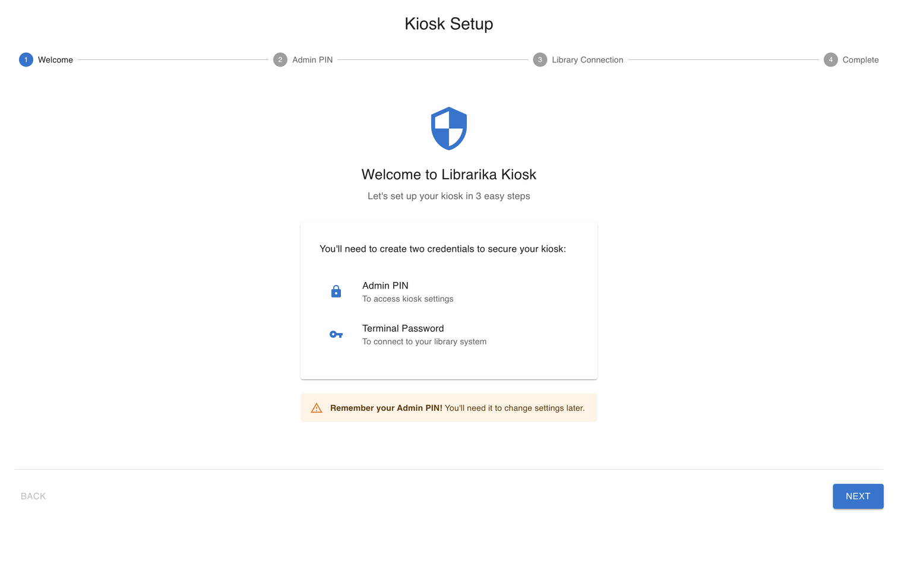
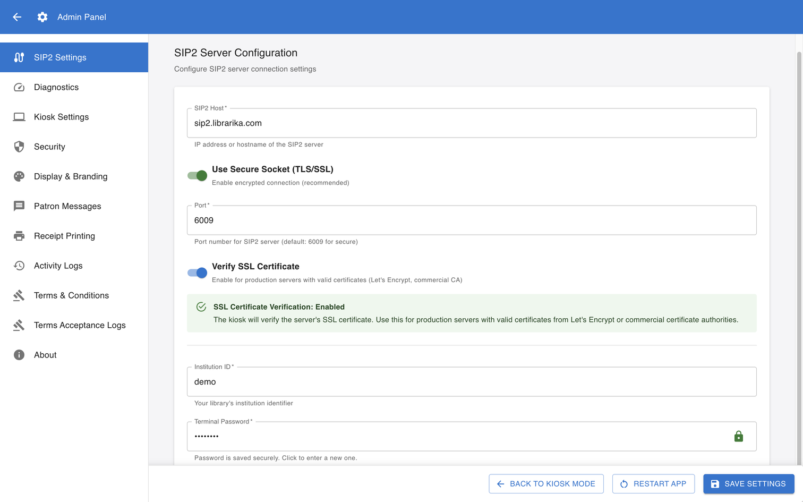

# Kiosk app: setup and management

**Who this is for:** library staff and admins who run a self-checkout kiosk.

**What you can do here:** prepare a computer as a Librarika self-checkout kiosk, connect it to your library, set it up, keep it updated and fix common problems. For what members see at the kiosk, see [Using a kiosk](using-a-kiosk.md). For licences and connection details, see [SIP2 integration](sip2.md).

---

## What the kiosk app is

**Librarika Kiosk** is a desktop app that turns a computer into a self-checkout station. Members scan their library card, then borrow and return items by scanning barcodes. If your library uses them, members can also renew their items and see their holds (see [Renewals and holds at the kiosk](#renewals-and-holds-at-the-kiosk)). The app connects to Librarika through Librarika's SIP2 service, so each kiosk needs a [SIP2 terminal licence](sip2.md#licensing).

The app runs on Windows, macOS and Linux. Downloads are on the [Librarika Kiosk App](https://librarika.com/spages/librarika-kiosk-app) page.

## What you need

* **A computer** for the kiosk. A touchscreen is recommended.
* **A barcode scanner**, USB or Bluetooth, set to work like a keyboard and to send **Enter** after each scan.
* **A receipt printer** (optional): the kiosk prints on the computer's default printer, on 80 mm or 58 mm paper.
* **A permanent internet connection.** The kiosk has no offline mode: without a connection, members can't borrow or return.
* **A SIP2 terminal licence and a terminal account** for this kiosk, set up by Librarika support (see below).
* **Barcode labels** on your items and member cards: item barcodes must be the copies' **accession numbers**, and card barcodes the members' **Member No**. See [Barcode labels](barcode-labels.md).

## Get a terminal licence and account

Each kiosk signs in to your library with its **own terminal account**: a staff account that is used only by that kiosk. Librarika support licenses the account as a SIP2 terminal for your library.

1. Under **Users**, add a user for the kiosk with an email address the library can read, for example `kiosk1@yourschool.org`, and give it the **Library Assistant** role: that is all a kiosk needs (see [Users & roles](users.md#add-user)). Don't use a person's own login.
	* Accept the invitation from that mailbox and choose a password. It must meet your library's [password length](library-sign-in-security.md#password-length).
	* If your library requires two-step verification for staff, Librarika may ask this account to set it up when you first sign in with it on the website. Do so, and keep its recovery codes with your kiosk records. Once the account is licensed, the kiosk itself is never asked.
	* If your library limits staff to branches, a terminal account limited to a branch can lend only that branch's items.
2. Contact [Librarika support](https://librarika.com/spages/contact) with the account and the **public** internet (IP) address of the library's connection (open a browser on the kiosk and search *what is my IP*). Support can also allow a range, such as `203.0.113.0/24`. Support sets up the licence: its start and end dates (usually a year) and the allowed addresses. If your provider changes your address, the kiosk stops working until support updates it.
3. Support confirms when the terminal is licensed. You can see it under `Manage` > `Preferences` > `SIP2`: *"SIP2 terminals licensed for this library. To add, move or renew a terminal, contact Librarika support."*

**Why a licensed terminal account matters:** a kiosk can't type a two-step code or choose a new password. A **licensed** terminal account is therefore not asked for two-step verification or a new password, even if your library [requires two-step verification for staff](library-sign-in-security.md). Any account that Librarika support hasn't licensed as a terminal is asked: if a kiosk signs in with such an account and two-step verification is on (or a new password is due), the kiosk stops working. Always use the terminal account that Librarika support set up. The exemption covers only sign-ins from the kiosk; it also skips the check for leaked passwords.

Keep the terminal account for the kiosk only. Librarika may refuse it on the website and in the app with *"This account is a SIP2 terminal account: it can only be used by SIP2 terminals."* If you change its password, update **Terminal Password** on each kiosk that uses it.

## Install the app

1. Download the installer for your system from the [Librarika Kiosk App](https://librarika.com/spages/librarika-kiosk-app) page.
2. Install it:
	* **Windows:** run the installer. If Windows shows *Windows protected your PC*, click **More info** > **Run anyway**.
	* **macOS:** open the `.dmg` and drag the app to Applications. The first time, right-click the app and choose **Open**.
	* **Linux:** use the `.AppImage` package.

## First-run setup

The first time the app starts, the **Kiosk Setup** wizard opens. It has four steps: **Welcome**, **Admin PIN**, **Library Connection** and **Complete**.

1. **Admin PIN**: choose a PIN of **6 to 12 digits**. Staff use it to open the settings. Easy PINs (common ones, sequences such as `123456`, or repeats) are refused. Keep it safe.
2. **Library Connection**:
	* **Institution ID**: your library's subdomain, for example `mylibrary` if your library is at `mylibrary.librarika.com`.
	* **Terminal Password**: **type the account's email address, a colon and the password, for example `kiosk1@yourschool.org:your-password`.** The field is labelled Terminal Password but needs both.
3. Click `Start Using Kiosk`.
4. Open the Admin Panel > **Kiosk Settings**, switch on **Start in Kiosk Mode** (and check that **Enable Kiosk Mode** is on), click `Save Settings`, then `Restart App`. Until you do this, the kiosk opens on the admin PIN screen every time it starts, for example after a power cut or a Windows update.

The app connects to Librarika's SIP2 server (`sip2.librarika.com`, port 6009, encrypted) by default. You only change this if Librarika support tells you to.

## Open and leave the settings

* To open the settings (**Admin Panel**), click the `Admin` button (gear) at the top of the start screen. It is hidden while a member is signed in. The **Ctrl+Shift+Alt+A** shortcut works only when **Enable Kiosk Mode** is off, because kiosk mode turns keyboard shortcuts off.
* Enter your **Admin PIN** and click `Unlock`. After **5 wrong PINs** the settings are locked for **15 minutes**.
* The admin session ends after 30 minutes: *"Session expired. Please re-enter admin PIN."*
* Each section has its own save button (`Save Settings`, `Save Library Hours`, `Save Messages` or `Save Configuration`). After changing **SIP2 Settings** or kiosk mode, click `Restart App`. `Back to Kiosk Mode` returns to the member screen.
* To close the app, click `Close App` and enter the admin PIN.

## Settings

The Admin Panel has these sections:

| Section | What you set |
|---|---|
| **SIP2 Settings** | **SIP2 Host**, **Port**, **Use Secure Socket (TLS/SSL)**, **Verify SSL Certificate**, **Institution ID** and **Terminal Password**. Restart the app after changing them. Keep TLS on: unencrypted connections are not allowed unless Librarika support has arranged it. |
| **Diagnostics** | `Run Diagnostics` checks that the kiosk can reach the SIP2 server. It doesn't check the terminal password or the licence. |
| **Kiosk Settings** | **Idle Timeout (milliseconds)** (default 300000, which is 5 minutes; from 10 seconds to 1 hour), **Enable Kiosk Mode** (full screen, shortcuts off), **Start in Kiosk Mode**, **Enable Virtual Keyboard**, **Date Format**, and library hours (below). Kiosk mode changes take effect after `Restart App`. |
| **Security** | Change the admin PIN. |
| **Display & Branding** | **Library Name**, logo, colours, theme, font size and the kiosk's language (17 languages). Members can't change the language. |
| **Patron Messages** | The welcome, idle, closing-soon and error messages, **Message when a returned item is on hold** (see [Renewals and holds at the kiosk](#renewals-and-holds-at-the-kiosk)), and your library's phone, email and website. |
| **Receipt Printing** | **Enable Receipt Printing**, **Automatic Printing**, **Print for Checkouts**, **Print for Checkins**, **Print for Renewals**, **Include Due Dates**, **Receipt Paper Width**, **Include Library Contact Info**, header and footer messages, and `Test Print`. See [Receipts](#receipts). |
| **Activity Logs** | What happened at the kiosk, for the last 30 days; you can export it as a CSV file. The log doesn't keep members' names, and card numbers are partly hidden. |
| **Terms & Conditions** | Optional terms that members accept before they use the kiosk. |
| **Terms Acceptance Logs** | Who accepted the terms, and when. |
| **About** | The app version. |

**For a public kiosk**, switch on **Enable Kiosk Mode** and **Start in Kiosk Mode**, so the kiosk starts full screen on the member screen.

### Library hours

Under **Kiosk Settings**, tick **Enable library hours enforcement** to use the kiosk only when the library is open:

* **Operating Mode**: `Always Open (24/7)`, `Scheduled Hours` or `Always Closed (Maintenance Mode)`.
* **Weekly Schedule**: add opening periods for each day (`Add Time Period`, `Copy to All Days`), then click `Save Library Hours`.
* **Warning Before Closing (minutes)** (default 15) and **Grace Period After Closing (minutes)** (default 5).
* **Allow checkouts near closing** (on by default).

Outside opening hours the kiosk shows **Library Closed** and the next opening time.

### Auto sign-out

A member is signed out automatically after the **Idle Timeout**. 30 seconds before, the kiosk shows **Session Timeout Warning** with a `Continue Session` button. A session that ends this way, or because the library closes, prints no receipt.

### Receipts

Switch on **Enable Receipt Printing**, then choose what to print for: **Print for Checkouts**, **Print for Checkins** and **Print for Renewals** (renewals in `My Items`, and items a member already has and renews when they scan them at checkout; off by default).

* Members get a receipt when they click `Print Receipt`. With **Automatic Printing** on (off by default), the kiosk also prints one by itself when the member leaves the checkout, return or `My Items` screen. One receipt covers everything on that screen.
* `Print My Items` prints the member's list of loans.
* A renewal receipt lists each renewed item with its new due date.
* With **Include Library Contact Info** on, every receipt (checkout, return, renewal, `My Items` and the test receipt) ends with your library's email, phone and website from **Patron Messages**, then your footer message. Without a website, the kiosk uses your library's Librarika address.
* Card numbers are partly hidden on receipts. When a session ends unattended, nothing is printed.

Receipts go to the computer's default printer. The kiosk doesn't keep copies of members' receipts on the computer.

## Renewals and holds at the kiosk

What members can do at the kiosk follows your library's settings in Librarika; there is nothing to switch on in the kiosk itself:

* **Renewals** appear when **Enable renewals** is on in `Manage` > `Preferences` > `Self Service` (see [Renewal settings](self-service.md#renewal-settings)). Members then see `Renew` and `Renew all` in `My Items`. When a member scans an item they already have at checkout, the kiosk asks whether to renew it; it never renews by itself. Kiosk renewals follow the same rules as renewals in `My Account` (see [Renew a loan](circulations.md#renew-a-loan)), and the member sees the new due date or the reason a loan wasn't renewed.
* **Holds** appear when **Enable hold queue** is on (see [Enable hold queue](hold-queue.md#enable-hold-queue)) and your plan includes holds. Members then see `My Holds`: holds **Ready for pickup** (with where and by when to collect them) and holds **Waiting** (with their place in the queue). Members can't place or cancel holds at the kiosk.
* **Returns of items on hold**: when a returned item has a waiting hold, the member sees **Another member is waiting for this item**, with *"Please give it to library staff, or leave it where your library asks for held items."* To tell members exactly where to put such items, type your own text in **Message when a returned item is on hold** under **Patron Messages**. It is shown as you type it, in every kiosk language; leave it blank for the standard sentence. See also [Check in an item someone is waiting for](hold-queue.md#check-in-an-item-someone-is-waiting-for).

When you turn renewals or holds on or off, kiosks pick up the change within about a minute, from the next member who signs in. No restart is needed.

**Loan periods:** a kiosk checkout is a self-checkout. Its due date uses the **Checkout Time** on the `Self Service` tab, but never goes past the **Checkout Limit** (see [Enable self-service for your library](self-service.md#enable-self-service-for-your-library)).

Renewals, holds, the hold message on returns and the shared card number message need **Librarika Kiosk 1.0.2** or later. See [Updates](#updates).

## Updates

To get Kiosk 1.0.2, download it from the [Librarika Kiosk App](https://librarika.com/spages/librarika-kiosk-app) page and install it over the current version, as in [Install the app](#install-the-app). Your settings are kept. To check the version, open the Admin Panel > **About**.

The kiosk checks for updates 10 seconds after it starts and every 4 hours. **Update Available** offers `Download Update` or `Later`. After the download, **Update Ready to Install** offers `Install and Restart` or `Install Later`. A downloaded update installs the next time the app closes. The window doesn't ask for the admin PIN and can appear while members use the kiosk, so install updates when the library is quiet.

## Check it works

After setup, sign in at the kiosk with a test member's card, borrow one item and return it. Check both in [Circulation](circulations.md). On the `SIP2` tab in `Manage` > `Preferences`, **Last used** should now show today.

---

## Troubleshooting

| What you see | What to check |
|---|---|
| **Unable to Connect to Library Server** banner and **Disconnected** at the top | The kiosk can't reach the SIP2 server. Check the internet connection. The kiosk retries by itself. If it never connects, the kiosk's internet address may not be allowed: ask Librarika support. |
| *"This kiosk is not fully configured. Please ask library staff to complete setup."* | Open the Admin Panel and fill in **Institution ID** and **Terminal Password** under **SIP2 Settings**. |
| Every member gets *"Your account is blocked. Please see library staff."* | Usually a kiosk problem, not the members: the terminal password is wrong, the licence has expired or is suspended, the kiosk connects from an address that isn't allowed, or the terminal account was asked for two-step verification or a new password. Check **SIP2 Settings**, check the licence under `Manage` > `Preferences` > `SIP2`, and contact Librarika support. On the `SIP2` tab, **Status** shows *Active*, *Licence ended: working until …* (grace period), *Expired*, *Starts …* or *Suspended*. **Last used** shows *Never* or a recent time: if it says *Never*, or hasn't changed since the problem started, the kiosk isn't reaching your library with this account; check **Institution ID** and **Terminal Password**. |
| One member gets *"Your account is blocked. Please see library staff."* | Check the member in Librarika: the barcode on the card must be exactly the member's **Member No**, including capital letters and leading zeros, and the member must be **Active**. |
| A licence message such as *"This SIP2 terminal licence has expired. …"*, *"… is suspended. …"*, *"… is not licensed for this location. …"*, *"… is not licensed for this library. …"* or *"… has not started yet."* | Some SIP2 kiosks show these. At sign-in the Librarika Kiosk shows only *"Your account is blocked"* instead. Check the terminal's **Status** under `Manage` > `Preferences` > `SIP2`, then contact Librarika support to renew the licence or update the allowed addresses, for example after you changed internet provider. |
| *"Connection lost. Please check with library staff to confirm if … was checked out."* | The connection dropped during a loan. Check the item in [Circulation](circulations.md) and fix it at the desk if needed. |
| *"We could not confirm whether … was renewed. …"* | The connection dropped during a renewal, which may have gone through. Check the loan's due date in [Circulation](circulations.md). |
| *"This card number matches more than one account. Please ask at the desk."* | Two or more members have the same **Member No**. Give each member their own number, then print a new card if needed. |
| No `Renew` or `My Holds` at the kiosk | Check that **Enable renewals** or **Enable hold queue** is on, wait a minute and sign in again. Check the version under **About**: you need Kiosk 1.0.2 or later. |
| An overdue item shows *"Overdue items can't be renewed."* | **Renew overdue loans** is off. The member returns the item, or staff renew or extend it at the desk. |

The kiosk's log files are in `%APPDATA%/Librarika Kiosk/logs/` on Windows, `~/Library/Logs/Librarika Kiosk/` on macOS and `~/.config/Librarika Kiosk/logs/` on Linux. Librarika support may ask for them; the **Activity Logs** CSV export is usually easier to send.
