# Library settings & plans

**Who this is for:** library admins.

**What you can do here:** change your library's information, logo, branches and preferences, upgrade or cancel your plan, and delete the library.

This section explains how to manage your library master data and other related information.

## Create library

Please see the [create new library](getting-started.md#create-new-library) section in order to start a new free library. 

To use a paid plan, create a library on the Free plan first, then upgrade it (see [Upgrade your plan](#upgrade-your-plan)).

---

## Change library information

### Change / update library info

Please update your library information carefully and make sure that they are up to date.

**Steps to update library information**:

* Go to the **Library Information** section from the dashboard.

	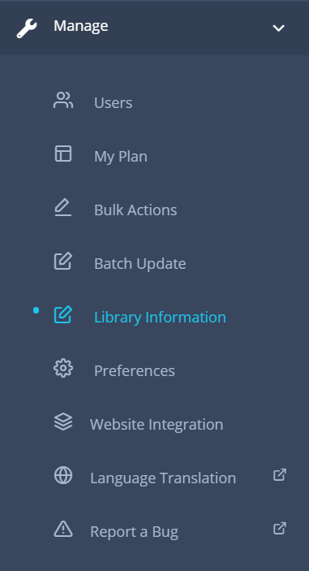

* Click on the `Library Info` tab if not selected automatically.
	
	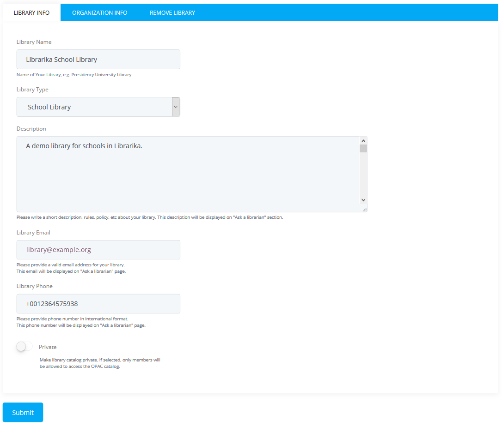

* Enter / update the information you want to change.
	* The description field should contain a short description about your library, library business hours, rules, policies, etc. This field is very important for your library site visitors as it will be displayed on the "Ask a Librarian" public page.
	* The email address and phone number provided here will be displayed on the "Ask a Librarian" public page. However, you can individually turn off the display of email address, phone number from the [preferences](#change-preferences) section. 
	* Uncheck the **Private** checkbox to make your catalog publicly visible online. 
* Now if you want to make your library private so that, only the members will be allowed to access the OPAC catalog.
	* Please checked the **Private** checkbox from the `Library Info` tab.

		If checked, your catalog will not be visible online, only members with member access can see it. This feature is suitable for corporate libraries.

* Click on the `Submit` button to save your changes.

### Change / update organisation information

Please update your organisation information carefully and make sure that they are up to date. The email address and phone number that you enter in this page will not be available in public.

**Steps to update organisation information**:

* Go to the **Library Information** section from the dashboard.

	

* Click on the `Organization Info` tab.
	
	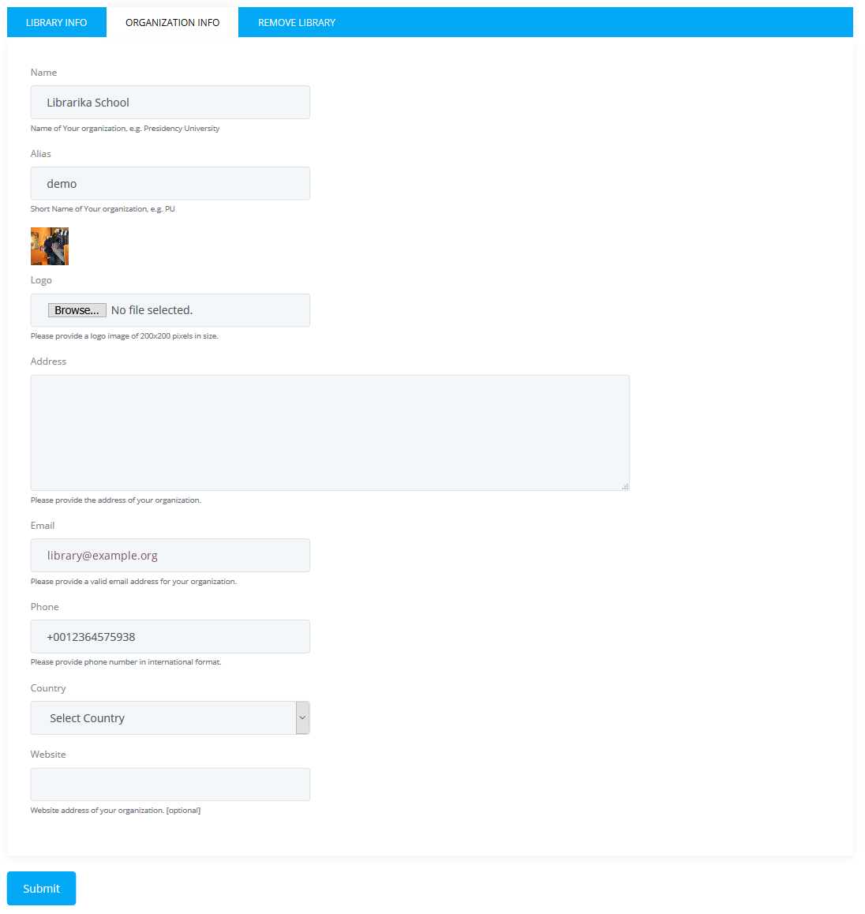

* Enter / update the information that you feel necessary.
* Click on `Submit` button to save your changes.

---

## Upload library logo

Logo is the single most important thing that gives your library an official identity. Please update your library logo as soon as possible to make it looks professional. For personal library, it is ok to keep the default Librarika logo.

We support PNG, JPG and GIF files from 200x200 up to 800x800 pixels. Larger images are resized to 200x200, so a square image looks best.

**Steps to upload logo**:

* Go to the **Library Information** section from the dashboard.

	

* Click on the `Organization Info` tab.
	
	

* In the logo field click on the `browse` button and select a PNG, JPG or GIF file between 200x200 and 800x800 pixels.
* Click on the `Submit` button to save your changes.

---

## Change preferences

The preferences section is the single most important settings page for your library. Here you can change the followings:

* `Options` -- basic options
* `Self Service` -- self-service settings
* `Request items` -- request items settings
* `Hold Queue` -- hold queue settings
* `Notifications / Reminders` -- notifications and reminders settings
* `SIP2` -- your library's SIP2 terminals (only shown when your library has one)
* `SSO` -- single sign-on
* `Appearance` -- themes and languages
* `Upgrade` -- upgrade your plan

The `Sign-in security` button at the top of the Preferences page opens your library's [sign-in security settings](#sign-in-security).

**Steps to update preferences**:

* In the sidebar, go to `Manage` > `Preferences`.

	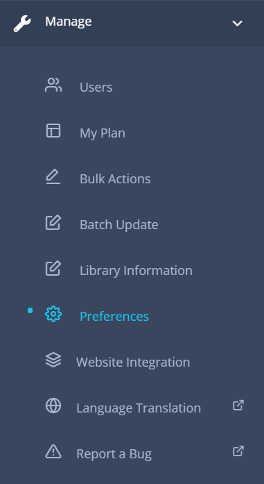

* Click on the `Options` tab if not selected automatically.

	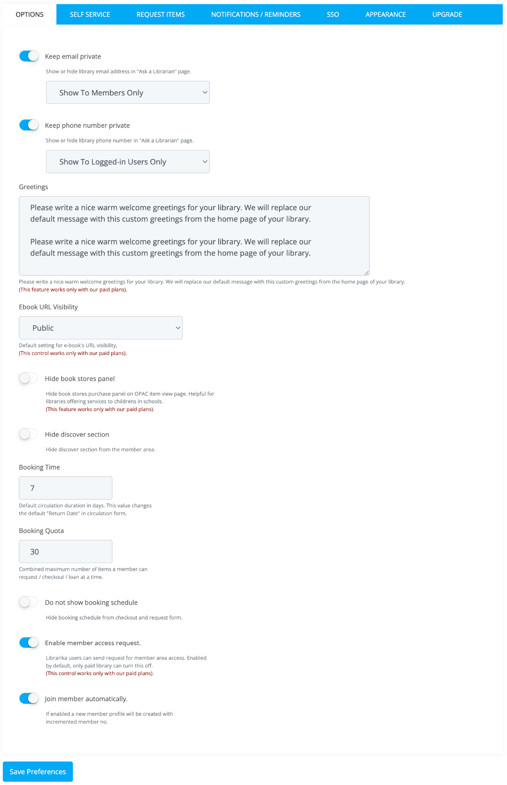
	
* Enter / update the information you want to change.
	* The **Keep email private** checkbox has 3 options that you can set based on your own preference and it will be displayed on the "Ask a Librarian" page.

		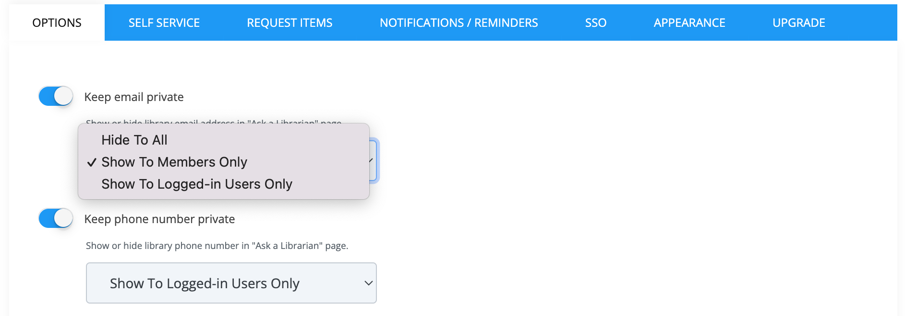

	* Then if you checked the **Keep phone number private** checkbox then you can find 3 options to set and based on this setting it will be displayed on the "Ask a Librarian" page.

		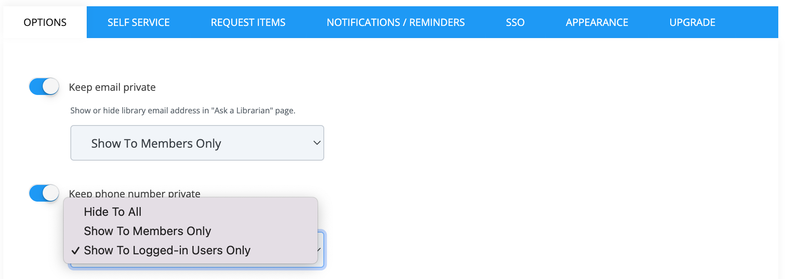

	* Next is the **Greetings** field where you can modify your verbage or welcome message for your library.
	* The **Ebook URL Visibility** option set privacy for your e-book which is links with 5 options, that is Hide To All / Public / Member / Borrower Always / Active Borrower. You can set them independently for each of the items in your catalog.
	* The **Booking Time** option is the default loan length in days. It sets the default **Return Date** in the circulation form.
	* The **Booking Quota** field is the maximum number of items a member can have requested, checked out or on loan at a time, all combined.
	* **Enable member access request.** -- people with a Librarika account can ask to join your library. It is on by default; only some plans can turn it off (see [What each plan includes](#what-each-plan-includes)).
	* **Join member automatically.** -- requests (including first SSO sign-ins) are accepted right away with the next member number. When it is off, they wait in [Member Requests](members.md#member-requests).

* If you click on the `Self Service` tab then it will be displayed like below.

	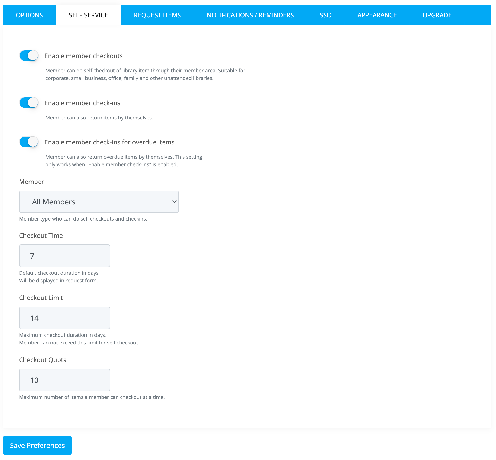

	* **Enable member checkouts** -- Allow members to check out items by themselves from the catalog.
	* **Enable member check-ins** -- Allow members to return (check-in) items by themselves from their My Account page.
	* **Enable member check-ins for overdue items** -- Allow members to return items even if they are overdue. It works only when **Enable member check-ins** is on. If it is off, overdue items can only be returned by library staff.
	* **Member** -- which members may use self-service: All Members, Regular Members Only or Privileged Members Only.
	* **Checkout Time** -- the default checkout duration in days (default 7).
	* **Checkout Limit** -- the longest checkout a member can choose, in days (default 14).
	* **Checkout Quota** -- the most items a member can have checked out at the same time through self-service (default 5).

	For more details on self-service options, see the [Self-service](self-service.md) page. For kiosk-based checkout with barcode scanners, see [SIP2 integration](sip2.md).

* If you click on the `Hold Queue` tab then you can configure the hold queue feature for your library. The hold queue allows members to place holds on items that are currently checked out and wait in a queue until the item becomes available.

	For detailed information on all hold queue settings and how the feature works, see the [Hold queue](hold-queue.md) page.

* If you click on the `Request items` tab then it will be displayed like below.

	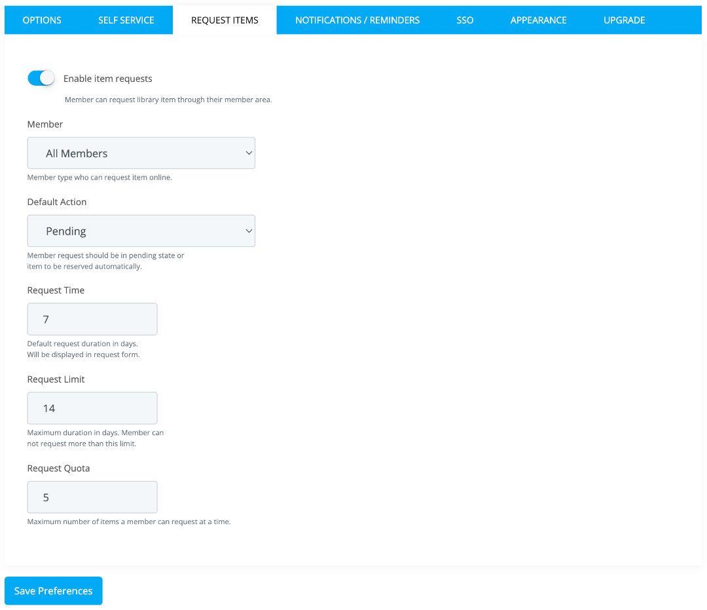

	* If you enable the **Enable item request** then member can request your library item from their member area section.
	* In the **Member** field you can set 3 member type options whom can request library item online, that is All members / Regular members only / Privileged members only.
	* By default the action is pending for requesting an item. But you can choose the other option **Reserved** if you want to reserve that item for your member immediately.

* If you click on the `Notifications / Reminders` tab then you can set reminders for your library members.

	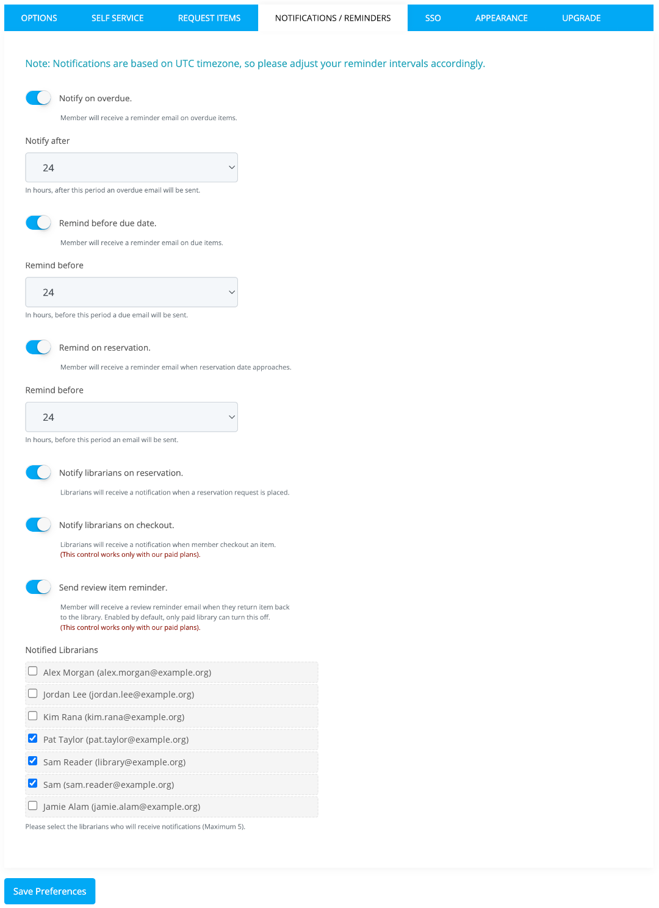

	* Our system will send notification reminders to the members of your library based on these settings.
	* **Notify on overdue.** -- members get an email when an item is overdue, after the hours chosen in **Notify after**.
	* **Remind before due date.** -- members get an email the chosen number of hours (**Remind before**) before the due date.
	* **Remind on reservation.** -- members get an email the chosen number of hours (**Remind before**) before the reservation date.
	* **Notify librarians on reservation.** -- staff get a notification when a reservation request is placed.
	* **Notify librarians on checkout.** -- staff get a notification when a member checks out an item (only on some plans: see [What each plan includes](#what-each-plan-includes)).
	* **Send review item reminder.** -- members get an email asking for a review when they return an item. It is on by default; only some plans can turn it off (see [What each plan includes](#what-each-plan-includes)).
	* **Here the most important field is **Notified Librarians**, where you can choose up to five staff who will receive notification reminders if any member joined or requested a book**.

* If your library has SIP2 terminals, a `SIP2` tab lists them with their allowed IP addresses, licence end date, status and when each was last used. To add, move or renew a terminal, contact Librarika support. See [SIP2 integration](sip2.md).

* If you click on the `SSO` tab then you can enable the SSO login for your library.

	It connects your school's or organisation's identity provider so that staff and members can sign in with their own login, and can make SSO the only way in. SSO is available on the Silver plan and higher, and SSO only on the Gold plan and higher; it works only after Librarika support activates it for your library. For every setting and step, see [Single sign-on (SSO with SAML)](sso-saml.md).

* If you click on the `Appearance` tab then it will be displayed as below.

	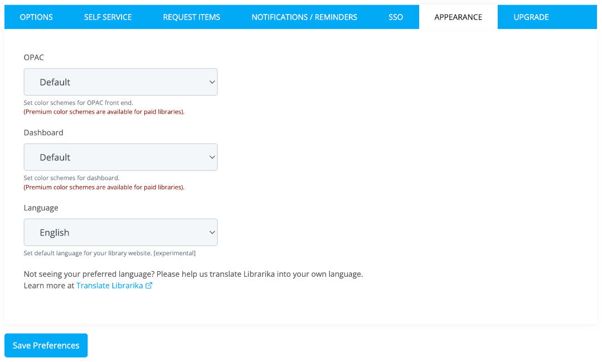

	* From this page you can set premium colour schemes for your library dashboard and OPAC (only on some plans: see [What each plan includes](#what-each-plan-includes)). Also you can select your preferred language from the Language dropdown menu.

* The `Upgrade` tab links to your plan; see [Upgrade your plan](#upgrade-your-plan).
* From the above tabs you can set / enter / update the value that you want.
* Click on the `Save Preferences` button to save your changes.
* Your latest changes are applied right away (some may take a few minutes to show).

### Sign-in security

Library admins decide on the `Sign-in security` page (button at the top of **Preferences**) whether staff and members need two-step verification, the minimum password length, and a date before which passwords must be changed. These settings can be changed on the Gold, Platinum, Diamond, Enterprise and Unlimited plans.

For every option, see [Library sign-in security](library-sign-in-security.md); to help someone who is locked out, see [Helping people who can't sign in](helping-people-sign-in.md).

---

## Create library branch

To create a new library branch or update the information of your previous library branches please follow the below steps.

* Go to `Manage` > `Library Information`, then click on the **Manage Branches** button.
* A page will be appeared like below.

	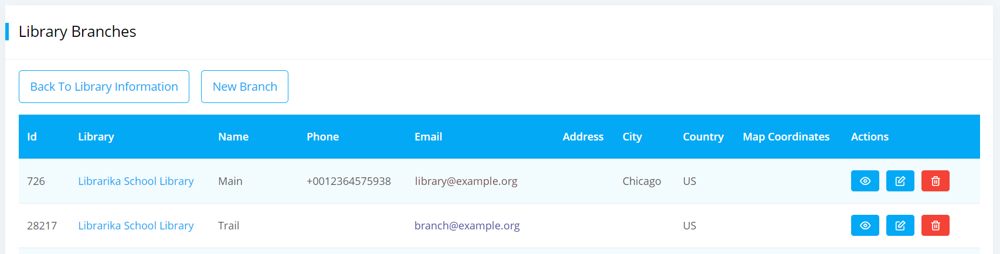

* Then in the library branches page you will find the **New Branch** button.
* Click on it and an add new branch page will be displayed.

	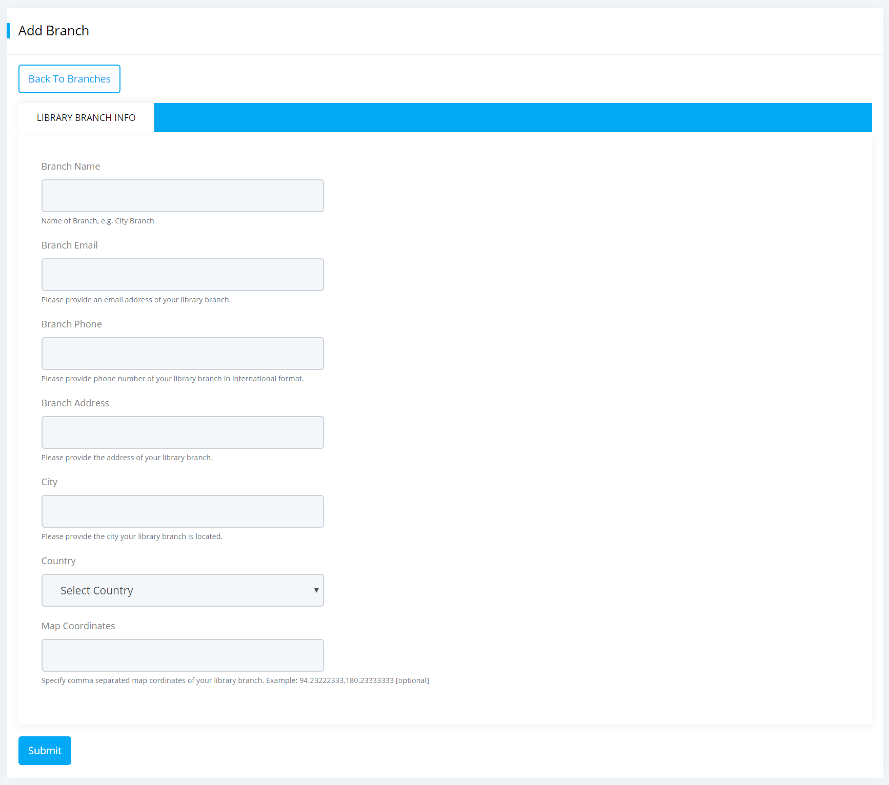

* Then enter all the information related to your branch and click on the submit button and a new branch will be created.
* To view all the details of your library branch please click on the `View` icon on the next to that branch.
* If you want to change any branch information then click on the `Edit` icon on the next to that branch.
* Also, if you want to delete any branch information then click on the `Delete` icon on the next to that branch.

---

## Upgrade your plan

You can upgrade your library to a paid plan at any time. The steps are the same for new and existing libraries.

To upgrade:

* Sign in to your library dashboard.

	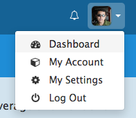

* Click on the `My Plan` option from the `Manage` dropdown menu.
	
	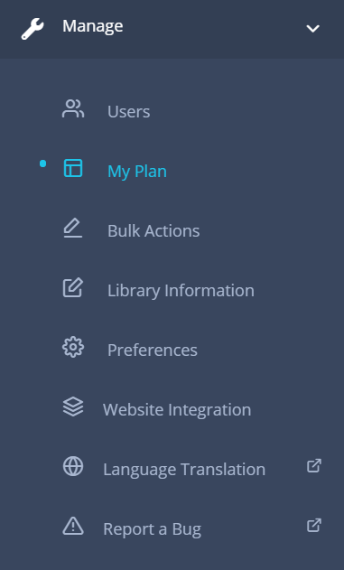

* The `My Plan` page will be displayed as shown below.

	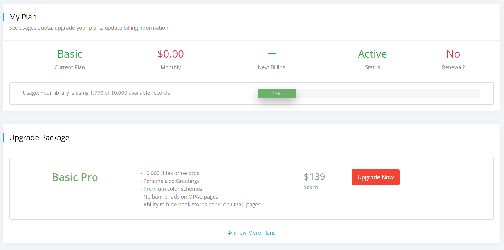

* Click `Show More Plans` to see every plan.
* Pick a plan and click `Pay with FastSpring`, then finish the checkout. Payments are handled by FastSpring.
* FastSpring renewals activate your plan automatically once the payment is confirmed. For a **new FastSpring subscription**, Librarika emails an activation code to your billing email: click `Apply Activation Code` on the `My Plan` page and enter it.
* Your library then moves to the plan you chose.

Plans renew automatically each year until you cancel (see [Cancel subscription](#cancel-subscription)).

### What each plan includes

The **Free** plan holds up to 2,000 titles or copies. The plans are Free, Basic Pro, Silver, Gold, Platinum, Diamond, Enterprise and Unlimited. This table is the one list of which plan includes what; the feature pages link here.

| Feature | Plans that include it |
|---|---|
| [Fees & payments](fees-payments.md) | Basic Pro, Silver, Gold, Platinum, Unlimited |
| [Hold queue](hold-queue.md) | Basic Pro, Silver, Gold, Platinum, Unlimited |
| [Barcode queue](barcode-labels.md#add-to-barcode-queue) of 500 labels (100 on other plans) | Basic Pro, Silver, Gold, Platinum, Unlimited |
| [Batch update](batch-update.md) | Basic Pro, Silver, Gold, Platinum, Unlimited |
| Premium colour schemes; turning off `Enable member access request.` and `Send review item reminder.`; `Notify librarians on checkout.` | Basic Pro, Silver, Gold, Platinum, Unlimited |
| [Sign-in security settings](library-sign-in-security.md) | Gold, Platinum, Diamond, Enterprise, Unlimited |
| [Branch access for users](users.md) | Gold, Platinum, Unlimited |
| [Single sign-on (SSO)](sso-saml.md), activated by [Librarika support](https://librarika.com/spages/contact) | Silver and higher |
| [SSO only](sso-saml.md#sso-only) | Gold and higher |
| [SIP2 terminals](sip2.md) | Each terminal needs its own licence: ask [Librarika support](https://librarika.com/spages/contact) |

The `My Plan` page shows the current list of plans and prices.

---

### Change or update payment / billing information

On a paid plan, the payment method is charged automatically when the annual subscription expires. You may want to change / update payment information so that next renewal takes place without any service disruption.

You can change the payment information anytime. Please follow the below steps:

* Go to `Manage` > `My Plan`.
* Then in the **Billing Information** section click `Update Payment Method` next to the payment type.

	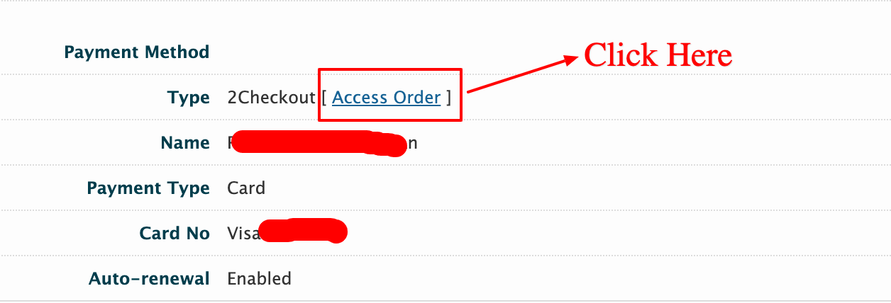

* Payments are handled by FastSpring. Click `Access My Account`, enter your billing email, and use the one-time link FastSpring emails you to sign in and update your payment method.
* Older subscriptions paid another way are renewed through FastSpring from the same page.
* When your current subscription expires, the system will automatically charge the credit card listed in your order profile and then generate an invoice.

## Cancel subscription

* Go to `Manage` > `My Plan` and click `Cancel Plan`.
* This turns off auto-renewal. You keep full access until the end of the paid period; after that your library returns to the Free plan. For refunds, see the [Terms of Use](https://librarika.com/spages/terms-and-conditions-of-use).
* To cancel an e-book storage subscription, contact Librarika support.

---

## Delete library

You can remove your library anytime from the dashboard. You need the **Library Administrator** role to delete your library. When you delete a library, its information, catalog, checkouts, members and other library records are removed.

The Librarika accounts of your staff and members are not deleted: they belong to each person, not to the library, and one account can be used in several libraries. Your own Librarika account is deleted too only if you also tick `Remove my account`.

Note: If you are on a paid plan or have an e-book storage subscription, please let us know so that we can discontinue your subscription before you delete your library.

**Steps to delete a library**:

* Go to the **Library Information** section from the dashboard.

	

* Click on the `Remove Library` Tab.
	
	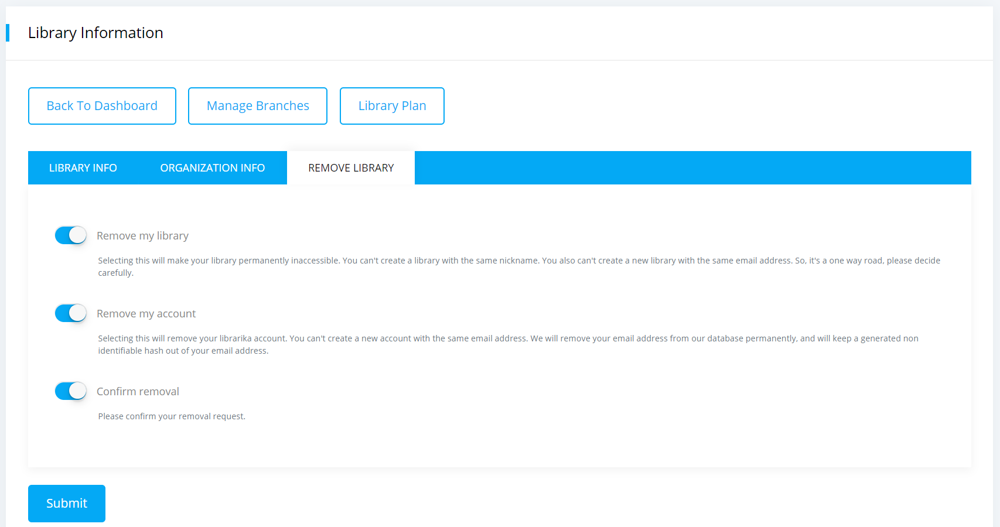

* Tick `Remove my library`. Tick `Remove my account` only if you also want to close your own Librarika account for good (you can't create a new account with the same email address afterwards).
* Also check the `Confirm removal` option to confirm your removal request.
* Once you click on the `Submit` button your library will be deleted.

---

## FAQ

**How do I make our catalog visible to members only?**

Tick **Private** in the `Library Info` tab and click `Submit`. Visitors who are not signed in then see a "This OPAC is private!" page, while signed-in members and staff can still use the catalog.

**Why won't my logo upload?**

The logo must be a PNG, JPG or GIF image at least 200x200 pixels and no larger than 800x800 pixels. Larger images are resized to 200x200, so a square image looks best.

**What do Booking Time and Booking Quota mean?**

`Booking Time` is the default loan length in days, which sets the default Return Date in the circulation form. `Booking Quota` is the total number of items a member can have requested, reserved and checked out at the same time; a quota set on a single member's record replaces it for that member (see [Booking Quota](members.md#booking-quota)).

**How many staff can receive notifications?**

Up to five. Pick them in the `Notified Librarians` list on the `Notifications / Reminders` tab.

**Why do reminder emails arrive earlier or later than I expected?**

Reminder times are calculated in UTC, not in your local time zone. Adjust the hours in the `Notifications / Reminders` tab to allow for the difference.

**Can I use the premium colour schemes on the Free plan?**

No. Premium colour schemes in the `Appearance` tab are available only on the plans listed in [What each plan includes](#what-each-plan-includes); on other plans, saving one shows *"Sorry, premium colour schemes are available for paid plans only."* and the change is not saved. See [Upgrade your plan](#upgrade-your-plan).

**Why can't I delete a branch?**

A branch that still has catalog copies assigned to it cannot be deleted. Move those copies to another branch (or delete them) first, then delete the branch.

**Can I undo deleting my library?**

No. Removing a library is permanent, and you cannot create a new library with the same nickname or email address afterwards. The Librarika accounts of your members and staff stay active, because they belong to each person, not to your library.

**How do I stop our email address or phone number showing on the Ask a Librarian page?**

Go to Preferences, open the `Options` tab and switch on `Keep email private` or `Keep phone number private`. Then choose who can still see it (Hide To All, Show To Members Only or Show To Logged-in Users Only) and click `Save Preferences`.

**Who can open an item's online link (URL)?**

That depends on the `Ebook URL Visibility` setting in Preferences, which you can change for a single item with `URL Visibility` on its edit form. Public shows the link to everyone, Member to logged-in members, Borrower Always to members who have ever borrowed that item, Active Borrower only while the member has it checked out, and Hide To All to no one. The setting notes that this control works only with paid plans.

For sign-in questions (requiring two-step verification, "Not enforced yet", asking everyone for a new password), see [Library sign-in security](library-sign-in-security.md).
