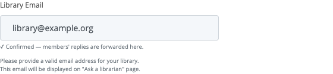
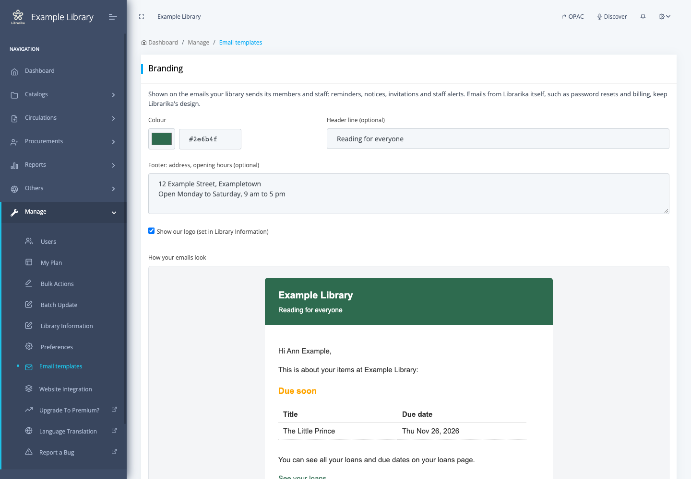
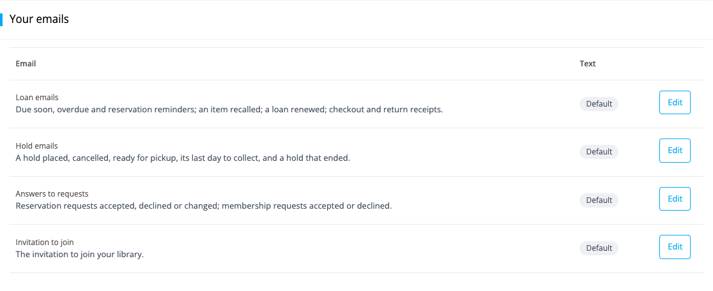
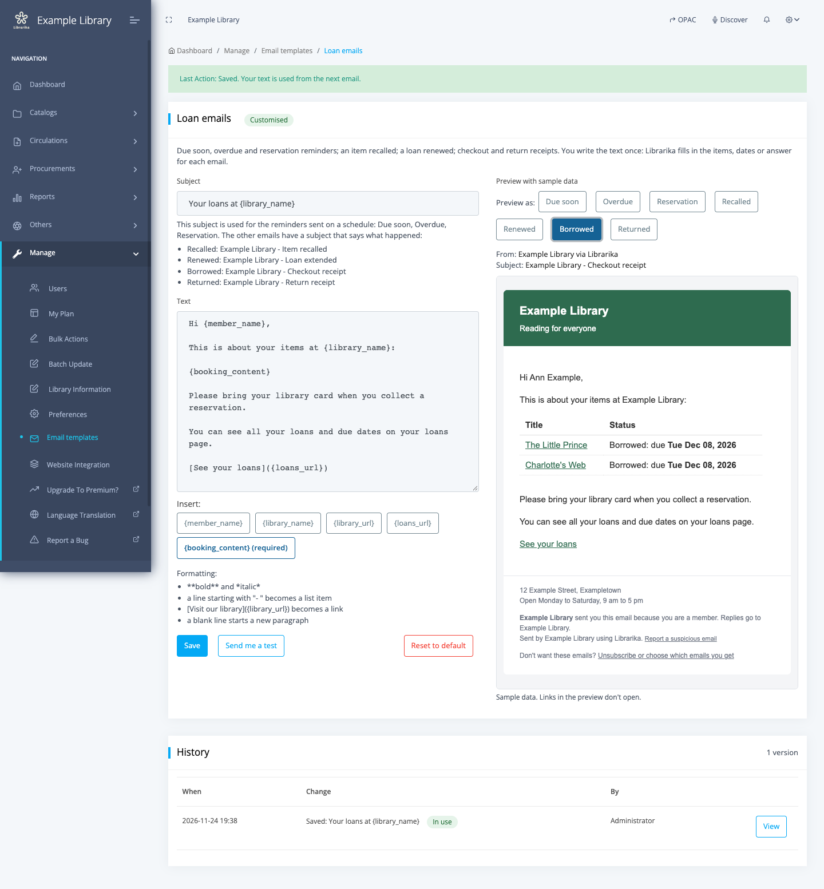
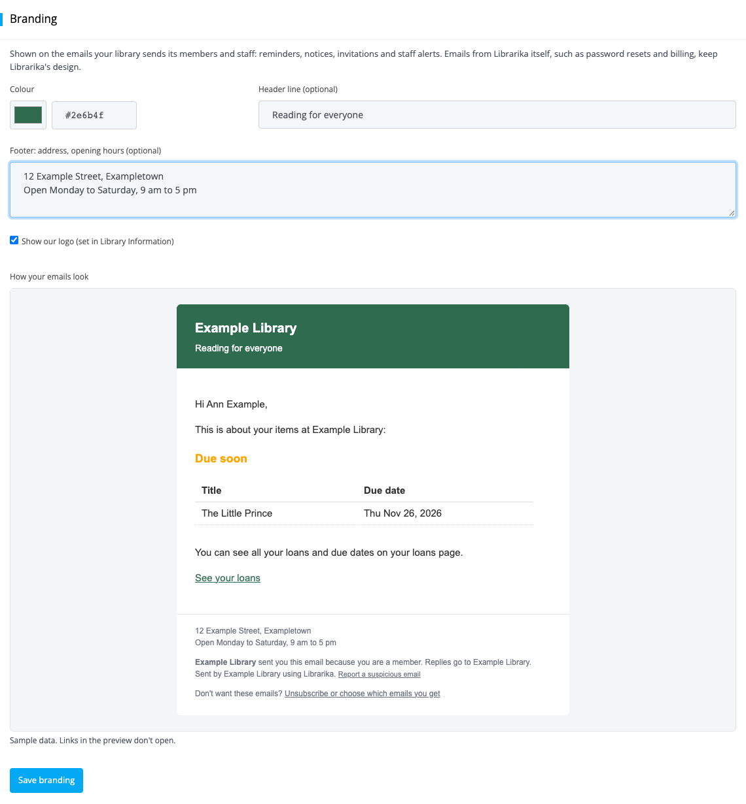
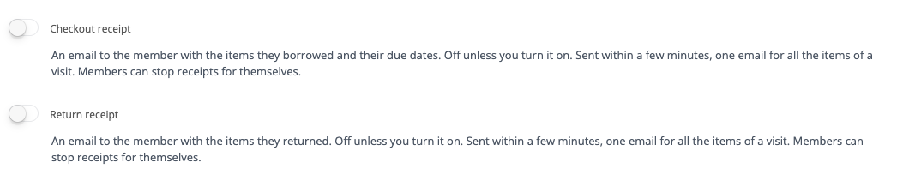
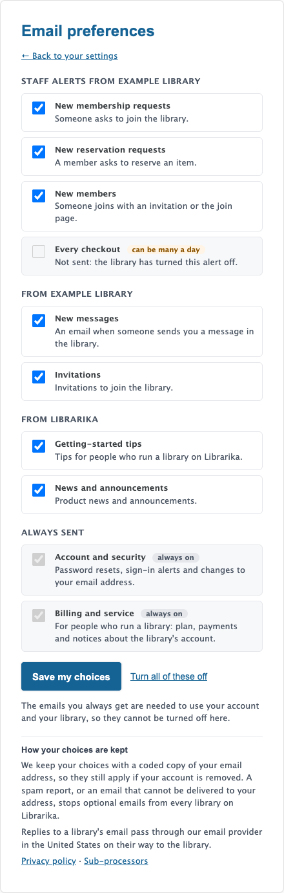
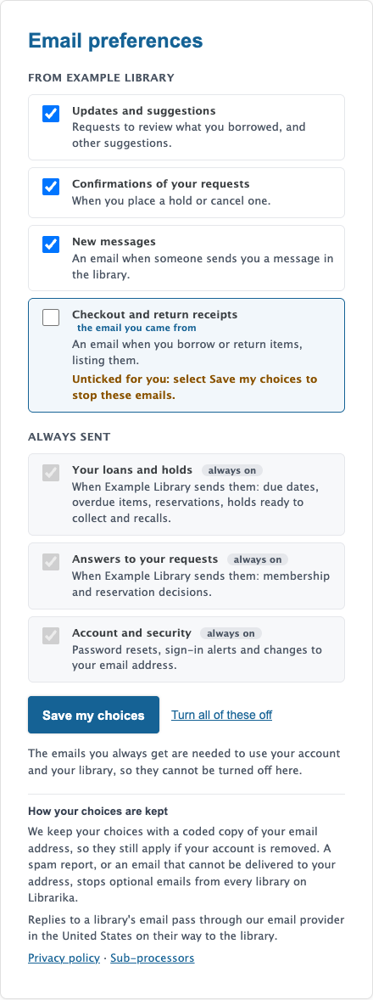

# Library emails

**Who this is for:** library admins and staff. Members: see [Your email choices](#your-email-choices-members).

**What you can do here:** make sure members' replies reach you, write the emails members get in your library's own words and look, turn on checkout and return receipts, choose which staff alerts you get, and find out why someone isn't getting emails.

Librarika sends your library's emails to members for you: reminders, notices about holds and requests, invitations and receipts. They are sent in your library's name ("Example Library via Librarika") from a Librarika address. Members can reply to them, and members choose which optional emails they get.

---

## Confirm your library's email address

Members' replies to your library's emails are forwarded to your library's email address, but only to a **confirmed** address. This keeps replies out of a mistyped inbox or the inbox of someone who has left.

**Until 25 December 2026** replies are also forwarded to an address that isn't confirmed yet. After that date they are forwarded only to a confirmed address, so confirm yours now.

If your library's email address is the library owner's own sign-in email, and the owner has verified it, it is already confirmed.

To confirm the address:

* Go to `Manage` > `Library Information`. The `Library Info` tab is shown.
* Under **Library Email** you see whether the address is confirmed:
	* **✓ Confirmed — members' replies are forwarded here.** Nothing to do.
	* **⚠ Not confirmed** — click `Send confirmation link`.

	

* Open the email Librarika sends to that address. Its subject asks whether it is the right email address.
* Click **Yes, this is (your library)'s address**, then click the same button on the page that opens. You don't need to sign in. The page says *"Confirmed. Members' replies to your library's emails are forwarded to this address."*

The link works for 7 days and only for the address it was sent to. Librarika sends at most 3 links an hour for one library, and at most 3 a day to one address.

**When you change the address:** after you save a new address under **Library Email**, Librarika sends a confirmation link to the new address and tells the previous address (and the library owner) about the change. Until the new address is confirmed, replies are forwarded only while the date above has not passed.

**When a member replies before the address is confirmed:** Librarika emails a confirmation link to your library's address, at most once a day.

---

## Members' replies

When a member presses Reply on a reminder, a notice, a receipt or an invitation from your library, the reply goes to Librarika and is forwarded to your library's email address (see [Confirm your library's email address](#confirm-your-librarys-email-address)).

* The forwarded email comes from **"(member's name) via Librarika (member reply)"**, or their email address when no name is given. Press Reply and you are writing to the member directly.
* A yellow banner at the top names the member's email address and says that Librarika forwarded the reply but did not write it.
* Only the text of the reply is forwarded. Formatting, images and attachments are not. A very long reply is cut short, with a note saying so.
* Replies that look like spam, or that can't be checked as really coming from the sender's address, are not forwarded.
* Limits: up to 200 replies a day are forwarded to one library, and up to 20 a day from one sender.

When a reply can't be forwarded because your address isn't confirmed (after 25 December 2026) or your library has reached its daily limit, the member gets a short email saying the reply didn't reach the library, at most once a day.

Staff alerts and "new message" emails can't be replied to. When replies to your library's emails can't be forwarded, the bottom of each email says *"Replies to this email aren't read."*

---

## Email templates

**Plans:** changing the wording and branding of your emails is part of the **Silver plan and above** (see [What each plan includes](libraries.md#what-each-plan-includes)). On the Free (Basic) and Basic Pro plans you can open every email and its preview, and the emails go out with Librarika's default text and look.

**Who:** library administrators. Go to `Manage` > `Email templates`.

### The four emails

You write each one once; Librarika fills in the items, dates or answer for each member.

| Email | What it covers |
|---|---|
| **Loan emails** | Due soon, overdue and reservation reminders; an item recalled; a loan renewed; checkout and return receipts. |
| **Hold emails** | A hold placed, cancelled, ready for pickup, its last day to collect, and a hold that ended. |
| **Answers to requests** | Reservation requests accepted, declined or changed; membership requests accepted or declined. |
| **Invitation to join** | The invitation to join your library. |

The **Text** column shows `Default` (Librarika's text) or `Customised` (your text).

Account, sign-in, security and billing emails come from Librarika itself and can't be changed.

### Edit an email

* Click `Edit` next to the email. Each email starts with ready-made default text you can keep or change.
* **Subject:**
	* Loan emails and Hold emails: your subject is used for the reminders sent on a schedule. The other emails have a subject that says what happened, for example *"Example Library - Checkout receipt"*. The page lists them.
	* Answers to requests: each email has a subject that says what the answer is about. You can't change it.
	* Invitation to join: your subject is used.
* **Text:** type your text. Click a placeholder under **Insert:** to add it at the cursor.
* **Formatting:** `**bold**` and `*italic*`; a line starting with `- ` becomes a list item; `[Visit our library]({library_url})` becomes a link; a blank line starts a new paragraph.
* **Preview with sample data** shows the whole email as you type. Use **Preview as:** to see each kind of email, for example `Due soon`, `Borrowed` or `Returned`. Links in the preview don't open.
* Click `Save`. You see *"Saved. Your text is used from the next email."*

**Placeholders**

| Placeholder | Filled with | In |
|---|---|---|
| `{member_name}` | The member's name | Loan, Hold, Answers |
| `{name}` | The invited person's name | Invitation |
| `{library_name}` | Your library's name | All four |
| `{library_url}` | Your library's website on Librarika | All four |
| `{loans_url}` | The member's loans page | Loan emails |
| `{holds_url}` | The member's holds page | Hold emails |
| `{booking_content}` | **Required:** the member's items and dates | Loan emails |
| `{hold_content}` | **Required:** the member's holds | Hold emails |
| `{decision}` | **Required:** the answer to the request | Answers |
| `{link}` | **Required:** the link to join | Invitation |

**What the text can't contain** (the page tells you when you save):

* more than 200 characters in the subject or 5,000 in the text;
* a required placeholder removed, or a placeholder from another email;
* links to sites other than your library's site on Librarika or Librarika itself;
* web or email addresses written out, other than your library's site, Librarika, your library's website and your library's own email address (email apps turn them into links);
* an unsubscribe link: Librarika adds one to every email that needs it.

### Send yourself a test

* Save your changes first. The test email sends the **saved** text, with sample data, of the kind shown in the preview.
* Click `Send me a test`. It goes to your own sign-in email address, which must be verified.
* A library can send up to 10 test emails an hour.

### Versions and reset

* Every save is kept under **History**, with when and by whom. The version in use is marked `In use`.
* To go back to an earlier version, click `View` next to it, then `Restore`. The text goes back into the editor; click `Save` to send it from now on.
* To use the default text again, click `Reset to default` and confirm. Your text stays in the history.

If your library moves to a plan below Silver, the default text and look are sent. Your saved text and branding are kept and used again on the Silver plan and above.

### Branding

On the same page, under **Branding**, set how your library's emails look:

* **Colour** -- the colour of the band at the top, as a code like `#156295`. The page warns you if text on that colour may be hard to read.
* **Header line (optional)** -- a line under your library's name, such as your motto. Up to 200 characters.
* **Footer: address, opening hours (optional)** -- shown at the bottom of each email. Up to 500 characters.
* **Show our logo (set in Library Information)** -- your library's logo next to its name.

**How your emails look** shows a sample as you type. Click `Save branding`.

Branding is shown on the emails your library sends its members and staff: reminders, notices, invitations and staff alerts. Emails from Librarika itself, such as password resets and billing, keep Librarika's design. The header and footer follow the same address rules as the text.

---

## Checkout and return receipts

Members can get an email listing what they borrowed, with due dates, or what they returned.

* Go to `Manage` > `Preferences` and open the `Notifications / Reminders` tab.
* Under **More emails to members**, switch on `Checkout receipt`, `Return receipt` or both. Both are off until you turn them on.
* Click `Save Preferences`.

How receipts work:

* Items from the same visit are listed in one email, usually sent within a few minutes.
* A member gets at most 10 receipt emails a day. A receipt that can't be sent within a day is not sent later.
* Receipts use the **Loan emails** text (see [Email templates](#email-templates)).
* When `Send review item reminder.` is on, the return receipt can include a **Write a review** link next to each item instead of a separate review email.
* Members can stop receipts for themselves (see [Your email choices](#your-email-choices-members)).

---

## Other email switches for your library

On the `Notifications / Reminders` tab of **Preferences** (see [Change preferences](libraries.md#change-preferences)):

* **Library emails and reminders** -- due-date, overdue and reservation reminders, and the review request.
* **More emails to members** -- switch off single notices, such as `Hold placed`, `Reservation declined` or `Item recalled`. Turning one off stops only the email; it still shows in the app.
* **Staff alerts** -- `New reservation requests`, `Every checkout`, `New membership requests` and `New members`, and **Who gets staff alerts** (up to five staff).

### Your own staff alerts

Staff alerts go to the staff chosen in **Who gets staff alerts**. Each of them can turn alerts off for themselves:

* On the `Notifications / Reminders` tab, under **Your staff alerts**: `Email me staff alerts from this library`. This changes only your own setting.
* Or open your settings (name menu at the top right > `Settings`), the `Emails` tab, and click `Manage email settings` to choose each kind of alert, new message emails, invitations, and Librarika's getting-started tips and news.

---

## Your email choices (members)

Every optional email from a library ends with *"Don't want these emails? Unsubscribe or choose which emails you get."* The link opens your **Email preferences** for that library. You don't need to sign in.

You can also open them from the library: `My Account` > `Account Settings`, section **Emails**, `Manage email settings`.

**You can choose** (for that library):

* **Updates and suggestions** -- requests to review what you borrowed, and other suggestions.
* **Confirmations of your requests** -- when you place a hold or cancel one.
* **New messages** -- an email when someone sends you a message in the library.
* **Checkout and return receipts** -- shown when the library sends receipts.

Tick or untick, then click `Save my choices`. *"Saved. Your choices apply from the next email."* `Turn all of these off` unticks everything on the page. When you open the page from an email's link, that kind of email is shown unticked: click `Save my choices` to stop it.

**Always sent** (can't be turned off here, because you need them to use your account and your library):

* **Your loans and holds** -- due dates, overdue items, reservations, holds ready to collect and recalls, when the library sends them.
* **Answers to your requests** -- membership and reservation decisions.
* **Account and security** -- password resets, sign-in alerts and changes to your email address.
* **Billing and service** -- for people who run a library: plan, payments and notices about the library's account.

Your choices are kept with a coded copy of your email address, not the address itself. See the [Privacy Policy](https://librarika.com/spages/privacy-policy).

---

## Bounces and spam reports

* **An address that no longer works:** when an email to an address can't be delivered because the address doesn't exist, Librarika stops sending library emails to it, from every library, including loan and hold notices.
* **An email marked as spam:** when someone marks a library's email as spam, Librarika stops sending them optional emails from every library, and stops that library's notices to them.

This protects delivery for everyone else. Only Librarika support can undo it: the member's **Email preferences** page then says why the emails stopped and asks them to contact Librarika.

To help a member, [contact Librarika support](https://librarika.com/spages/contact) with the member's email address. Support can see whether emails to it were stopped, and why.

---

## FAQ

**A member says they get no emails. What can I check?**

1. Check the email address on the member's record for typos. If they sign in to Librarika, also check their account's email address; members change it themselves in `Account Settings`.
2. Ask them to look in their spam or junk folder and to add your library's address to their contacts.
3. Loan and hold reminders are sent only when they are switched on in **Preferences** > `Notifications / Reminders`.
4. If they stopped some emails, they can turn them back on with the link at the bottom of any email from your library, or in `Account Settings` > **Emails**.
5. If the address no longer worked or they marked an email as spam, [contact Librarika support](https://librarika.com/spages/contact) with the address (see [Bounces and spam reports](#bounces-and-spam-reports)).

**I don't see Email templates in the Manage menu.**

Only library administrators see it. Other staff who open the page see *"Only library administrators can change the library's emails."* Ask an administrator of your library.

**I can see the emails but can't change them.**

Changing the wording and branding is part of the Silver plan and above. On the Free (Basic) and Basic Pro plans the page shows `View` instead of `Edit`. See [Upgrade your plan](libraries.md#upgrade-your-plan).

**Members' replies aren't reaching me.**

Check that your library's address is confirmed (`Manage` > `Library Information`, **Library Email**) and send a new confirmation link if not. After 25 December 2026, replies are forwarded only to a confirmed address. Also check your spam folder. If your library's address itself stopped receiving Librarika's emails (it bounced or marked them as spam), replies are not forwarded: contact Librarika support.

**I didn't get the confirmation link.**

Check your spam folder. Librarika sends at most 3 links an hour for one library and 3 a day to one address, so wait before you click `Send confirmation link` again. The link works for 7 days.

**Can I change the account, password or billing emails?**

No. Account, sign-in, security and billing emails come from Librarika and always keep Librarika's text and design.

**Why can't I put a link to our website in an email?**

Links can go only to your library's site on Librarika or to Librarika. You can write your website's address as text, and it can appear in the footer.

**My test email didn't arrive.**

The test goes to your own sign-in address, which must be verified, and sends the saved text. A library can send up to 10 test emails an hour. Check your spam folder.

**Do receipts replace the review email?**

When return receipts and `Send review item reminder.` are both on, the return receipt can carry the **Write a review** link instead of a separate review email.

**Can a member stop due-date and overdue reminders?**

No. Loan and hold notices and answers to requests are sent while your library has them switched on; members can stop only optional emails, such as receipts and review requests. They stop only when the address no longer works or the member marks your email as spam (see [Bounces and spam reports](#bounces-and-spam-reports)).
