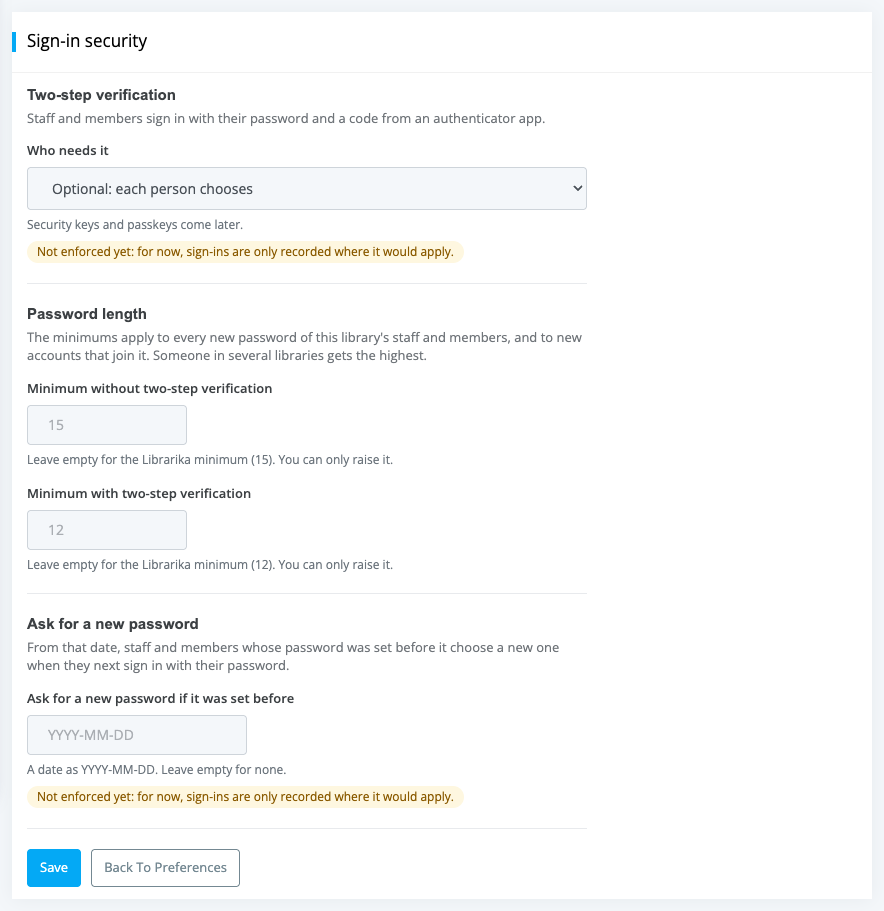

# Library sign-in security

**Who this is for:** library admins.

**What you can do here:** decide how staff and members of your library sign in: require two-step verification, set minimum password lengths, and ask everyone for a new password.

## Open the sign-in security page

Library admins can set how staff and members of their library sign in. In the sidebar, go to `Manage` > `Preferences` and click `Sign-in security`.

Only Library Administrators see this page. If there is no `Sign-in security` button on Preferences, the feature isn't available for your library yet.

The page has three sections, **Two-step verification**, **Password length** and **Ask for a new password**, and a `Save` button. `Back To Preferences` returns to the Preferences page.

## Which plans can change these settings

You can change these settings on the **Gold**, **Platinum**, **Diamond**, **Enterprise** and **Unlimited** plans (see [What each plan includes](libraries.md#what-each-plan-includes)).

On other plans (Free, Basic Pro and Silver) the page is shown but locked:

* it says **Available on the Gold, Platinum, Diamond, Enterprise and Unlimited plans.** and *"Your library uses Librarika's sign-in protection: passwords of at least 15 characters, and two-step verification for anyone who turns it on."*;
* the fields and `Save` are greyed out, and the date field says *Set by Librarika support*;
* `Compare plans` opens the upgrade page, and `Contact support` is for asking everyone to choose a new password (see [Ask for a new password](#ask-for-a-new-password)).

On any plan, people can turn on [two-step verification](two-step-verification.md) for themselves in their settings.

## Two-step verification

* **Who needs it** -- choose one:
	* `Optional: each person chooses` -- the default. Everyone can turn on [two-step verification](two-step-verification.md) for themselves.
	* `Required for staff` -- everyone with a role in your library (*Library Administrator*, *Library Staff* and *Library Assistant*) must use it.
	* `Required for staff and members` -- everyone, including members who can sign in.
	* The note *"Security keys and passkeys come later."* means that for now two-step verification uses an authenticator app only.
* **Also ask for the two-step code after signing in with Google, Apple or the library's SSO** -- by default, people who sign in with Google, Apple or SSO aren't asked for the code, because those services usually have their own two-step check. Tick this to ask for the code anyway. It only applies to people who have turned two-step verification on. This option is shown only when it is available for your library. If it shows *"Librarika already asks for it on every library."*, Librarika already asks everyone with two-step verification for the code after these sign-ins, whatever you tick here. Like the requirement, this follows the person: someone who belongs to several libraries is asked for the code after these sign-ins if any of their libraries ticks it.

When a requirement is on, a person who needs it and hasn't set it up is asked to set it up the next time they sign in with their password. They can't turn it off while it is required.

The requirement follows the person: if someone belongs to several libraries and any one of them requires two-step verification, they need it for their whole account.

Self-checkout kiosks that sign in with a licensed terminal account aren't affected. See [Get a terminal licence and account](kiosk-app.md#get-a-terminal-licence-and-account).

## Password length

* **Minimum without two-step verification** and **Minimum with two-step verification** -- leave them empty to use Librarika's minimums (15 and 12 characters). You can only **raise** them, up to Librarika's maximum password length. Any other number is refused with *"The minimum password length can only be raised: use a number from … to …"* (the message shows the allowed range).
* The minimums apply to new passwords of your library's staff and members, and to new accounts that join your library. Existing passwords keep working until they are changed.
* Someone who belongs to several libraries gets the **highest** minimum of all their libraries.

## Ask for a new password

* **Ask for a new password if it was set before** -- enter a date as `YYYY-MM-DD`. From that date on, staff and members whose password was set before it [choose a new one](passwords.md#choose-a-new-password) the next time they sign in with their password. A future date gives people time to change it themselves first. Leave it empty for none.
* Use it, for example, if you think passwords may have leaked.
* Self-checkout kiosks that sign in with a licensed terminal account aren't affected. See [Get a terminal licence and account](kiosk-app.md#get-a-terminal-licence-and-account).
* **On any plan**, [Librarika support](https://librarika.com/spages/contact) can set this date for your library. If your plan can't change these settings and you need everyone to choose new passwords, ask support. On those plans the date is the only setting that takes effect.

Click `Save` when you are done. You see *"The security settings have been saved."*

## "Not enforced yet"

A setting may show **Not enforced yet: for now, sign-ins are only recorded where it would apply.** This means Librarika is still rolling out the feature. You can save the setting now. Until it is enforced, nobody is stopped from signing in; Librarika only records the sign-ins where it would apply. Once it is enforced, the note disappears and the setting takes effect.

## Good practice for your library

* **Require two-step verification for staff.** Staff accounts can change your catalog, members and settings, so they need the most protection.
* **Before requiring it for everyone, tell your members.** Explain that they will need an authenticator app on their phone and should save their recovery codes. Point them to the [quick guide for members](sign-in-and-security.md#quick-guide-for-members).
* **Members who use the mobile app:** if the app asks them to update after they turn on two-step verification, they can use your library's website until they do (see [Troubleshooting the app](app-troubleshooting.md)).
