# Member area

**Who this is for:** library members who sign in to their library.

**What you can do here:** see and renew your loans, see your reservations, holds and history, write reviews, and change your settings.

The Member Area (`My Account`) is your own page in the library: loans, holds, history, reviews and settings.

## My bookings

My bookings section will list all of your currently active bookings along with their due date and status.

To view your active bookings, please follow the below steps:

* Sign in to your library.
* Click on `My Account` menu from the top.

	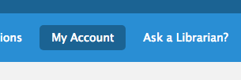

* List of all active bookings will appear as shown below.

	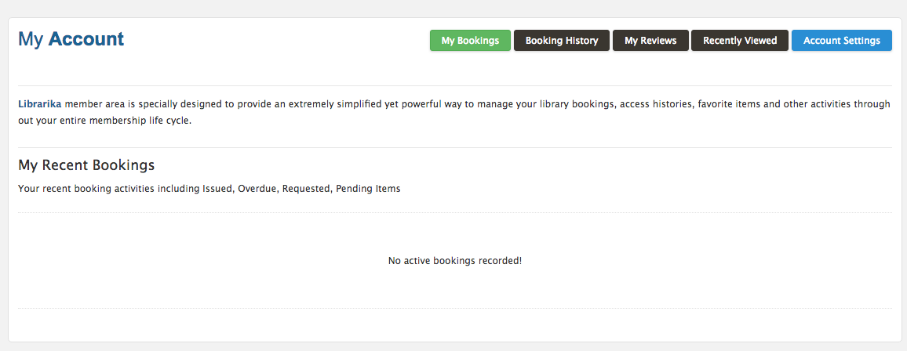

* You can now take relevant actions based on the status of each booking.

## Renew your loans

If your library allows renewals for your membership, you can give a loan more time yourself.

* Click `My Account`. Your loans are listed under **My Recent Bookings**.
* Click `Renew` under the loan. You see a message such as *"Items renewed: 1."* and the new due date.
* To renew everything that can be renewed, click `Renew all` (shown when more than one loan can be renewed).
* After a renewal the loan shows **Renewed: 1 of 2**: how many times it has been renewed, out of the most your library allows.

A greyed-out `Renew` means the loan can't be renewed now, and the reason is shown under it, for example *"Another member is waiting for this item."*, *"This item has been renewed the maximum number of times."* or *"This item can be renewed from …"*. A loan is renewed only if you could borrow the item again today, so unpaid fees, your borrowing limit or another member's hold can stop it. Overdue items can be renewed only if your library allows it; the late fee up to that day is then added to your account. Otherwise, please return them.

No `Renew` button and no reason under the loan? Your library has not turned on renewals, or not for your membership. Ask at the desk.

If you can renew online, your due-date reminder emails also say so, with a link to `My Account`.

## Booking history

Your past loans and reservations, newest first.

To view your history of bookings, please follow the below steps:

* Sign in first. 
* Click on `My Account` menu from the top.

    

* My account page will appear with the button named `Booking History` as shown below.

    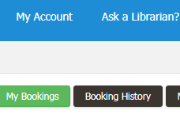

 * Click on it and all your recent booking history will be appeared.

    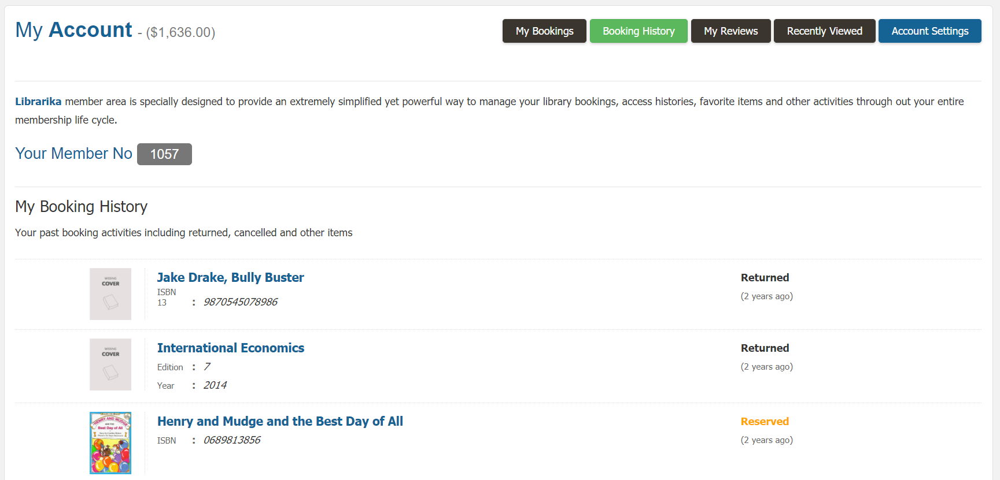

* Now you can view all the history of your actions time to time.
  
## My reviews

The reviews you have written.

If you want to see all the reviews then you have to follow the below steps:

* First, sign in to your library and go to my account menu like before.
* In `My Account` section you can see the button `My Reviews` like below.

    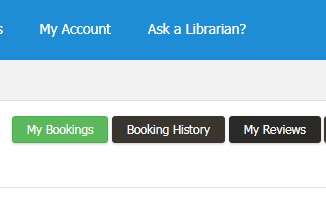

* If you click on it then you can see the review on your books like below.

    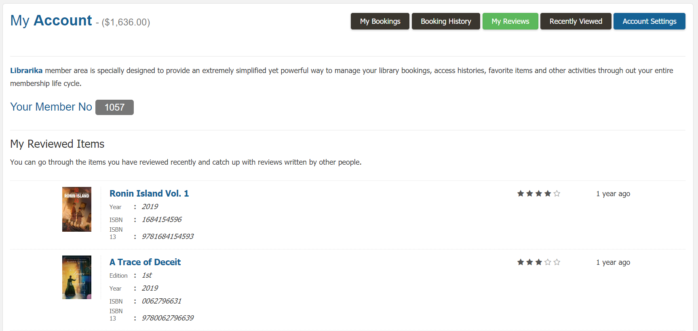

* Now you can view all those books that have been reviewed so far.
* You can also see the details of the books by clicking on its title and also view the reviews written by other people.

## Recently viewed

Recently viewed section will show you all those books that you have been viewed recently.

* Like before from `My Account` go to the `Recently Viewed` option.
* Click on it and you can see the books you have viewed recently like below.

    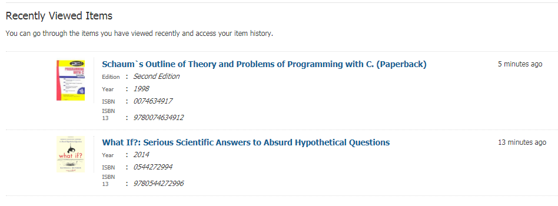

* When you view this page you can see the details of each book by clicking on its title. From there you can also give your review on that book.

## Account settings

Account settings is the section where you can update all the information of your library account.

* From `My Account` go to the account settings option. 
* Click on `Account Settings` button and you can see all the information of your account like below.

    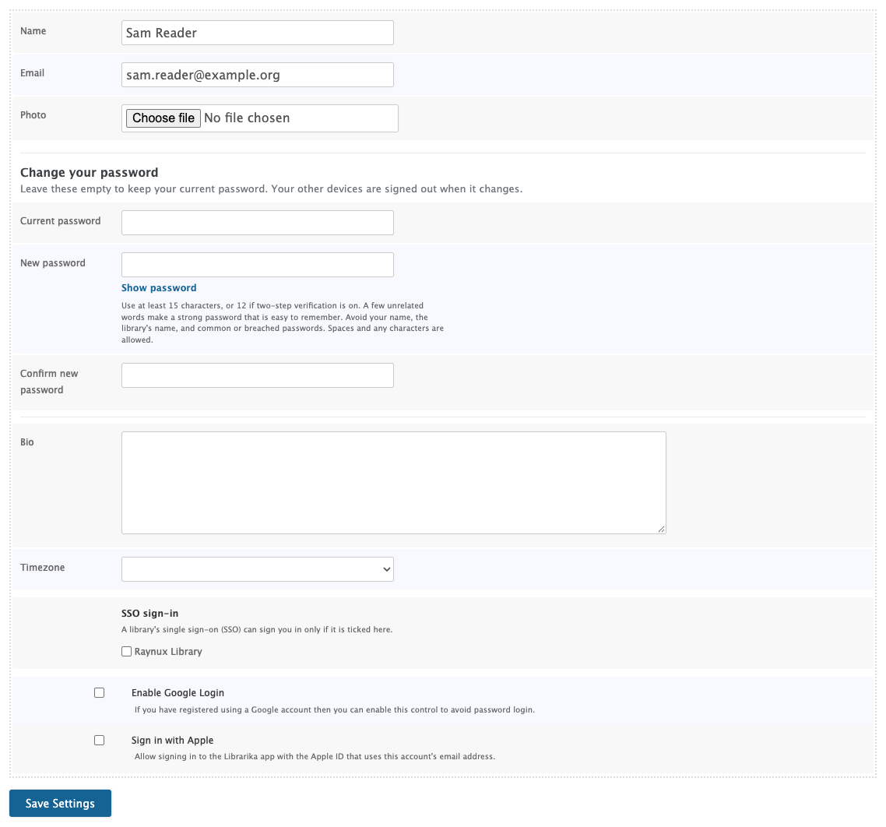

* Now you can update any information of your account.
* To change your password, under **Change your password** enter **Current password**, **New password** and **Confirm new password**. The new password needs at least 15 characters (12 with two-step verification); a strength meter under the field shows which rules are still to meet. See [Passwords](passwords.md).
* To keep your password, leave these fields empty.
* After updating all information you have to click on `Save Settings` button as shown below.
    
    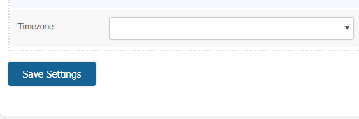

* Once you click the save settings button your given information will be saved.
* Now whenever you visit this page you can view your information or update your info.
* On the same page you can choose how you sign in (**SSO sign-in**, **Enable Google Login**, **Sign in with Apple**) and see your **Sign-in activity**: where your account is signed in, with a `Sign out` button for each browser or phone. See [Signing in](signing-in.md#your-sign-in-settings) and [Sign-in activity](sign-in-activity.md).
* Changing your password signs out your account everywhere else, including the mobile app, and you get an email about it.
* Under **Emails**, click `Manage email settings` to choose which optional emails you get from the library, such as receipts and review requests. Emails about your loans, holds and account are always sent. See [Your email choices](library-emails.md#your-email-choices-members).
* Under **Two-step verification** you can turn on a second step for signing in: a code from an authenticator app on your phone. Click `Turn on` (or `Manage` when it is on). See [Two-step verification](two-step-verification.md).
* Before you change your password or email, or remove your account, Librarika may ask you to [confirm it's you](signing-in.md#confirm-its-you).

## My holds

If your library has the hold queue feature enabled, you can place holds on items and manage your holds from the My Holds section. You can hold items that are checked out and, unless your library has turned it off, items that are on the shelf: the library takes the copy from the shelf, sets it aside for you and tells you when it is ready for pickup.

Members can place and manage their own holds from the catalog and their account area.

### Place hold from catalog

Members can place holds on items from the catalog detail page:

* Search for the item in the catalog.
* Click on the item title to view its details.
* A `Place Hold` button is displayed at the title level. If all copies are checked out, it says *"All copies are currently checked out"*. If a copy is on the shelf, it says *"A copy is on the shelf. Place a hold and we'll set it aside for you, or borrow it now."*

* Click the `Place Hold` button.
* A hold form will appear. If copy-level holds are enabled and multiple copies exist, you can select a specific copy.
* Add any notes if needed.
* Click `Submit` to place the hold.
* A success message will appear with your queue position.

Additionally, if copy-level holds are enabled, a `Place Hold` button appears next to each copy in the copies table that you can hold.

**Note:** The `Place Hold` button is only visible when:

* The hold queue feature is enabled for the library.
* You are signed in as a member.
* Your member type matches the allowed member type setting (All, Regular, or Privileged).
* The item is a circulating item.
* Title-level holds are enabled (for the title-level button).
* Your library allows holds on items on the shelf, or every copy (for the title-level button) or that copy (for copy-level buttons) is checked out.

If your library doesn't allow holds on items on the shelf and a copy is available, you see *"A copy is on the shelf. You can borrow it now."* instead.

### View my holds

To view your active holds:

* Click on `My Account` from the top menu.
* Click on `My Holds` to view your hold list.
* Each hold displays:
	* **Title** -- The item title.
	* **Hold Type** -- Title-level or Copy-level.
	* **Queue Position** -- Your position in the queue.
	* **Status** -- Current status with colour-coded badge:
		* **Blue (Waiting)** -- Waiting for a copy to become available.
		* **Green (Ready)** -- Item is ready for pickup.
		* **Yellow (Suspended)** -- Hold is temporarily paused.
	* **Pickup Deadline** -- Displayed for Ready holds, showing the date by which you must pick up the item.
	* **Where to collect** -- When your library has more than one branch, a Ready hold shows where to collect it (*"Ready for pickup at …"*).

**Note:** My Holds only shows your active holds (Waiting, Ready, and Suspended). Fulfilled, Expired, and Cancelled holds are not displayed here.

### Suspend, activate, and cancel holds

From the My Holds page, members can manage their holds:

**Suspend a Hold**

* Click the `Suspend` button next to a Waiting hold.
* Select the date until which you want to pause the hold.
* Click `Submit`.
* Your hold will be paused but your queue position will be maintained.

**Activate a Hold**

* Click the `Activate` button next to a Suspended hold.
* The hold will return to Waiting status and you can also activate it before the suspension date.

**Cancel a Hold**

* Click the `Cancel` button next to the hold.
* Confirm the cancellation.
* The hold will be cancelled and removed from the queue.

---

## Submit reservation request

Submit reservation request is the section where you can send a request for any books that you want to reserve.

To complete your reservation, please follow the below steps:

* First, sign in to your library.
* Click on `Search Catalog` from the main menu.
    
    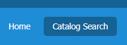

* On the `Search Catalog` page you can search any books that you want to reserve.
* Now search your needed book and it will appear as shown below.

    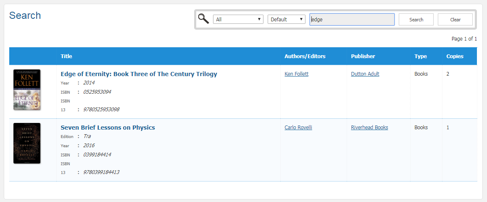

* If you click on the `Title` of the book then all of its detail will be shown up like below.

    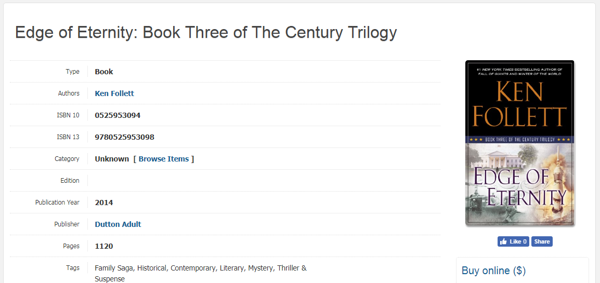

* In the book details page you can see the request button for each copy of the book.

    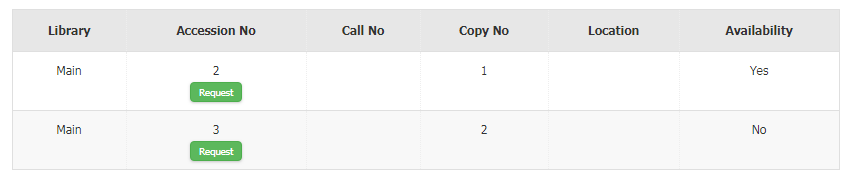

* If you click on the `Request` button then your reservation request form will appear.

    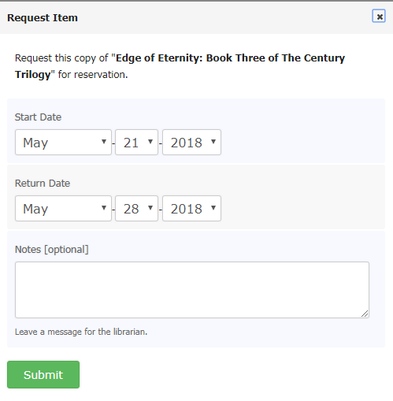 

* Now you can give your reservation date and also you can write a simple note about it, then click on `Submit` button.
* Once you submit this form your request will be placed successfully like below.

    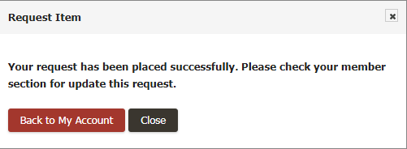 

* Now your request has been placed and if the library staff accept your request, then you will be notified and the item will be reserved for you.

## Cancel reservation request

Cancel reservation request is the section where you can cancel your reservation request that you have been placed earlier.

To cancel your reservation, please follow the below steps:

* At first go to the main menu.
* Click on `My Account` menu from the top.
* You can see the `Cancel` button in your recent bookings section.
    
    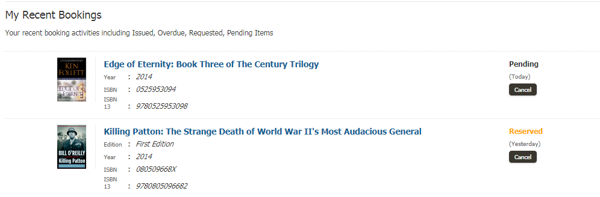 

* Click on `Cancel` button and you can see the cancel reservation form of your book like below.

    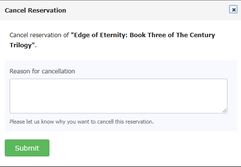

* Now you must have to show a reason why you want to cancel your reservation, otherwise you can not submit the form and an error message will be shown.

    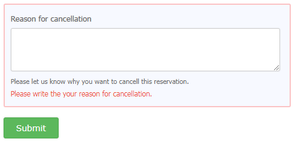

* After giving your reason you can submit your form.
* Once you click on `Submit` button your cancellation will be confirmed like below.

    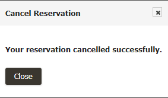

## Self-checkout and self-return

If your library has self-service enabled, members can check out and return items directly from the member area without staff involvement. Members can check out items from the catalog page and return items from the My Bookings section.

For detailed instructions on setting up self-checkout and self-return, see the [Self-service](self-service.md) page.

---

## FAQ

**Which password do I use to sign in?**

Your Librarika password, the one you created when you accepted the library's invitation. You can also use Google, Apple or your library's SSO. See [Ways to sign in](signing-in.md#ways-to-sign-in).

**I forgot my password. What should I do?**

Click `Forgot password?` on the **Log in** page and follow the email you receive. The link works once and expires after one hour. See [Forgot your password?](passwords.md#forgot-your-password).

**Should I turn on two-step verification?**

Yes, we recommend it. It protects your account even if someone learns your password. Your library may also require it. See [Two-step verification](two-step-verification.md).

**I lost my phone and can't enter my code. What do I do?**

Enter one of your recovery codes instead of the code. If you have no recovery codes, contact [Librarika support](https://librarika.com/spages/contact). Your library can't turn off two-step verification, but it can help you reach support. See [Lost your phone?](two-step-verification.md#lost-your-phone).

**How do I see where my account is signed in?**

Open `Account Settings` and scroll to **Sign-in activity**. See [Sign-in activity](sign-in-activity.md#sign-in-activity).

**I left my account signed in on a library computer. What can I do?**

Open **Sign-in activity** from another device and click `Sign out` next to that session, or `Sign out everywhere else`.

**Can the library see my sign-ins?**

The library's staff see only when you were last active in their library, not your history, devices or addresses.

**Why can't I renew a loan?**

The reason is shown under the greyed-out `Renew` button. Common reasons: another member is waiting for the item, the loan has been renewed the most times your library allows, it is too early to renew, or you owe more than your library allows. If there is no `Renew` button and no reason under the loan, your library hasn't turned on renewals for your membership. See [Renew your loans](#renew-your-loans).

**Can I hold a book that is on the shelf?**

Yes, unless your library has turned this off. Click `Place Hold` on the book's page. The library takes the copy from the shelf, sets it aside for you and tells you when it is ready for pickup. See [My holds](#my-holds).

**How do I stop some emails from my library?**

Click *"Unsubscribe or choose which emails you get"* at the bottom of the email, or open `Account Settings` > **Emails** > `Manage email settings`. Untick what you don't want and click `Save my choices`. Emails about your loans, holds, requests and account can't be turned off. See [Your email choices](library-emails.md#your-email-choices-members).

**Can I reply to an email from my library?**

Yes, when the email says *"Replies go to"* your library at the bottom: your reply is passed on to the library. If it says *"Replies to this email aren't read."*, contact the library another way.

**What is a kiosk PIN? Is it my password?**

Some libraries ask for a kiosk PIN after you scan your card at their self-service kiosks. It is a separate number, not your password: it is used only at the kiosks, with your card, and doesn't sign you in here or in the app. See [Enter your PIN](using-a-kiosk.md#enter-your-pin).

**I forgot my kiosk PIN. What should I do?**

Go to your library's PIN page (your library's address followed by `/pin`), type your card number and email address, and follow the emailed link to choose a new PIN. The link works once, for 30 minutes. Or ask at the desk. See [Set or reset your kiosk PIN](using-a-kiosk.md#set-or-reset-your-kiosk-pin).
