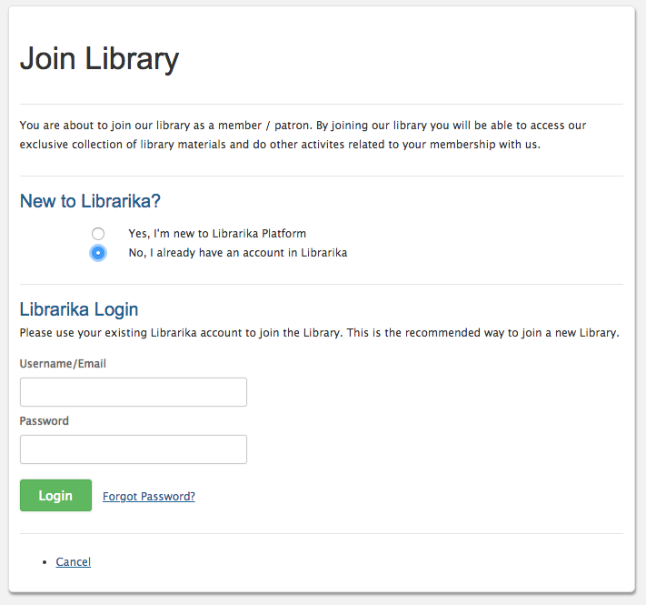
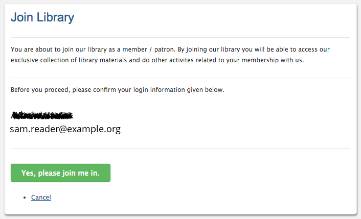

# Member quick start

**Who this is for:** people who borrow from a library that uses Librarika.

**What you can do here:** join your library from an invitation (or ask to join), sign in, and find your way around the Member Area.

---

## 1. Open your invitation

When a library adds you as a member with an email address and turns on member access, you get an invitation email. Click the link in it. It opens your library's **Join Library** page.

* The invitation works for **30 days**. If it has expired, you see *"This invitation has expired. Please ask the library to send it again."*
* If you are already signed in to Librarika with a different email address, sign out first, then open the link again.

## 2. Create your account, or sign in

Under **New to Librarika?** choose one:

* **`Yes, I'm new to Librarika Platform`**: enter your **Name**, **Email** and a **Password**, then click `I agree, please create my account`.
	* The password is a **new password for Librarika**, not your email password or your school's or organisation's password. It needs at least 15 characters; a few unrelated words work well. See [Passwords](passwords.md#what-makes-a-good-password).
	* Use the **email address the invitation was sent to**. If you use another address, Librarika sends a verification link to that address, and the invitation can be accepted only by an account with the invited address.
* **`No, I already have an account in Librarika`**: enter your **Username/Email** and **Password** and click `Login`. Forgot it? Click `Forgot Password?`.

After two wrong passwords, the page asks you to tick the captcha (*"Please confirm you're not a robot to keep trying."*) before you can try again.

If your library uses **SSO only**, the page shows a `Sign in with SSO` button instead: *"This library allows sign-in with its SSO only. Sign in with SSO to accept this invitation."* Sign in with your school's or organisation's login.

## 3. Confirm and join

Check that the account shown is yours, then click `Yes, please join me in.` You see *"Congratulations! You've sucessfully joined the library."*

**Good to know:** an account created from an invitation link is ready to use straight away, but its email address isn't confirmed yet. Invitations from **other** libraries appear under **My Invites** on librarika.com only once your email address is confirmed. Resetting your password with `Forgot password?` confirms it, because the reset link reaches your mailbox.

## 4. Sign in next time

Go to your library's website (for example `mylibrary.librarika.com`) and click `Login`. Enter your **Username** (your email) and password and click `Log in`, or use `Continue with Google`, `Continue with Apple` or your library's SSO (the key button). See [Signing in](signing-in.md).

## 5. Use the Member Area

Once signed in, click `My Account` to open the [Member Area](member-area.md): your loans and reservations, holds, history, reviews and settings. You can also:

* search the library's [online catalog (OPAC)](opacs.md);
* check items out and in yourself, if your library allows it: see [Self-service](self-service.md);
* use the [Librarika app](mobile-app.md) on your phone.

## 6. Optional: turn on two-step verification

Two-step verification protects your account even if someone learns your password. In your settings, find **Two-step verification** and click `Turn on`. You need an authenticator app on your phone. See [Two-step verification](two-step-verification.md). Your library may require it; if so, Librarika asks you to set it up when you sign in.

---

## No invitation? Ask to join

You can ask a library to let you join:

1. Sign in on [librarika.com](https://librarika.com). No account yet? Click `Create one` on the login page.
2. Open **My Libraries** from your name menu and click `Join a library`.
3. Under **Ask to join a library**, enter the **Library address** (for example `https://mylibrary.librarika.com`) and click `Send request`.

What happens next depends on the library:

* *"Your request to join has been sent. The library will review it and give you a member number."* The request shows under **Waiting for approval** until the library answers.
* *"You have joined the library. Its catalog is at …"* The library accepts requests automatically.
* *"This library does not take requests to join online. Please contact the library."*
* *"This library already has a member with your email address. Please ask your library for an invitation."*

The same **Join a library** window lists any **Invitations** for your email address, each with a `Join` button.
