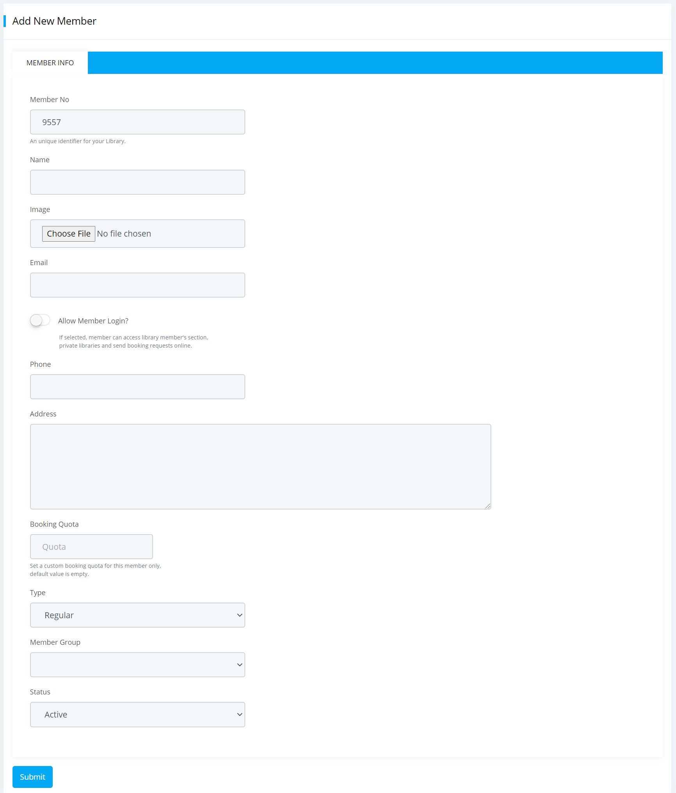
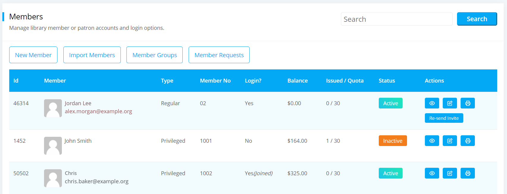
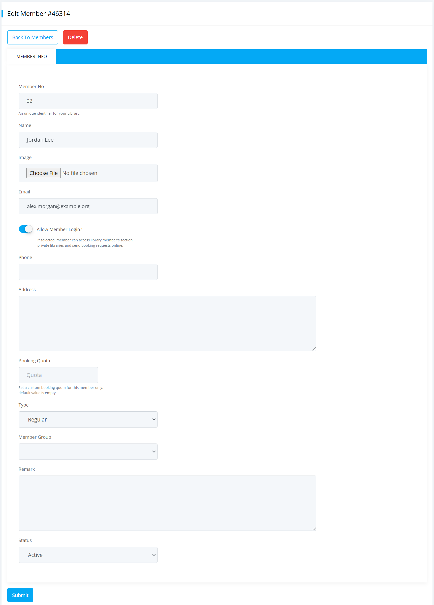
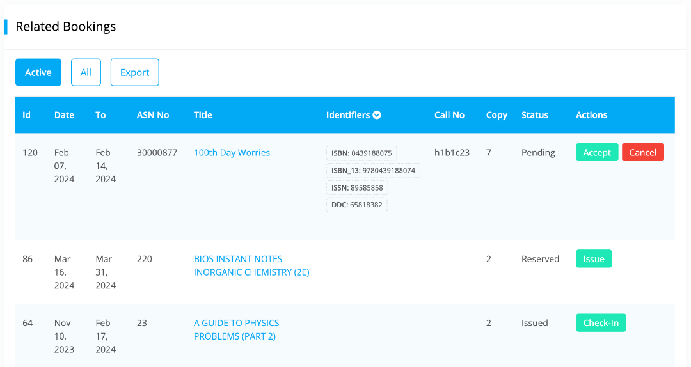
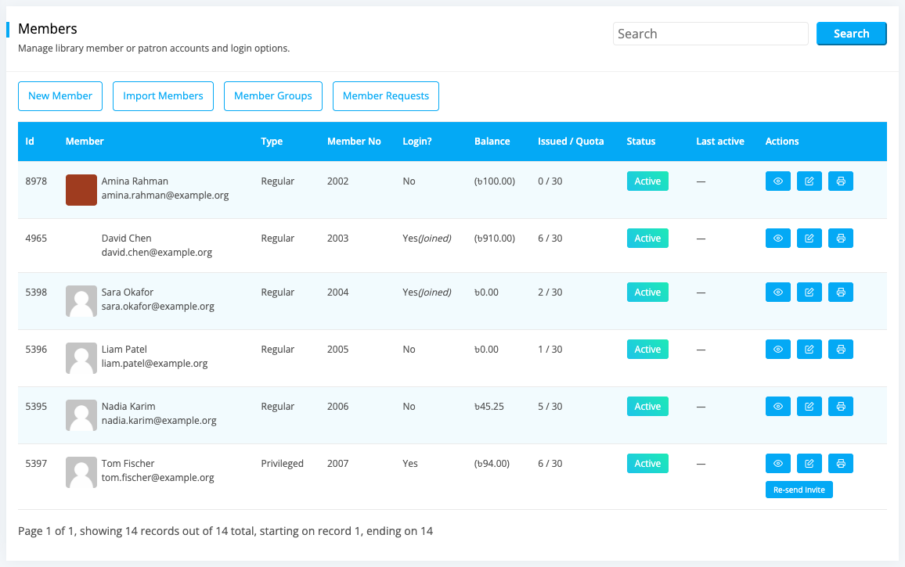
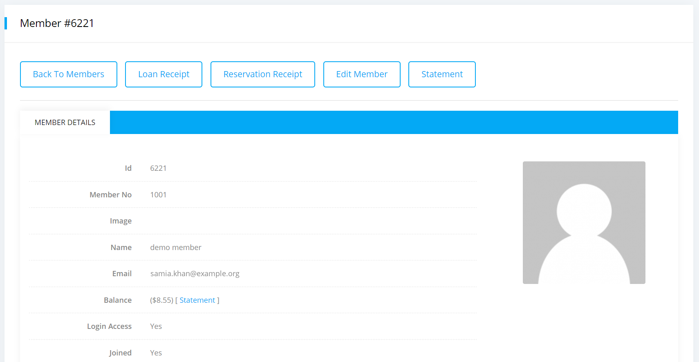
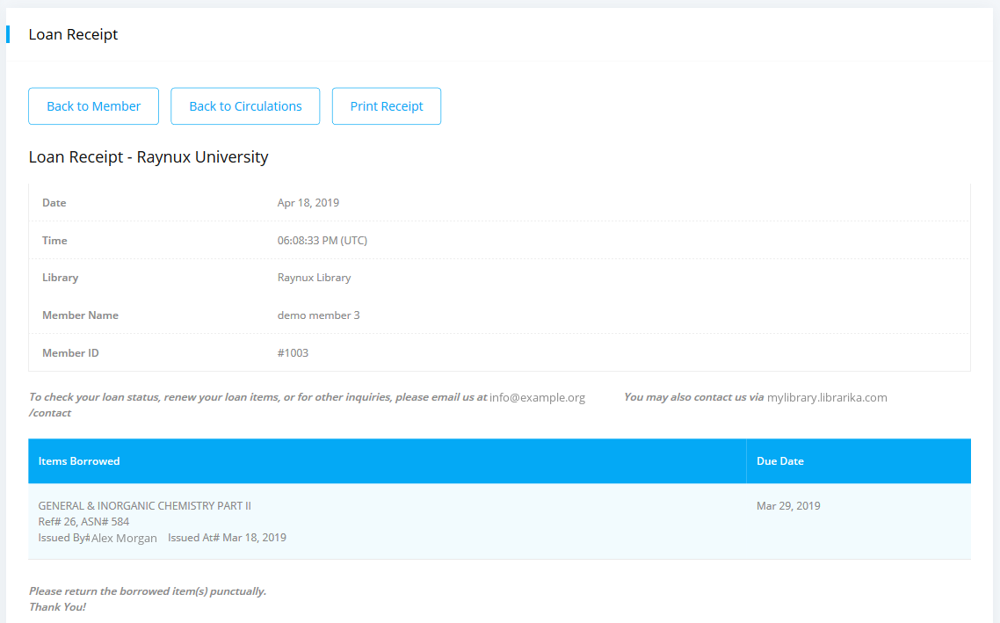
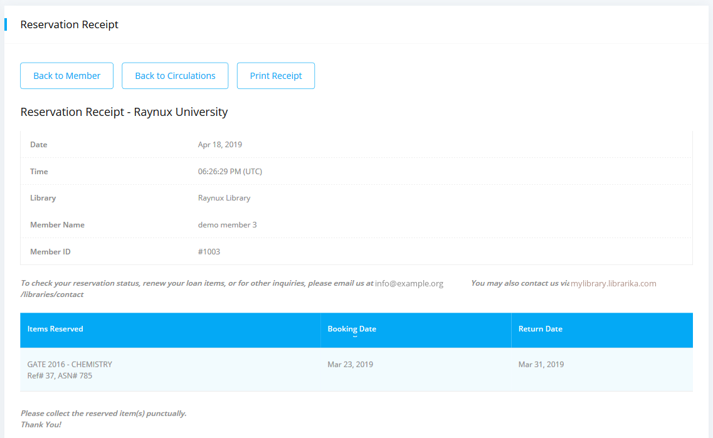
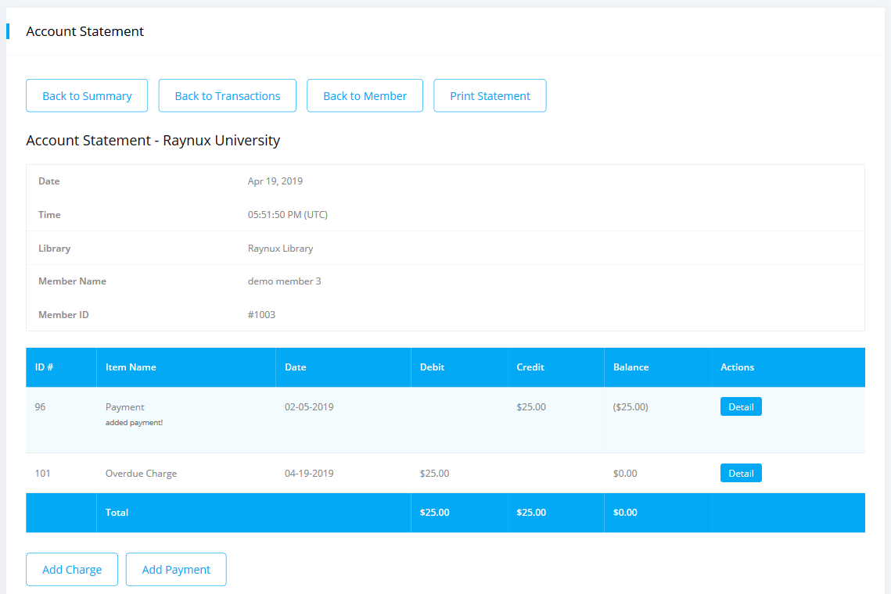
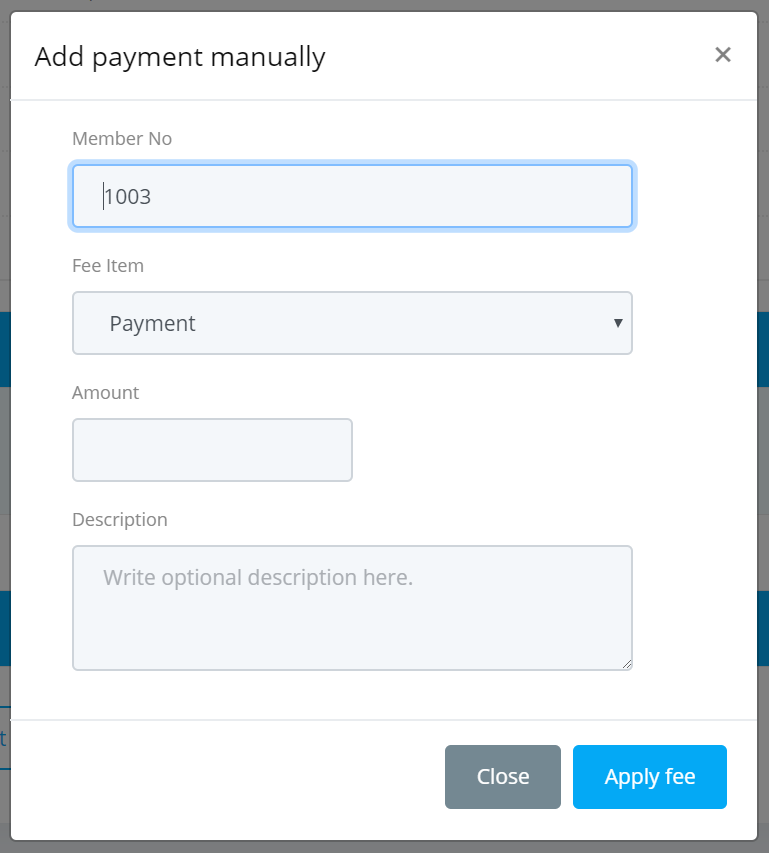

# Members

The members section lists all the members of your library (some libraries call them *patrons*). Only an unique _member no_ is necessary for a member to check out/in books from your library.

You can provide login access to a member if you wish but it is not a mandatory requirement from system's perspective. However, if you enable login access, system will ask for an unique email address for the member.

### Booking quota

A booking quota is the total limit up to which a member can reqeust / check-out / reserve books (or items) at a given point of time. By default, a global variable for the booking quota is available under `Manage -> Preferences` section, but the global quota will be overridden with the individual booking quota if set specifically for a member.

You can set individual booking quota for each member using the Add / Edit member method mentioned below. Again, if a individual quota not set, then global quota will be enforced.

### Add new member

To add a member to your library, please follow the below steps:

* Please go to the `Dashboard -> Circulations -> Members` section.

* Click on `New Member` button.
* Add new member form will be displayed as shown below.

	

* The `Type` field is used to separate the users in two levels, for example in a school the teachers / staffs should be under the privileged member type and the students should be under the regular member type.

* If you want that members can check-in and check-out books by themselves then please turn on the `Allow Member Login?` option. See [Self-Service](self-service.md) for details on enabling self-service checkout and check-in.
* Enter necessary information regarding the member. Only member no, name, type and status fields are mandatory.
* Click on the `Submit` button when you are done
* A new member record will be created.

### Edit existing member

To edit an existing member in your library, please follow the below steps:

* Please go to the `Dashboard -> Circulations -> Members` section.
* Locate the member record you want to edit.

	

* Click on the `Edit` icon on the right to that member.
* Member edit form will be displayed as shown below.

	

* Update necessary information regarding the member.
* Click on the `Submit` button when you are done. 
* Your changes will be saved.

### Import members

You can perform bulk import of members to your library using our bulk import method. Please read our [Import Members][member_bulk_import] instruction page for more details on how to proceed.

### Member related bookings

From members section you can find all the related circulations of your library members. For example all the books a member has borrowed, whether they still have it or have returned it etc. By default you can see only the active bookings of a member but you can see other bookings also. However, you can also export them into a CSV file.

* To view your member related bookings please go to member view page and navigate to the bottom then you can see all the bookings like below. 

	

### Member Area access

Librarika has a member only access area for the members of a library. If access is granted, member can sign in to the library using their credential and access the member area.

In member area they can access following informations:

* View current checked-out items including due date and status.
* View requested items with pending / approval status.
* View past check-out history with status. 
* View recently viewed / favorited items.
* Write review to the past check-out items.
* Self-checkout and self-return items (if [self-service](self-service.md) is enabled).

Also, they can perform some activities that is otherwise not possible, such as: request item, write review, access catalogs in a private library.

#### Enable member access

Enabling member access is very easy. You can do it in following way:

* Go to the members edit page as per above [edit member](#edit-existing-member) instruction.
* Enter email address of the member if empty.
* Turn on `Allow Member Login?`.
* Click on the `Submit` button when you are done.
* A "Join Library" invitation email will be sent to that email address.
* Member needs to accept the invitation in order to connect with your library.

Alternatively, a member can create an account in *Librarika* platform indenendently and submit `Member Access Request` to join your library. In this case, go to the [Member Requests](#member-requests) section as mentioned below and accept or reject the reqeust upon review.

#### Disable member access

Same way you can disable member login access from the edit member page. 

* Go to the members edit page as per above [edit member](#edit-existing-member) instruction.
* Turn off `Allow Member Login?`.
	* This alone pauses their login. You can turn it on again later without a new invitation email.
* To remove their login completely, also turn on **Remove Login?** (shown once the member has joined). You can send a new invitation later.
* Click on the `Submit` button when you are done.

### Last active

The **Last active** column on the Members list shows when each member last signed in to your library or opened it in the Librarika app. It helps you see who still uses the library.

* A dash (`—`) means the member hasn't signed in since this was introduced, or has no Librarika account yet (for example, they haven't accepted the invitation).
* Only the member's own sign-ins count. A visit by Librarika support never does.
* You can't see a member's sign-in history, devices or addresses. Members see their own history in their [Sign-in activity](sign-in-activity.md#sign-in-activity).

### Delete member

To delete a member from your library, please follow the below steps:

* Please go to the `Dashboard -> Circulations -> Members` section.

* Locate the member record you want to delete and click on the `Edit` icon on the right to that member.

	

* Member edit form will be displayed with a button named `Delete` on the top of the section.
* Click on the `Delete` button
* The member record will be deleted.

Related:

* Deleting a member will set member reference to null for all circulation records, but it will not actually delete the circulation records from the system for future reference.

---

## Member groups

Member groups section lets you add / edit / delete member group information such as Grade / Class to your library. Once a new member group is created, you can then assign member's to that group from the member edit page.

Member group provides the flexibility to bulk edit / delete the belonging members using the bulk actions method.

To access Member Groups:

* Please go to the `Dashboard -> Circulations -> Members` section.
* Click on the `Member Groups` button on top of the section.

---

## Member requests

Member requests section is where you will see all pending member requests for your library. When someone submit a member access request, it will appear here based on your library policy.

You can then either accept the request or decline the request. If you want to accept, system will ask you to provide a Member No for the new member.

To access Member Requests:

* Please go to the `Dashboard -> Circulations -> Members` section.
* Click on the `Member Requests` button on top of the section.

### Members loan / reservation receipt

Here you can find the receipt of those items which has been borrowed by your library members. Also you can find the item reservation receipt of your library members. 

To do so, please follow the below steps:

* Please go to the `Dashboard -> Circulations -> Members` section.
* Locate the member record for loan or reservation receipt.

	

* Click on the `View` icon on the right to that member.
* Member details page will be appeared like below.

	

* For member loan receipt, please check the followings. 

	* Click on the `Loan Receipt` button on top of the member details section.
	* The loan receipt form will be appeared as shown below.

		

	* You can print the receipt if you click on the `Print Receipt` button.

* For member reservation receipt, please check the followings. 

	* Click on the `Reservation Receipt` button on top of the member details section.
	* The reservation receipt form will be appeared as shown below.

		

	* You can print the receipt if you click on the `Print Receipt` button.

## Members payment statement

In this section you can find the account statement of any particular member. Also from this section you can apply various charges and payment to any specific member.

To use this section, please follow the below steps:

* Please go to the `Dashboard -> Circulations -> Members` section.
* Locate that member whose statement you want to view. 

	

* Click on the `View` icon on the right to that member.
* Member details page will be appeared like below.

	

* Click on the `Statement` button from the top of this section.

	

* Also you can print the statement by clicking on the `Print Statement` button.
* Now at the bottom of this section you can see two buttons.
* If you want to add charge to your library member then you need to enable the fee item (Such as overdue charge) first. To enable fee item please go to the [Fees & Payments](fees-payments.md#how-to-activate-the-module) section and enable the overdue charge fee item.
* Then click on the `Add Charge` button from the account statement section and a from will be appeared like below.

	

* In the **Amount** field you can set the amount that you want to charge to any of your library member. 
* If you want to add a payment, you need to enable the fee item (Payment) first. To do so please go to the [Fees & Payments](fees-payments.md#how-to-activate-the-module) section and enable the payment fee item.
* Then click on the `Add Payment` button from the account statement section and a from will be appeared like below.

	

* In the **Amount** field please enter the amount that you want to take from a member.
* The amount will be set to 0 if your library member do not have any charge to pay.
* Also amount under **Round Brackets** means member has extra balance on his / her wallet.

---

## FAQ

**What does the Last active column show?**

When the member last signed in to your library's website, or opened your library in the Librarika app. See [Last Active](#last-active).

**Why does a member show a dash in Last active?**

They haven't signed in since the column was introduced, or they don't have a Librarika account yet because they haven't accepted the invitation. You can re-send it with the `Re-send Invite` button.

**Can I see where and when a member signed in?**

No. Library staff see only the last active time. Each member sees their own full history in [Sign-in activity](sign-in-activity.md#sign-in-activity).

**A member can't sign in. What should I check?**

Check that `Allow Member Login?` is on for them (see [Enable Member Access](#enable-member-access)) and that they accepted the invitation. If your library uses SSO, also see [Single sign-on](sso-saml.md).

**Can a member use Google or Apple to sign in?**

Yes, if their Google or Apple account uses the same email address as their Librarika account. See [Ways to sign in](signing-in.md#ways-to-sign-in).

[member_bulk_import]: https://librarika.com/spages/import-members "Bulk Import of Members"

**A member forgot their password or lost their phone. How can I help?**

For a forgotten password, ask them to click `Forgot password?` on the login page. If they lost the phone with their authenticator app, they sign in with a recovery code; without recovery codes, they contact Librarika support. Staff can't see or reset members' passwords. See [Helping someone who can't sign in](helping-people-sign-in.md).

**Should we require two-step verification for members?**

Only after telling them what to expect: they need an authenticator app on their phone and should save their recovery codes. You can start by requiring it for staff only. See [Good practice for your library](library-sign-in-security.md#good-practice-for-your-library).

