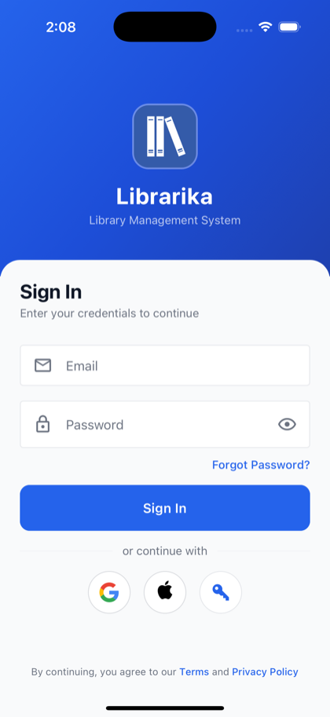
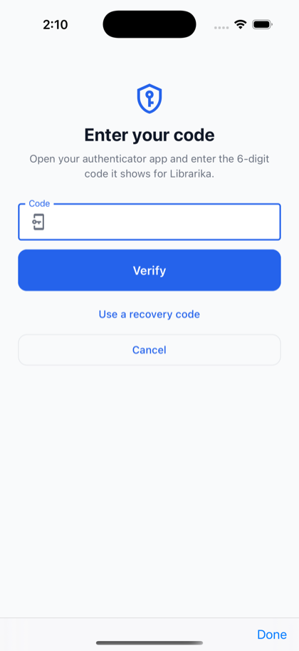
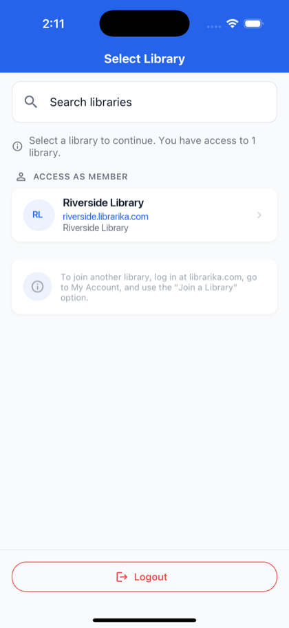

# Get the app & sign in

**Who this is for:** everyone who uses the Librarika app: library members and library staff.

**What you can do here:** install the app, sign in, choose a library, and learn which screens you get as a member or as staff.

The Librarika app for iPhone and Android serves **both members and library staff**. After you sign in and choose a library, the app shows the member screens or the staff screens, depending on your role in that library:

* **Members** browse the catalog, see their loans, holds and balance, and check items out and in themselves (if the library allows it). See [For members in the app](app-members.md).
* **Staff** (library admins, staff and assistants) scan barcodes, add titles and cover photos, and manage members and loans. See [For library staff in the app](app-staff.md).

---

## Get the app

 

You need a **Librarika account**. If you tap Google or Apple and no account has that email address yet, the app creates one, but it belongs to no library: you see **No Libraries Found** until you accept your library's invitation (see [Member quick start](member-quick-start.md)) or ask to join on librarika.com. To sign in with an email and password, or to create a library, sign up on [librarika.com](https://librarika.com) first.

---

## Sign in

You sign in to your **account** first, then choose a library.

* **Email and password:** enter your **Email** and **Password** and tap `Sign In`. Use your Librarika password.
* **Google, Apple or SSO:** tap one of the round buttons under **or continue with**: Google, Apple, or the key for your library's **SSO**. The buttons appear only when they are available.
* **Forgot your password?** Tap `Forgot Password?`, enter your **Email** and tap `Reset Password`. Then follow the link in the email (see [Forgot your password?](passwords.md#forgot-your-password)).

Google and Apple sign you in to the Librarika account with the same email address, just like on the website. See [Signing in](signing-in.md#ways-to-sign-in).

### Sign in with your library's SSO

1. Tap the key button.
2. On **Sign in with your library's SSO**, enter your library's web address, for example `mylibrary` for `mylibrary.librarika.com`, in **Library web address** and tap `Continue`.
3. Sign in on your school's or organisation's page. You come back to the app signed in.

The app remembers the library, so next time you can pick it from the list (*"Choose a library you signed in to before, or enter another library's web address."*). To remove a saved library, tap × next to it. A sign-in with SSO opens only the library whose SSO you used.

### Two-step verification

If you turned on [two-step verification](two-step-verification.md), the app asks for your code after your password:

1. On **Enter your code**, open your authenticator app and type the 6-digit code into **Code**. The app checks it as soon as you have typed six digits, or tap `Verify`.
2. **Lost your phone?** Tap `Use a recovery code` and type one of your recovery codes into **Recovery code**. Tap `Use your authenticator app` to switch back, or `Cancel` to return to Sign In.

You have 5 minutes to enter the code (in the last minute the screen shows *"This sign-in expires in …"*); after that, you see *"Your sign-in has expired. Please sign in again."* The app doesn't have a "don't ask again on this device" option, but it keeps you signed in (see below), so you rarely need a code.

You turn two-step verification on and off on the **website**, not in the app. If your library requires it and you haven't set it up, the app shows *"Your account needs two-step verification. Please set it up on the Librarika website, then sign in to the app again."* with a `Set up two-step verification` button.

### When the app sends you to the website

| Message | Button | What to do |
|---|---|---|
| *"You need to change your password. Please sign in on the Librarika website to change it, then sign in to the app again."* | `Change password on the website` | Choose a new password on the website (see [Choose a new password](passwords.md#choose-a-new-password)), then sign in to the app with it. |
| *"Your account needs two-step verification. …"* | `Set up two-step verification` | Set it up on the website, then sign in to the app. |
| *"Please update the Librarika app to sign in. Your account uses two-step verification."* | — | Your app is an older version. Close the app completely and open it again; it updates itself when it starts. If the message stays, update Librarika from the App Store or Google Play. Until then, use your library's website. |

---

## Choose a library

After you sign in, **Select Library** lists your libraries in two groups:

* **Manage as Librarian**: libraries where you are a library admin, staff or assistant. You get the [staff screens](app-staff.md).
* **Access as Member**: libraries where you are a member. You get the [member screens](app-members.md).

Tap a library to open it. Use **Search libraries** if you have many.

**Staff and member in the same library?** The library appears in both groups; the row you tap decides which screens you get. To switch, use `Switch Library` and tap the other row.

**No libraries?** You see **No Libraries Found** (*"Your account is not associated with any library yet."*). Accept your library's invitation, or ask to join a library on librarika.com (`My Libraries` > `Join a library`; the app's hint says *My Account*, but on the website the link is under **My Libraries**), then sign in to the app again.

### Switch library

Members: `Account` tab > `Switch Library`. Staff: `Settings` tab > `Switch Library`, or the ⋮ menu at the top > `Switch Library`. You stay signed in and go back to **Select Library**.

---

## Staying signed in

The app keeps you signed in. It renews its access in the background, so you don't need to sign in every day. You are signed out when:

* you sign out in the app;
* you [sign the phone out](sign-in-activity.md#sign-out-a-device) from the website;
* you change your password, or turn two-step verification on or off, on any device (every other device is signed out).

Each phone appears in **Where you are signed in** on the website with its name (for example *iPhone 15 · iOS 18*).

## Sign out

* **Members:** `Account` tab > `Sign Out`, then confirm with `Sign Out`.
* **Staff:** `Settings` tab > `Logout` (or ⋮ > `Logout`). The app asks *"Are you sure you want to logout?"*; tap `OK`.
* **Before you choose a library:** `Logout` at the bottom of **Select Library**.

Signing out ends the sign-in on Librarika too, and the phone stops receiving your notifications.

## Lost your phone?

Sign in on the website, open your settings and, under **Where you are signed in**, click `Sign out` next to the lost phone. See [Sign out a device](sign-in-activity.md#sign-out-a-device). If the phone also had your authenticator app, see [Lost your phone?](two-step-verification.md#lost-your-phone).

## App updates

Your app version is at the bottom of the member **Account** tab and the staff **Settings** tab (*Version … (Build …)*); give it to support if they ask.

When a new version is required, the app shows **Update Required** (*"A new version of Librarika is available. Please update to continue using the app."*) with `Update Now`. When an update is optional, it shows **Update Available** with `Not Now` and `Update`.
