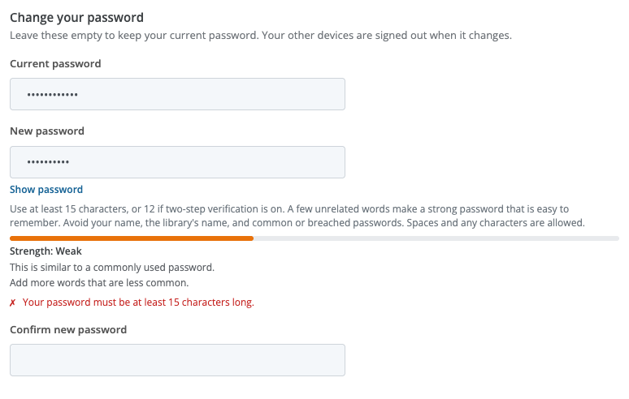
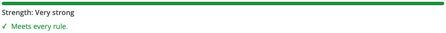

# Passwords

**Who this is for:** everyone who signs in with a Librarika password: library staff, members and app users.

**What you can do here:** learn the password rules, change your password, reset a forgotten one, and see why Librarika may ask you to choose a new one.

Librarika's password rules are part of security improvements based on industry standards. Long passwords protect you better than short, complicated ones, so the rules ask for length and leave the rest to you.

---

## What makes a good password

When you choose a new password (when you join, change it or reset it), it must:

* have **at least 15 characters**, or **at least 12** if you have [two-step verification](two-step-verification.md) turned on. Your library may ask for more (see [Password length](library-sign-in-security.md#password-length));
* have **at most 128 characters**;
* not be a **common password** or one that has appeared in a **data breach** somewhere on the internet;
* not contain your **username, email address or name**;
* not contain your **library's name** or the word "Librarika";
* not be one character or a short pattern repeated (such as `aaaa` or `abab`), or a simple sequence (such as `abcdef` or `123456`);
* not be the same as your **current password** or one of your **last 5 passwords**.

**Tip:** a few unrelated words make a strong password that is easy to remember, for example *maple river lantern cobalt* (don't use this one). **Spaces and any characters are allowed**, including letters from any language. You don't need to add symbols or capital letters.

## The strength meter

Under the **New password** field you see the rules, and as you type, a strength bar.

* **Strength** goes from *Very weak* to *Very strong*. It is advice: a stronger password is harder to guess.
* Below it you may see tips, such as *"Add more words that are less common."*
* Rules your password doesn't meet yet are listed in red with a cross. When every rule is met, you see **Meets every rule.** in green.
* Click **Show password** to see what you typed.

The check runs in your browser, so nothing you type is sent anywhere until you save. When you save, Librarika checks the rules again. If the password is refused, you see why, for example *"You used this password recently. Please choose a different one."*

## Your current password keeps working

The new rules apply only when you **choose a new password**. The password you have today keeps working until you change it, unless Librarika or your library asks you to [choose a new one](#choose-a-new-password).

## Change your password

1. Open your settings (see [Your sign-in settings](signing-in.md#your-sign-in-settings)): members click `My Account` > `Account Settings`; staff click their name menu at the top right > `Settings` (gear icon) and open the `Change Password` tab.
2. Enter your **Current password**, then the **New password** twice.
3. Click `Save Settings`.

If you have two-step verification on, Librarika may first ask you to [confirm it's you](signing-in.md#confirm-its-you).

When your password changes:

* every **other** browser and phone is **signed out**, including the mobile app. The browser you are using stays signed in;
* devices where you ticked *"Don't ask again on this device for 30 days"* ask for your two-step code again;
* you get an **email** telling you that your password was changed. If you didn't change it, use the link in that email to reset your password straight away.

## Forgot your password?

1. On the **Log in** page, click `Forgot password?`.
2. Enter the email address you use to sign in and click `Email me a link`.
3. You see *"If an account exists for that email address, we have sent a link to reset your password."* You see the same message whether or not the address has an account, so nobody can use this page to find out who has one.
4. Open the email and click the link. The link works **once** and **expires after one hour**. If it has expired, ask for a new one.
5. Choose your new password, enter it again and click `Save new password`.

Resetting your password signs you out on your other devices. It doesn't turn off two-step verification: when you next sign in, you still enter a code from your app (or a [recovery code](two-step-verification.md#recovery-codes)).

Because the link reached your mailbox, a reset also confirms your email address if it wasn't confirmed yet.

If you don't receive the email, check your spam folder. If you still have no email, ask your library which email address your account uses.

## Choose a new password

Sometimes Librarika shows **Choose a new password** right after you sign in, with *"Your account needs a new password before you go on."* Librarika may ask for this when:

* Librarika support asked you to change it, for example after resetting your two-step verification;
* your library asked everyone to choose a new password (see [Ask for a new password](library-sign-in-security.md#ask-for-a-new-password));
* Librarika found that your password appeared in a data breach (Librarika may ask for this; it depends on your account);
* your library created your account in a member import with a password chosen by staff: you choose your own at your first sign-in.

Enter a new password twice and click `Save password`. If you'd rather do it later, click `Sign out`; you will be asked again at your next sign-in.

In the mobile app you may see *"You need to change your password. Please sign in on the Librarika website to change it, then sign in to the app again."* Do that on the website first, then sign in to the app.

## Too many wrong passwords

To protect your account from people guessing passwords, Librarika slows down repeated failed sign-ins:

* After **two** wrong passwords, the **Log in** page asks you to complete a **captcha** ("I'm not a robot" check). If you skip it you see *"Please confirm you are a human!"*
* After more wrong passwords, Librarika may make you wait a little before trying again. You see *"Please wait 30 seconds; retrying sooner extends the wait."* (the number of seconds varies). Wait for that time, then try again. Trying sooner makes the wait longer.
* The captcha can also appear when many failed sign-ins come from the same internet connection (for example a school network), even if you typed your password right. Tick it and continue.
* If someone keeps trying wrong passwords on your account, you get an **email** about it. If that wasn't you, nobody has got in: the email has a link to reset your password if you want to be safe.

If you are not sure of your password, use [Forgot password?](#forgot-your-password) instead of guessing.

---

## FAQ

**Why is my new password refused?**

The message says which rule it doesn't meet: too short (at least 15 characters, or 12 with two-step verification), a common or breached password, or it contains your name, email, the library's name or "Librarika". See [What makes a good password](#what-makes-a-good-password).

**Why is my old password not accepted when I change it?**

Your new password must be different from your current password and from your last 5 passwords. You see *"You used this password recently. Please choose a different one."* Choose a new one; a few unrelated words work well.

**Do I have to change my password now that the rules are stricter?**

No. Your current password keeps working. The new rules apply the next time you choose a password, unless Librarika or your library asks you to [choose a new one](#choose-a-new-password).

**Why does Librarika ask me to choose a new password?**

Librarika support or your library asked for it, for example after resetting your two-step verification or after a possible leak, or your password was found in a data breach. Choose a new one to continue. See [Choose a new password](#choose-a-new-password).
