# Reports

**Who this is for:** library staff.

**What you can do here:** view, print and export catalog, circulation, member and overdue reports.

Reports show your catalog, circulation, members and overdue items, usually for a date range. Most reports have filters, a `Print Page` button and an `Export CSV` button. Each CSV file holds up to 5,000 records; larger exports are split into pages (see the [FAQ](#faq)).

Go to `Reports` and pick a group of reports.

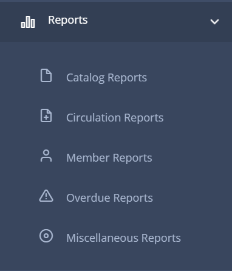

Open a report with its `View Report` button. Many reports start with the last 30 days; change the range with the date picker at the top of the page.

## Catalog reports

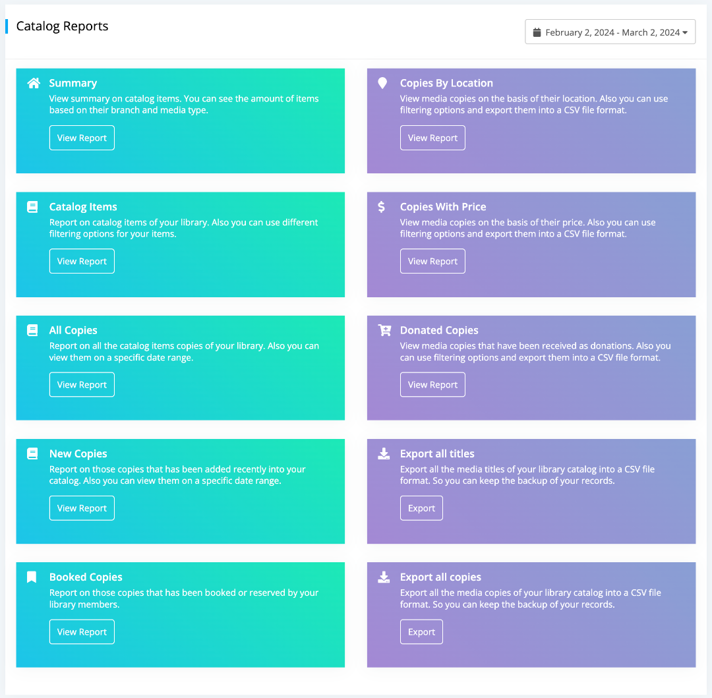

| Report | What it shows | Options |
|---|---|---|
| Summary | How many items each branch has | Print |
| Catalog Items | Your titles | `Filter Options`, sort by identifier |
| All Copies | All copies | Date range |
| New Copies | Copies added in the date range | Date range |
| Copies By Location | Copies grouped by location | |
| Copies With Price | Copies that have a price, most expensive first | Filters, CSV |
| Donated Copies | Copies from purchases marked as a donation | Filters, CSV |
| Booked Copies | Copies that are booked | |
| Export all titles | Every title, as a CSV file | |
| Export all copies | Every copy, as a CSV file (can be edited and uploaded with [Batch update](batch-update.md)) | |

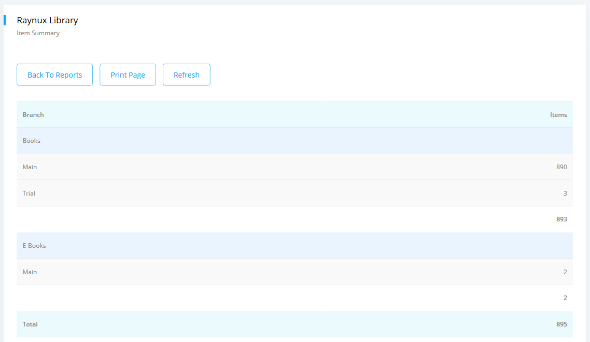

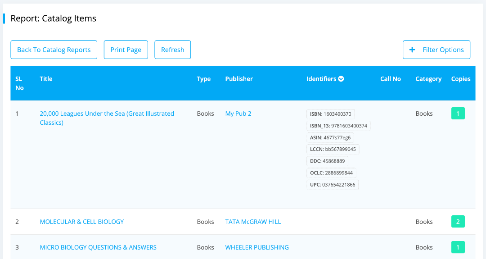

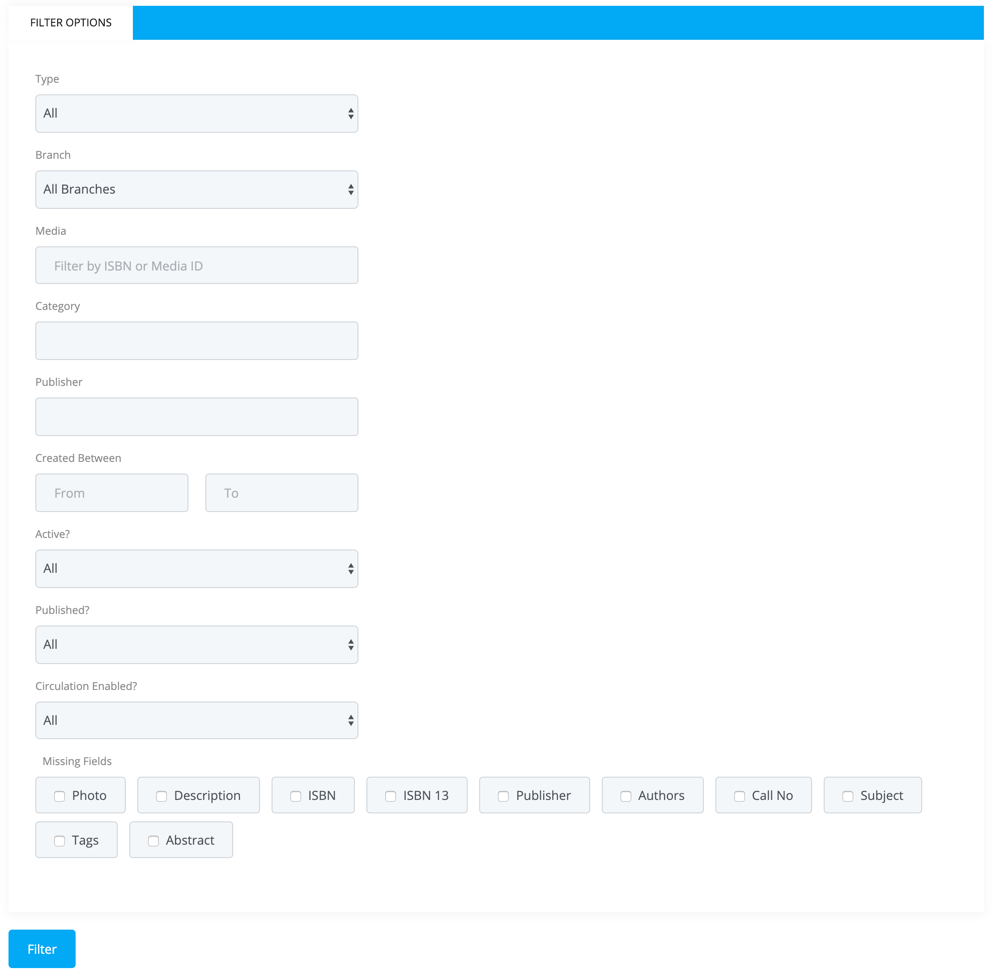

## Circulation reports

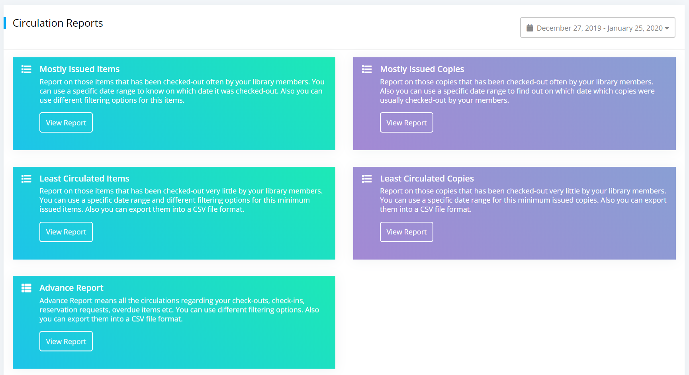

| Report | What it shows | Options |
|---|---|---|
| Mostly Issued Items | Titles with the most checkouts | `Advance Options` |
| Least Circulated Items | Titles with the fewest checkouts | Date range |
| Advance Report | Every loan, with many filters | `Filter Options`, member email and mailing address columns, CSV |
| Mostly Issued Copies | Copies with the most checkouts | Date range |
| Least Circulated Copies | Copies with the fewest checkouts | Date range |

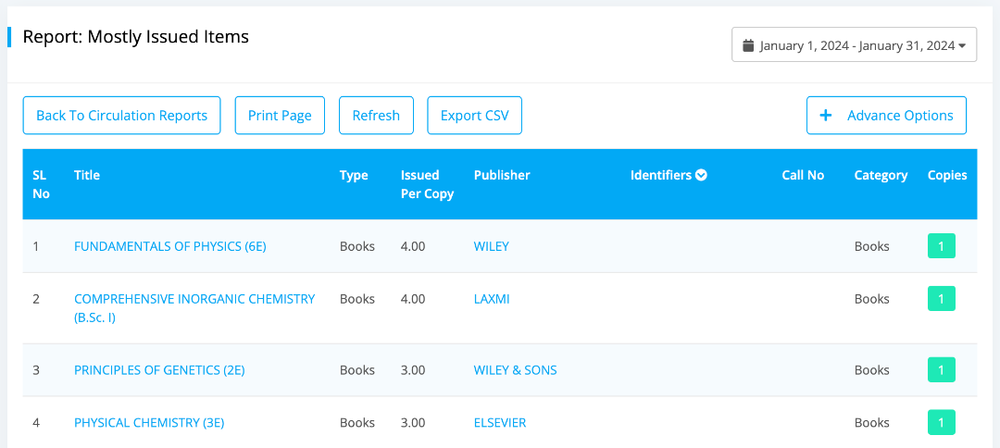

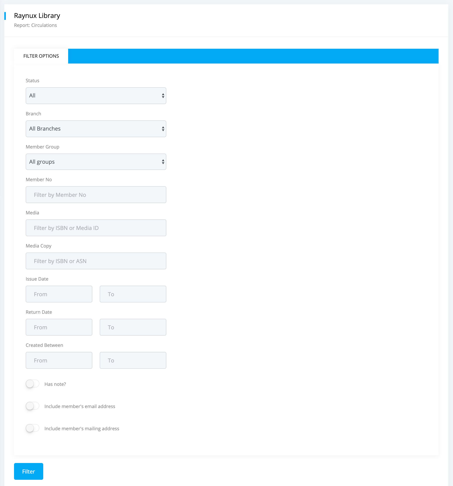

## Member reports

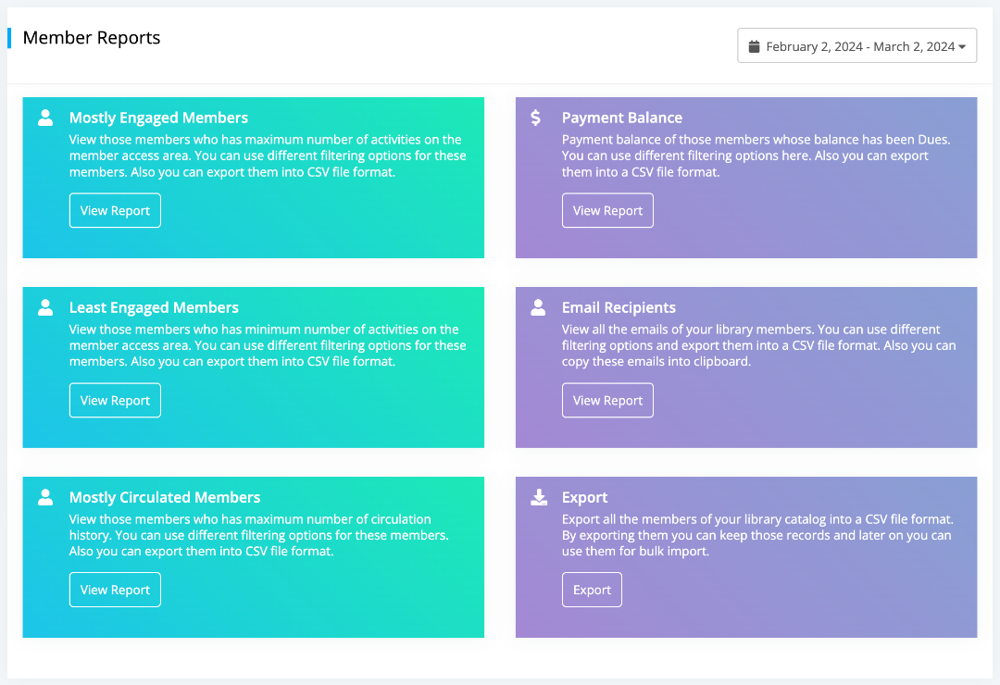

| Report | What it shows | Options |
|---|---|---|
| Mostly Engaged Members | Members who use the library most | `Filter Options` |
| Least Engaged Members | Members who use it least | `Filter Options` |
| Payment Balance | Members who owe money | |
| Email Recipients | Your members' email addresses | Filters, CSV, `Copy Emails` |
| Mostly Circulated Members | Members with the most circulation history | Filters such as booking status, CSV |
| Export all members | Every member, as a CSV file (can be edited and uploaded with [Batch update](batch-update.md)) | |

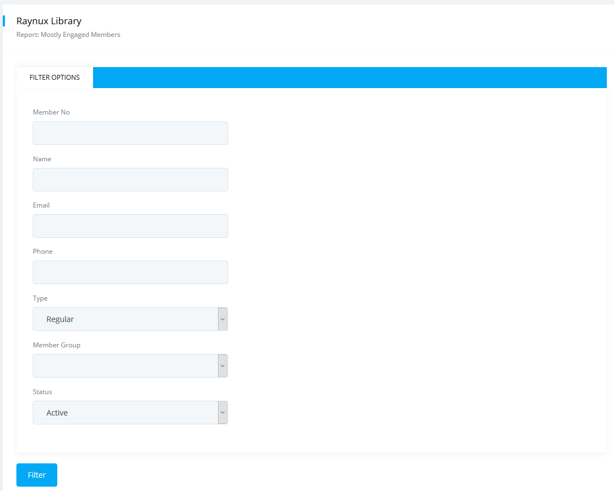

## Overdue reports

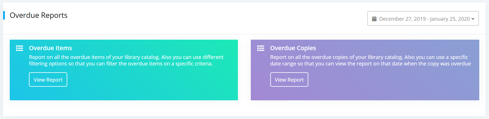

| Report | What it shows | Options |
|---|---|---|
| Overdue Items | Loans past their return date | `Advance Options` |
| Overdue Copies | Overdue copies | |

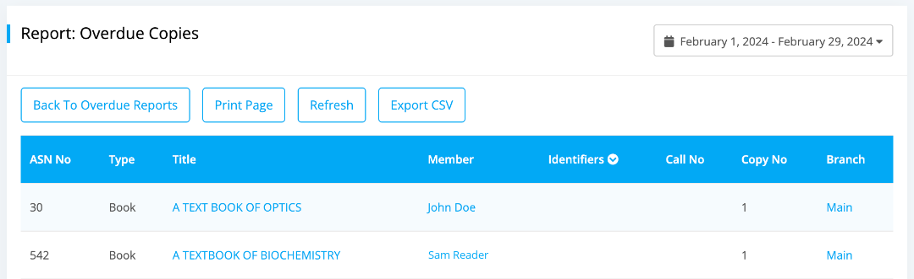

## Miscellaneous

Exports of your categories, authors, publishers, tags and purchases (`Export all purchases`), as CSV files, for a backup or to reuse in an import.

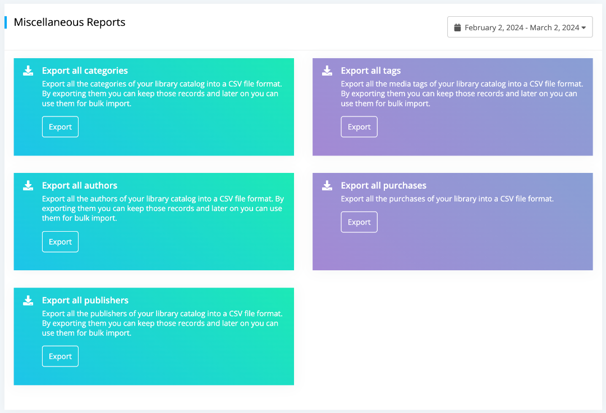

## FAQ

**Why do I see Page 1, Page 2... links instead of a single Export button?**

Each CSV file holds up to 5,000 records. If you have more than that, the export is split into several files, so click each page link to download all of them.

**Why does a report only show the last 30 days?**

Reports such as `Mostly Issued Items`, `Least Circulated Items`, `Mostly Engaged Members` and `New Copies` use a date range that starts at the last 30 days. Pick another range (for example This Month or a Custom Range) with the date range picker at the top of the page; Librarika remembers your choice while you move between reports.

**Does the CSV export of the Advance Report include my filters?**

Yes. `Export CSV` on the [Advance Report](#circulation-reports) exports the same list you filtered with `Filter Options`, not your whole circulation history.

**How do I add members' email addresses or mailing addresses to the circulation export?**

Open the `Advance Report`, click `Filter Options` and switch on `Include member's email address` and/or `Include member's mailing address`. The extra columns then appear in the report and in the CSV file.

**How do I get a list of my members' email addresses?**

Open the `Email Recipients` report under [Member Reports](#member-reports). You can filter the list, export it to CSV, or click `Copy Emails` to copy all the addresses to your clipboard.

**How do I print a report?**

Click the `Print Page` button on the report page. It prints what is currently shown on the screen, so apply your filters first.

**Can I edit an exported file and upload it back?**

Yes, for copies and members. The files from `Export all copies` and from the member `Export` can be edited and uploaded again with [Batch update](batch-update.md). Other exports, such as categories or authors, are for keeping a backup or reusing in an import.

**Why can't I see some reports or Export buttons?**

Report links and Export buttons only appear if your user role has permission to use them. Ask your library admin if you need access.
