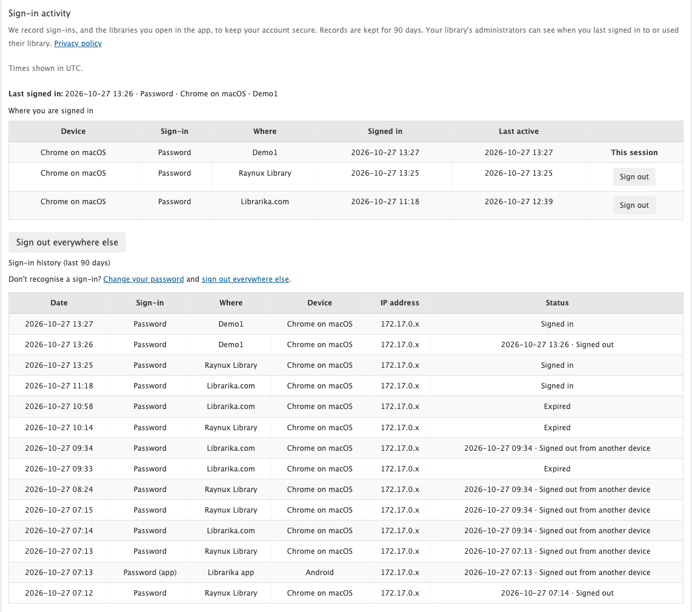
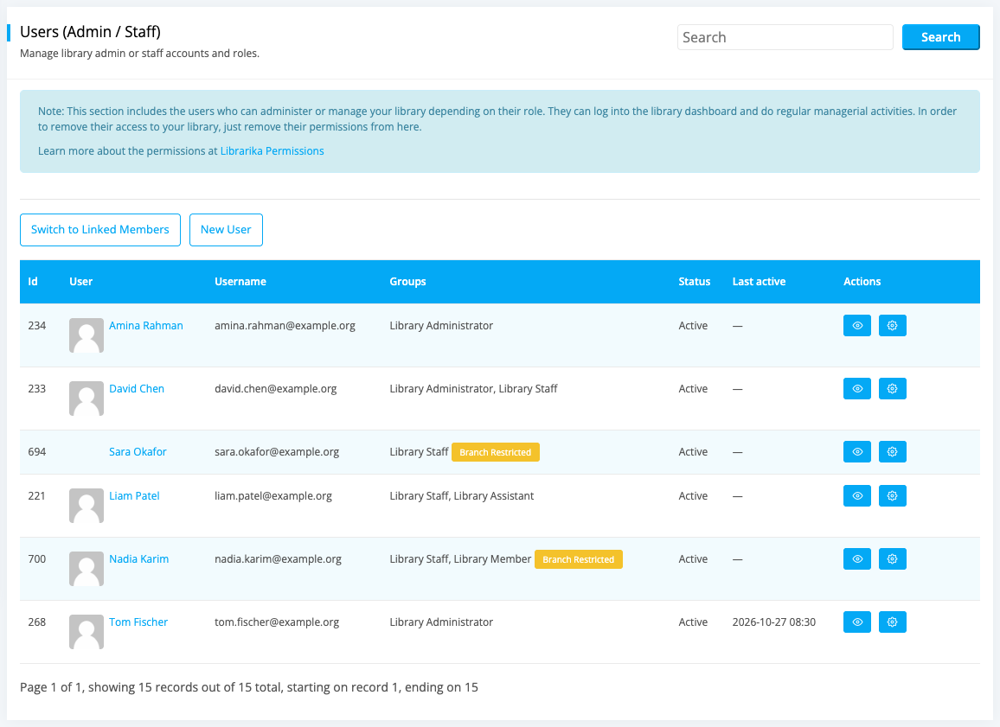

# Sign-in activity & privacy

**Who this is for:** everyone.

**What you can do here:** see where your account is signed in, sign out a device you don't recognise, understand the emails Librarika sends about your account, and see what your library can and can't see.

---

## Sign-in activity

Open your settings (see [Your sign-in settings](signing-in.md#your-sign-in-settings)). **Members:** **Sign-in activity** is near the bottom of **Account Settings**, above **Remove My Account**. **Staff:** it is in **Settings**, below the tabs. It shows where your account is signed in and every sign-in of the last 90 days.

* **Last signed in** -- your previous sign-in (not the current one): when, how and where.
* **Where you are signed in** -- every browser and phone that is still signed in, with when it signed in and when it was last used. Your current browser shows **This session**.
* **Sign-in history (last 90 days)** -- every sign-in, newest first, 20 per page.

Each row shows:

| Column | What it means |
|---|---|
| Sign-in | How you signed in: `Password`, `Google`, `Apple`, `Library SSO`, `From Librarika.com` (you opened the library from *My Libraries*), `Email link`. **(app)** means the mobile app. |
| Where | The library, or `Librarika.com`. For the app, the libraries you opened in the app. |
| Device | The browser and system (for example *Chrome on Windows*), or the phone's name for the app. |
| IP address | Your internet address with the last part hidden (for example `203.0.113.x`). |
| Status | `Signed in`, `Signed out`, `Signed out from another device`, `Password changed`, `Expired`, or `Signed out for safety`. |

Times are shown in the timezone of your Account Settings.

### Sign out a device

* Click `Sign out` next to a session in **Where you are signed in**. That browser or phone is signed out right away.
* Click `Sign out everywhere else` to sign out every session except the one you are using.
* A phone you sign out also stops receiving that account's notifications.

To sign out other sessions you must be signed in with your password, Google or Apple, not with SSO. If you only use SSO (or your library allows SSO only), see [No Librarika password?](sso-saml.md#what-people-cant-change-after-signing-in-with-sso): set a password on librarika.com with `Forgot password?`, which also signs out every other device.

### Don't recognise a sign-in?

1. Click **Change your password** (just above the history) and choose a new password.
2. Changing your password **signs out every other session** automatically, including the mobile app.
3. Check the **SSO sign-in** list and untick any library you don't use.
4. Turn on [two-step verification](two-step-verification.md), so a password alone is no longer enough to sign in.

### "Librarika support accessed your account"

When you ask Librarika support for help, a support person may sign in to your account to look at a problem. That visit appears in your history as **Librarika support accessed your account**, without a device or address. It never counts as your own use of a library.

---

## Emails about your account

Librarika emails you when something important happens to your account, so you notice if it wasn't you:

* your password was changed;
* someone signed in to your account from a **new device or browser**;
* there were many **failed sign-in attempts** on your account;
* two-step verification was turned on or off;
* a **recovery code** was used.

If you get one of these emails and it wasn't you, [reset your password](passwords.md#forgot-your-password) right away and check your [Sign-in activity](#sign-in-activity).

---

## What your library's administrators can see

A library's administrators see only one thing about your sign-ins: a **Last active** column on their **Users** and **Members** lists. It shows the last time you signed in to **their** library or opened it in the app.

They can't see your history, your devices, your addresses or your activity in other libraries. They also can't see your password, whether you use two-step verification, or your recovery codes. Sign-ins by Librarika support are never counted.

---

## Your privacy

* Sign-in records are kept for **90 days**, then deleted automatically.
* The full internet address is kept for 30 days to investigate misuse, then shortened. You always see it shortened.
* Deleting your account deletes your sign-in history.
* To get a copy of your sign-in records, click `Download my sign-in and security data` under **Sign-in activity** in your settings. You get a file (`librarika-sign-in-and-security-data.json`) with your sign-ins and security settings. It never contains your password, codes or full internet addresses.
* See the [Privacy Policy](https://librarika.com/spages/privacy-policy) for details.

---

## FAQ

**I signed out on my phone, but it still shows as signed in. Why?**

Older versions of the app only signed out on the phone itself. Click `Sign out` next to that phone in **Where you are signed in** to end it on Librarika too.

**What does "Signed out for safety" mean?**

The app's sign-in was used in a way that looked like a copy on another device, so Librarika signed that session out to protect your account. Sign in again on your phone.

**Why is "Sign out everywhere else" missing?**

You are signed in only once, or you signed in with SSO. Sign in with your password, Google or Apple to sign out other sessions.

**Why is part of my IP address hidden?**

For your privacy. A shortened address is enough to see roughly where a sign-in came from.

**Can I delete my sign-in history?**

It is deleted automatically after 90 days, and all of it is deleted with your account.

**Can my library's administrators see my sign-ins?**

They see only when you were last active in their library. They can't see your history, devices or addresses.

**Can my library see my password or recovery codes?**

No. Nobody at your library can see your password, your recovery codes or whether you use two-step verification.
