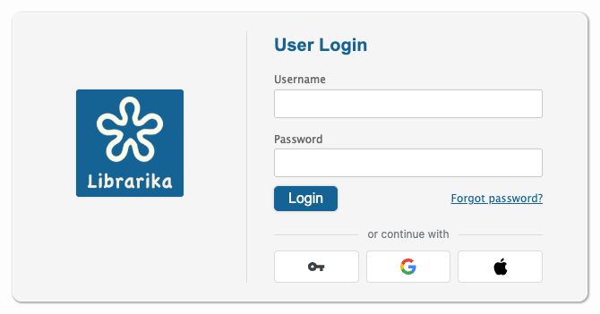
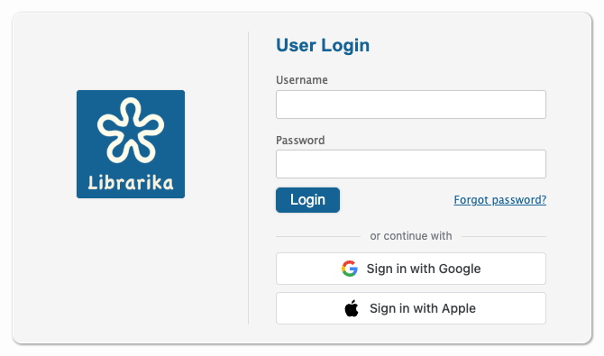
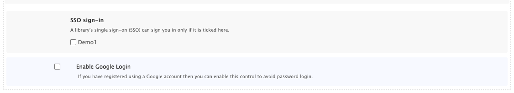
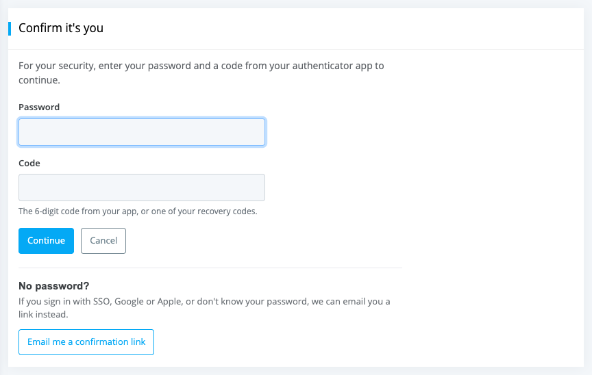

# Signing in

**Who this is for:** everyone: library staff, members and people who use the mobile app.

**What you can do here:** sign in with a password, Google, Apple or your library's SSO, manage your sign-in settings, and confirm it's you before important changes.

Your **Librarika account** belongs to you, not to one library. You use the same account on [librarika.com](https://librarika.com), in every library you belong to and in the mobile app.

Related pages: [Passwords](passwords.md) · [Two-step verification](two-step-verification.md) · [Sign-in activity & privacy](sign-in-activity.md)

---

## Ways to sign in

On the **Log in** page of a library (and of librarika.com) you can sign in with:

* **Username and password**: your email address and your Librarika password. Click `Log in`.
* **Google**: `Continue with Google`, with the Google account that uses the same email address as your Librarika account.
* **Apple**: `Continue with Apple`, with your Apple ID, if it uses the same email address as your Librarika account.
* **SSO** (single sign-on, the key icon): `Sign in with SSO`, your school's or organisation's own login. This button only appears in libraries that use [SSO](sso-saml.md). In those libraries the Google and Apple buttons are usually hidden.

When all three buttons are shown, they become small icon buttons under **or continue with**.

On [librarika.com](https://librarika.com) the page also has **Don't have an account?** `Create one`:

**Good to know:**

* Google and Apple sign you in to the Librarika account with the **same email address**.
* Your account must be verified first. A new account that hasn't confirmed its email yet is asked to *"Please verify your email address in order to login."*
* Apple's **Hide My Email** option gives Librarika a private relay address (ending in `privaterelay.appleid.com`), which won't match your Librarika email. Choose **Share My Email** when Apple asks, or sign in with your password.
* After two wrong passwords, the page asks you to tick a captcha before you try again. See [Too many wrong passwords](passwords.md#too-many-wrong-passwords).

### Create an account with Google or Apple

No Librarika account yet? On librarika.com click `Create one`. The **Create your Librarika account** page offers two ways:

* **Sign up with Google or Apple**: click `Continue with Google` or `Continue with Apple`. Your account is created with the email address of your Google or Apple account, already confirmed, and there is no new password to remember. If you want a password later (for example for the mobile app), use `Forgot password?` on the login page to set one.
* **Sign up with your email**: enter your details and click `Create account`. Librarika emails you a link to confirm your address.

If an account with that email address already exists but its email was **never confirmed**, signing up with Google or Apple takes that account over: its old password stops working and it is signed out everywhere. This stops someone else from holding an account in your name.

On a library's website, signing up this way also asks that library to let you join (see [Member quick start](member-quick-start.md#no-invitation-ask-to-join)). Libraries that allow **SSO only** don't accept Google or Apple sign-ups.

### Signing in with your organisation's SSO

If your library uses SSO, click the key icon on the library's login page and sign in on your organisation's page. You come back to the library already signed in.

* Your organisation's SSO can only sign you in to libraries that are **ticked in your own [SSO sign-in list](#your-sign-in-settings)**. The library is ticked for you when its SSO created your account.
* Some libraries allow **SSO only**. Their login page shows only the SSO button: *"This library uses its own sign-in (SSO). You will come back here after signing in."* A sign-in with a password, Google or from **My Libraries** on librarika.com is not accepted there; you see *"This library allows sign-in with its SSO only. Please sign in with SSO."* Your account still works everywhere else.
* If you see *"This library's SSO is not allowed to sign in to your account yet. Sign in with your password or Google, then tick this library under Settings, "SSO sign-in"."*, do exactly that: sign in another way, tick the library in your [sign-in settings](#your-sign-in-settings), and use SSO next time.

### Your Librarika password and your organisation's password

When you accept an invitation from a library, you create a **new password for Librarika**. It is separate from your email account's password and from your organisation's SSO password, so don't reuse those. You need it on librarika.com and in other libraries you join, where your organisation's SSO can't sign you in.

---

## Your sign-in settings

Open your settings (the **My Settings** page): members click `My Account` > `Account Settings`, or `My Settings` in the name menu; staff click their name menu at the top right > `Settings`. Staff see the settings in tabs, such as `Social Logins` and `SSO Sign-in`.

* **SSO sign-in** -- *"A library's single sign-on (SSO) can sign you in only if it is ticked here."* Untick a library to stop its SSO from signing in to your account. Each library shows why it is there (for example *added when SSO created your account* or *added by you*). This list only appears if you belong to a library that uses SSO.
* **Enable Google Login** and **Sign in with Apple** -- your own switches for Google and Apple.
* Click `Save Settings` when you are done.

The same page has your [password](passwords.md#change-your-password) and [two-step verification](two-step-verification.md) settings.

If you signed in **with SSO**, you can look at these settings but not change them. You see, for example, *"You signed in with SSO (or support signed in as you). Sign in with your password or Google to change this list."* The same applies to changing your email address, turning on Google or Apple sign-in, signing out other sessions and removing your account. This protects your account: whoever controls an SSO login can't change how your account signs in.

---

## Confirm it's you

Before an important change, Librarika asks you to **confirm it's you**. This stops someone who finds your computer still signed in from taking over your account. You may be asked before you:

* change your password or email address;
* turn two-step verification on or off, set up a new phone, or make new recovery codes;
* remove your account.

* Enter your **Password** and, if two-step verification is on, a **Code** from your app (or a recovery code). Click `Continue`.
* After confirming, you won't be asked again for about **10 minutes**.
* If you signed in with your password just now, you may not be asked at all.

**No password?** If you sign in with SSO, Google or Apple, or don't know your password, click `Email me a confirmation link`. Open the email **in the same browser**; the link works once, for one hour. If two-step verification is on, you then enter a code from your app.

---

## Change your email address

Your email address is also your username. To change it:

1. Open your settings, enter the new address in the email field and click `Save Settings`.
2. Librarika asks you to [confirm it's you](#confirm-its-you) (*"Please confirm it's you to continue."*).
3. You see *"Your changes have been saved. We sent a confirmation link to … Your email address changes when you open that link."*
4. Open the email at the **new** address and click `Confirm email address` on the page that opens. You see *"Your email address is now …"*

Until you confirm, your **old address stays in use** for signing in and for emails. The link works for 24 hours. Asking for another change, changing your password or resetting it cancels the link.

* *"Another account already uses this email address. Please use a different one."* -- each address can belong to one account only.
* *"You have asked to change your email address too many times. Please try again in an hour."* -- wait an hour.

In the mobile app, the app asks for your current password first, then shows *"Pending: … — check your inbox"* until you confirm. See [Account settings in the app](app-account-settings.md#change-your-email-address).

---

## Links in emails from Librarika

Links that confirm something open a page with a **button**, and only the button does the action. This way, a mail scanner that opens links in your inbox can't use up your link. Click the button to finish:

| Email | Page | Button |
|---|---|---|
| Confirm your new account | **Verify your email address** | `Verify email address` (then you choose a password) |
| Confirm a new email address | **Confirm your email address** | `Confirm email address` |
| Activate a new library | **Activate your library** | `Activate my library` |
| Remove your account | **Delete your account?** | `Delete my account` (or `Keep my account`) |
| Reset your password | **Choose a new password** | `Save new password` |

The **Confirm it's you** email link is different: it works only in the same browser where you asked for it, while you are signed in.

---

## Remove your account

Removing your account closes it for good: you lose access to every library you belong to, your sign-in history is deleted, and you can't create a new account with the same email address.

* **Members:** in your settings, under **Remove My Account**. **Staff:** in **Settings**, the `Remove Account` tab.
* Tick **Remove my account** and **Yes, I understand it can't be undone**, then confirm it's you: enter **Your current password**, or tick **No password? Email me a confirmation link instead**. Click `Delete`.
* With the email link, open the page and click `Delete my account`. The link works once, for one hour.
* After **10 wrong passwords in an hour** you see *"Too many attempts. Please try again later."* Wait, or use the emailed link.

Members can also remove their account in the mobile app (`Account` > `Delete Account`).

---

## The mobile app

The app signs you in with the same account and the same choices: password, Google, Apple and your library's SSO, with your two-step code if you use it. See [Get the app & sign in](mobile-app.md).

---

## FAQ

**Why does Librarika say no account uses my Google or Apple email?**

Google and Apple sign you in only to the Librarika account with the same email address. If your Librarika account uses another email, sign in with your password, or ask your library which email your account uses. If you have no Librarika account yet, click `Create one` on the login page and use `Continue with Google` or `Continue with Apple` (see [Create an account with Google or Apple](#create-an-account-with-google-or-apple)).

**Can I use my school or work password in Librarika?**

Only through the library's **SSO** button, if your library uses SSO. The Librarika password is a separate password that you create yourself.

**Why can't I sign in with my password to my library any more?**

Your library may allow **SSO only** on its website. Use the SSO (key) button. Your password still works on librarika.com and in other libraries.

**Why does Librarika ask me to confirm it's me?**

You are about to change something important, such as your password, email, two-step verification or account. Enter your password and code, or ask for an emailed link if you sign in with SSO, Google or Apple. See [Confirm it's you](#confirm-its-you).
