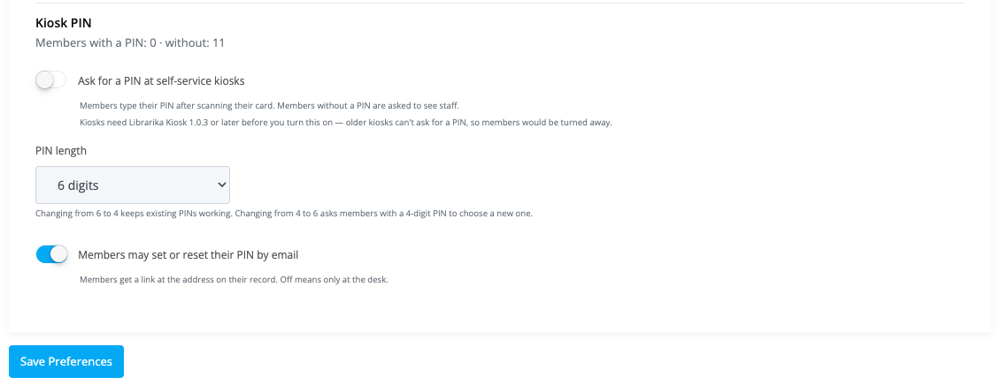

# SIP2 integration

**Who this is for:** library staff connecting a self-checkout kiosk or other SIP2 device. Using the Librarika Kiosk app? Go straight to [Kiosk app: setup and management](kiosk-app.md).

**What you can do here:** connect a SIP2 device: licences, connection details and setup steps.

If you are looking for browser-based self-checkout without any hardware, see [Online Self-Service](self-service.md#online-self-service) instead.

## What is SIP2?

SIP2 (Standard Interchange Protocol 2) is the standard way self-service devices, such as self-checkout kiosks, talk to a library system. Librarika's SIP2 service lets these devices look up members, check items out and check them in.

## Requirements

To use SIP2-based self-checkout, you will need:

* A **SIP2 licence for each terminal** -- Librarika sets up and licenses each terminal for you. Contact Librarika support for availability on your plan and for pricing.
* A **dedicated staff account for each terminal** -- an active user account in your library that is used only by that terminal, not a person's own login.
* **Kiosk hardware** -- A computer or tablet to serve as the self-checkout terminal.
* A **barcode scanner** -- To scan member IDs and item barcodes.
* **SIP2-compatible kiosk software** -- Software that connects to Librarika via the SIP2 protocol such as the [Librarika Kiosk App](#librarika-kiosk-app) below.

## Licensing

SIP2 is licensed per terminal. Each terminal that connects to Librarika needs its own licence, which Librarika links to the terminal's staff account. A licence runs for a set period (usually a year). After the end date the terminal keeps working for a grace period that Librarika sets; the `SIP2` tab shows *Licence ended: working until <date>*. A licence can also list the IP addresses the terminal may connect from. Contact Librarika support for pricing and to add, move or renew a terminal.

## Connection details

* **Host**: `sip2.librarika.com`, port **6009**, SIP2 over TLS (encrypted) only.
* **Institution ID (AO)**: your library's subdomain, for example `mylibrary` for `mylibrary.librarika.com`.
* **Account**: the terminal's own staff account; see [Get a terminal licence and account](kiosk-app.md#get-a-terminal-licence-and-account).
* **Login (93)**: CN = username (the account's email address), CO = password.
* **Terminal password (AC)**: in every patron status, checkout and check-in message, `username:password` of the terminal account (its email address, a colon, its password).
* **Supported messages**: login (93), SC status (99), patron status (23), patron information (63), checkout (11), check-in (09), renew (29) and renew all (65). Renew is offered only when your library has renewals on, and the member's holds only when your library has holds on (see [Renewals and holds at the kiosk](kiosk-app.md#renewals-and-holds-at-the-kiosk)). The SC status reply shows what your library offers at the time; a change is seen within about a minute.
* **Shared card numbers**: if more than one member has the same **Member No**, the patron is refused with *"This card number matches more than one account. Please ask at the desk."*
* **Loan periods**: a checkout without a due date gets the **Checkout Time** on the `Self Service` tab, never past the **Checkout Limit**.
* **Card and item barcodes**: the patron identifier must be exactly the member's **Member No**; the item identifier is the copy's accession number.
* **Allowed IPs**: if the licence lists IP addresses or ranges, the terminal must connect from one of them.
* **Kiosk PIN**: if your library [asks for a kiosk PIN](#kiosk-pin), the terminal must send the member's PIN as the patron password (AD) in every patron status (23), patron information (63), checkout (11), renew (29) and renew all (65) message. The PIN is sent over the encrypted connection only. Without it the member is refused with *"Please enter your PIN."*

## Setup steps

1. **Create a terminal account for each terminal and have it licensed:** see [Get a terminal licence and account](kiosk-app.md#get-a-terminal-licence-and-account). Ask for the licence **before** you require two-step verification for staff.
2. **Enter the connection details above** in your kiosk software.
3. **Print barcode labels** for your catalog items and member cards. See [Barcode labels](barcode-labels.md) for instructions.
4. **Test** the connection by performing a test checkout and check-in at your kiosk.

## Kiosk PIN

By default a member only scans their card at a kiosk. You can also ask members to type a **kiosk PIN** after they scan their card, so that a lost or borrowed card is harder to misuse.

* The kiosk PIN is only for your library's self-service kiosks. It is **separate from the member's sign-in password**: it doesn't sign anyone in to the website or the Librarika app, and the sign-in password doesn't work as a PIN.
* Librarika keeps only a scrambled (one-way) form of the PIN, so neither library staff nor Librarika can look it up. It isn't shown on screen, written to logs or sent by email.
* The PIN is asked only at SIP2 kiosks. [Online self-service](self-service.md#online-self-service) and the Librarika app keep using the member's sign-in.

### Before you turn it on

1. **Update every kiosk to Librarika Kiosk 1.0.3 or later** (see [Updates](kiosk-app.md#updates)). Older versions can't ask for a PIN, so members would be turned away. If you use kiosk software from another supplier, check that it asks for the patron password and sends it to Librarika (see [Connection details](#connection-details)).
2. **Make sure most active members have a PIN first.** Each kiosk accepts at most 30 refused PINs an hour, and a member without a PIN who tries the kiosk counts as one. After that, the kiosk refuses everyone, even members with the right PIN (*"PIN check not available"*), until the hour is up. Check the *Members with a PIN: … · without: …* counts on the `SIP2` tab before you switch on.
3. **Help members choose a PIN.** You can set PINs while the requirement is still off: staff can do it at the desk or email members a link (see [Kiosk PIN on the member page](members.md#kiosk-pin)), and members can do it themselves on your library's `/pin` page (see [Set or reset your kiosk PIN](using-a-kiosk.md#set-or-reset-your-kiosk-pin)).

### Turn it on

The settings are on the `SIP2` tab of `Manage` > `Preferences`, under **Kiosk PIN**. The tab appears once a terminal is licensed for your library. The section also shows how many active members have a PIN and how many don't (*Members with a PIN: … · without: …*).

* **Ask for a PIN at self-service kiosks**: members type their PIN after scanning their card. Members without a PIN are asked to see staff, and each of their tries counts towards the kiosk's limit of 30 refused PINs an hour (see [Before you turn it on](#before-you-turn-it-on)). When you switch it on, Librarika reminds you that kiosks need Librarika Kiosk 1.0.3 or later and tells you how many members have no PIN yet: *"Members without a PIN (…) will be asked to see staff at the kiosk. Switch on?"*
* **PIN length**: `6 digits` (the default) or `4 digits`. Changing from 6 to 4 keeps existing PINs working. Changing from 4 to 6 asks members with a 4-digit PIN to choose a new one: after they type their old PIN, the kiosk tells them to choose a new PIN.
* **Members may set or reset their PIN by email** (on by default): members can ask for a link on your library's `/pin` page, and staff see an email-link button on the member page. The link goes to the email address on the member's record. Turn it off if PINs should be set only at the desk.

Click `Save Preferences`. Kiosks pick up the change within about five minutes.

### PIN rules

A PIN has exactly the number of digits your library chose. Librarika refuses PINs that are easy to guess:

* the same digit, or a repeated pair or group of three (for example `111111`, `121212`, `123123`);
* digits counting up or down (for example `123456` or `654321`);
* the member's card number, or part of it;
* PINs that many people use.

### Wrong PINs and locks

* After **5 wrong PINs in a row**, the member's card is locked at the kiosks for **15 minutes**.
* After each further **5 wrong PINs**, it is locked for **an hour**.
* After **50 wrong PINs in a row**, it stays locked until staff click `Unlock` on the member page or a new PIN is set.
* A right PIN, a new PIN or a staff unlock starts the count again.

Only the kiosks refuse a locked card; the member can still borrow at the desk. Staff see the lock on the [member page](members.md#kiosk-pin). Each kiosk also accepts at most 30 refused PINs an hour; after that it says *"PIN check not available. Please ask the library staff."* for up to an hour.

### What the kiosk shows

Until the PIN is right, the kiosk shows nothing about the member: no name, loans or fees, only the last four characters of the card number. An unknown card, a card number shared by two members and a member who isn't active get the same answer as a wrong PIN. A card that is locked or has no PIN gets its own message, so the member knows what to do. For what members see, see [Using a kiosk](using-a-kiosk.md#enter-your-pin).

## Librarika Kiosk App

Librarika has its own kiosk app for self-checkout terminals. Members scan their library card, then borrow and return items and, if your library uses them, renew items and see their holds; staff set it up with an admin PIN and can add branding, library hours, auto sign-out and receipt printing. Renewals and holds need Librarika Kiosk 1.0.2 or later, and the [kiosk PIN](#kiosk-pin) needs 1.0.3 or later, installed over the current version from the [Librarika Kiosk App](https://librarika.com/spages/librarika-kiosk-app) page.

* For staff: [Kiosk app: setup and management](kiosk-app.md).
* For members: [Using a kiosk](using-a-kiosk.md).
* Downloads and supported systems: the [Librarika Kiosk App](https://librarika.com/spages/librarika-kiosk-app) page.

## FAQ

**Is SIP2 available on the Free plan?**

Each SIP2 terminal needs its own licence from Librarika. Contact Librarika support to ask about SIP2 for your plan and about pricing.

**Do I need a barcode scanner?**

Yes. SIP2 kiosk-based checkout requires a barcode scanner to scan member IDs and item barcodes. If you don't need hardware-based checkout, consider using [Online Self-Service](self-service.md) instead -- it works from any browser with no scanner needed.

**Can I use third-party kiosk software?**

Yes. Any SIP2-compatible kiosk software can connect to Librarika. Librarika also has its own kiosk app: see [Kiosk app: setup and management](kiosk-app.md).

**Can two kiosks share one SIP2 licence?**

No. Each terminal has its own licence and signs in with its own active staff account in your library. Use a separate account for each terminal, not a person's own login, because a terminal account is meant for SIP2 use only.

**Where can I see my SIP2 terminals and when their licences end?**

Go to `Manage` > `Preferences` and open the `SIP2` tab (it appears once a terminal is licensed for your library). It shows each terminal's allowed IPs, licence end date, status and when it was last used. To add, move or renew a terminal, contact Librarika support.

**Why has my kiosk stopped working?**

Check the status on the `SIP2` tab in Preferences. The licence may have expired (after the end date the terminal keeps working for a grace period that Librarika sets; the tab shows *Licence ended: working until <date>*), it may be suspended, or the kiosk may be connecting from an IP address that is not in its allowed list, for example after an internet provider change. Contact Librarika support to renew the licence or update the allowed IPs.

**What can members do at a SIP2 kiosk?**

Members can identify themselves, check out items and return them. If your library has renewals on, they can also renew their items (see [Renewal settings](self-service.md#renewal-settings)); if it has holds on, the Librarika Kiosk shows their holds and warns when a returned item is on hold for someone else (see [Hold queue](hold-queue.md)). Members can't place holds or pay fees at a kiosk.

**Do kiosk checkouts follow my circulation rules?**

Yes. The same checks apply as at the desk: an inactive member, a member who has reached their booking quota or dues limit, an item with circulation disabled, an item already issued, or an item on the hold shelf for another member is refused.

**Can members be asked for a PIN at the kiosk?**

Yes. Switch on **Ask for a PIN at self-service kiosks** on the `SIP2` tab in Preferences, after every kiosk runs Librarika Kiosk 1.0.3 or later. See [Kiosk PIN](#kiosk-pin).

**Is the kiosk PIN the member's password?**

No. It is a separate number used only at your library's kiosks. It doesn't sign anyone in to the website or the app, and changing one doesn't change the other.

**What happens to members who have no PIN when we turn it on?**

After they scan their card and type a PIN, the kiosk shows **Kiosk PIN needed**: *"Please see the library staff to set your kiosk PIN."* Set one for them at the desk, or email them a link (see [Kiosk PIN on the member page](members.md#kiosk-pin)). Each of their tries also counts towards the kiosk's limit of 30 refused PINs an hour, so set PINs before you switch on: the `SIP2` tab shows how many active members still have no PIN.

**Can staff see or tell a member their PIN?**

No. Librarika keeps only a scrambled (one-way) form of the PIN, so neither library staff nor Librarika can look it up. The PIN isn't shown on screen, written to logs or sent by email. If a member forgets it, they choose a new one at the desk or with an emailed link.

**A member is locked out of the kiosk. What do I do?**

Open the member's page: the **Kiosk PIN** row shows the lock. Click `Unlock`, or let the member choose a new PIN with `Reset PIN at the desk`. A short lock (15 minutes or an hour) also ends by itself. See [Wrong PINs and locks](#wrong-pins-and-locks).

**Does a third-party SIP2 kiosk work with the kiosk PIN?**

It should, if it asks for a PIN and sends it as the patron password (AD) in every patron status, patron information, checkout and renew message. Librarika has tested the PIN only with Librarika Kiosk, so test with your supplier before you turn it on.
