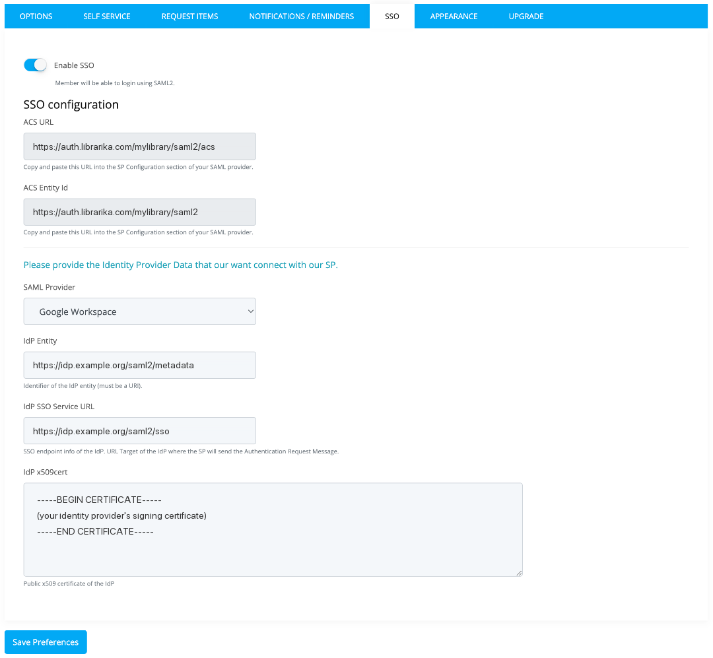

# Single sign-on (SSO with SAML)

**Who this is for:** library administrators who want staff and members to sign in with their school's or organisation's own login.

**What you can do here:** connect your identity provider to Librarika, decide whether SSO is the only way in, and fix common problems. For what members see when they sign in with SSO, see [Signing in](signing-in.md#signing-in-with-your-organisations-sso).

---

## What SSO is

With single sign-on (SSO), people sign in to your library with the login they already have at your school or organisation, for example their Google Workspace or Microsoft account. Your organisation's **identity provider (IdP)** checks who they are and tells Librarika, using the **SAML 2.0** standard. Librarika supports any identity provider that speaks SAML 2.0.

SSO adds a way to sign in; it doesn't replace the Librarika account. Each person still has their own Librarika account, which they also use on librarika.com and in other libraries.

**Availability:** Librarika support switches SSO on for each library after checking your settings. If SSO isn't available for your library yet, the SSO tab shows a note in red next to **Enable SSO**. Ask [Librarika support](https://librarika.com/spages/contact) whether your plan includes SSO and to switch it on.

---

## Set up SSO

You need someone who can add a SAML application in your identity provider's admin console.

**Before you start:** if **Enable SSO** has a red note next to it, SSO isn't available for your library yet. [Contact Librarika support](https://librarika.com/spages/contact) first: until SSO is available, the identity provider details you enter in Step 3 are **not saved**, and **Enable SSO** shows as off again after you save.

### Step 1: open the SSO tab

In the sidebar, go to **Manage** > **Preferences** and open the `SSO` tab. Switch on **Enable SSO** (*"Member will be able to login using SAML2."*). The rest of the SSO settings appear.

The **SSO only on the website** and **SSO only on the mobile app** switches (see [SSO only](#sso-only)) appear under **Enable SSO**; they are not in this picture.

Under **SSO configuration** Librarika shows two values to give your identity provider:

* **ACS URL**: `https://auth.librarika.com/<your-library>/saml2/acs`
* **ACS Entity Id**: `https://auth.librarika.com/<your-library>/saml2`

`<your-library>` is your library's subdomain, for example `mylibrary` for `mylibrary.librarika.com`.

### Step 2: add Librarika to your identity provider

In your identity provider, create a new **SAML application** (sometimes called a custom or enterprise SAML app):

* **ACS URL** (also called *Reply URL* or *Assertion Consumer Service URL*): paste the **ACS URL**.
* **Entity ID** (also called *Audience* or *SP Entity ID*): paste the **ACS Entity Id**.
* **Name ID**: must be the person's **email address**, the same address as their Librarika account. Sign-in fails without it.
* **Signed assertions**: the identity provider must sign its SAML assertions.
* Give the people who should use the library access to the application.

Librarika doesn't read other attributes: a new account's name starts as the part of the email before `@`, and the person can change it in their settings.

**Google Workspace:** in the Admin console, add a custom SAML app. Use the ACS URL and Entity ID above, and set **Name ID** to the primary email.

**Microsoft Entra ID:** add an enterprise application (non-gallery) with SAML sign-on. Use the values above, and make sure the Name ID is the user's email address (for example `user.mail`). Guest accounts whose name contains `#EXT#` can't sign in.

### Step 3: enter your identity provider's details

Your identity provider shows its own SAML details (often on a page called *IdP metadata* or *SAML signing certificate*). Copy them into the SSO tab:

* **SAML Provider**: choose your provider from the list.
* **IdP Entity**: your identity provider's identifier, a URI.
* **IdP SSO Service URL**: the address Librarika sends people to for signing in.
* **IdP x509cert**: your identity provider's public signing certificate. Paste the text of the certificate.

Librarika doesn't import a metadata file: copy each value by hand.

### Step 4: save and ask for activation

Click `Save Preferences` and check that your values are still there after the page reloads (if they are gone, SSO isn't available for your library yet: see [Before you start](#set-up-sso)). Then [contact Librarika support](https://librarika.com/spages/contact) to activate SSO for your library. SSO doesn't work until support has checked and activated it.

### Step 5: test

After support confirms, open your library's login page in a private browser window and click `Sign in with SSO` (the key button). Sign in on your identity provider's page; you should come back to your library signed in. There is no separate test button.

---

## SSO only

Two switches on the `SSO` tab make SSO the only way into your library. They only work while **Enable SSO** is on.

* **SSO only on the website**: *"Members and staff can sign in to this library's website with SSO only. Anyone signed in another way (password, Google, or from My Libraries on librarika.com) is signed out and asked to sign in with SSO."*
	* The login page then shows only the SSO button.
	* You can switch it on only **while you are signed in with your library's SSO**, so you can't lock yourself out. Otherwise you see *"Saved, but "SSO only" for the web was not switched on: sign out, sign in with this library's SSO, then switch it on."*
	* Google and Apple sign-ups aren't accepted for your library.

	**Before you switch it on:**

	1. Make sure your own Librarika email exists in your identity provider. An owner account such as library@yourschool.edu may not exist there; if so, sign in with an account that does and give it the **Library Administrator** role first (see [Users](users.md#add-user)).
	2. If you also use Librarika in another library, sign in with your password and tick this library under **Settings** > **SSO sign-in** (see [Who SSO can sign in](#who-sso-can-sign-in)).
	3. Sign out, sign in with `Sign in with SSO`, then switch on **SSO only on the website** and click `Save Preferences`.
* **SSO only on the mobile app**: *"In the Librarika mobile app, members and staff can open this library only after signing in with this library's SSO. App sign-ins with a password, Google or Apple are refused for this library."*

People's Librarika accounts keep working on librarika.com and in other libraries. Before you switch either on, check that every person's email in your identity provider matches their Librarika email.

Self-checkout kiosks that sign in with a licensed terminal account keep working when you switch on SSO only.

**If SSO stops working.** While **SSO only on the website** is on, nobody can sign in to your library's website if your SSO breaks (for example, your identity provider's signing certificate expires or changes, or its SAML app is removed), administrators included. [Contact Librarika support](https://librarika.com/spages/contact): support can still open your library and turn SSO only off. To avoid this, paste your identity provider's new certificate into **IdP x509cert** before the old one expires.

---

## Who SSO can sign in

When someone signs in with your SSO for the first time:

* **No Librarika account with that email yet:** SSO creates one. If your library already has a member with that email who hasn't joined, they are linked to that member straight away. Otherwise your member request settings decide: they join at once if `Join member automatically.` is on, the request waits for staff if not, and it is refused if `Enable member access request.` is off.
* **An account with that email already exists:** SSO signs in only if your library is on that person's own **SSO sign-in** list (in their settings). Your library is added for them automatically when SSO created the account, or when the account belongs only to your library. Otherwise they see *"This library's SSO is not allowed to sign in to your account yet. Sign in with your password or Google, then tick this library under Settings, "SSO sign-in"."* They do that once, and SSO works from then on. If your library has **SSO only on the website** on, they do it on **librarika.com** (your library's own login page accepts only SSO): sign in there with their password or Google, open their settings, tick your library under **SSO sign-in** and click `Save Settings`; then they use `Sign in with SSO` on your library's page.
* **An account that was never confirmed:** they see *"Please confirm your email address first. Use the link in the email we sent you."*

This protects accounts used in more than one library: one organisation's SSO can't take over an account it doesn't own. An account that isn't linked to any library yet is not added to your library's list automatically either.

**Rollout note:** while Librarika is rolling out this check, people whose account isn't on the list may still be signed in, and Librarika only records these sign-ins. Once the check is enforced, they see the message above.

### What people can't change after signing in with SSO

A session started with SSO can't change how the account signs in. To change their email address, turn on Google or Apple sign-in, change the SSO sign-in list, sign out other sessions or remove their account, people sign in with their password or Google. They see, for example, *"You signed in with SSO. Sign in with your password or Google to change your email address."*

**No Librarika password, or the library allows SSO only?** An account created by SSO has no password its owner knows, and an SSO-only library's login page refuses password and Google sign-ins. Make these changes on **librarika.com** instead: click `Forgot password?` there, set a password from the email, then sign in on librarika.com with it and make the change. Resetting the password also signs out every other browser and phone, including a lost phone.

### Passwords and SSO

People you invite still create a **Librarika password** when they accept the invitation. It is separate from your organisation's password: they need it on librarika.com and in other libraries, where your SSO doesn't sign them in.

### Two-step verification and SSO

People who sign in with SSO usually aren't asked for a two-step code, because your identity provider has its own checks. To ask anyway, see [Library sign-in security](library-sign-in-security.md#two-step-verification).

---

## SSO in the mobile app

In the Librarika app, people tap the SSO button (the key) on the sign-in screen, enter your library's web address (for example `mylibrary`) and sign in on your identity provider's page. The app remembers the library for next time. See [Get the app & sign in](mobile-app.md).

---

## Troubleshooting

| What people see | What to do |
|---|---|
| *"Your SSO login is either invalid or expired."* | The sign-in took too long, was reused, or SSO isn't active yet. Try again from the library's login page. If it keeps happening, check the ACS URL, Entity ID and certificate on both sides, and ask support whether SSO is activated. |
| *"Your organisation's sign-in did not send an email address. …"* | Set the Name ID in your identity provider to the user's email address. |
| *"This library's SSO is not allowed to sign in to your account yet. …"* | The person's account is also used elsewhere. They sign in with their password or Google once and tick your library under **SSO sign-in** in their settings. |
| *"More than one account uses this email address, so it cannot be signed in this way. …"* | Contact Librarika support. |
| *"This library allows sign-in with its SSO only. Please sign in with SSO."* | **SSO only on the website** is on. Use the `Sign in with SSO` button. |
| *"SSO is not available for this library."* (app) | SSO isn't switched on for the library, or support hasn't activated it yet. |

---

## FAQ

**Is SSO active as soon as I save?**

No. After you save your SSO settings, contact Librarika support. SSO works once support has checked and activated it.

**Can members still sign in with their Librarika password?**

Yes, unless you switch on **SSO only on the website** (see [SSO only](#sso-only)). Enabling SSO adds a way to sign in; it doesn't remove the others.

**My identity provider isn't in the SAML Provider list.**

Any SAML 2.0 identity provider works. Contact Librarika support and tell them which provider you use.

**Do members need to be added in Librarika first?**

No. A person without a Librarika account gets one at their first SSO sign-in, and joins or asks to join your library (see [Who SSO can sign in](#who-sso-can-sign-in)). Members you already added are linked when the email in your identity provider matches.

**Why does an invited member have to create a password if we use SSO?**

The Librarika account is theirs, not the library's: they also use it on librarika.com and in other libraries, where your SSO doesn't sign them in. They can still use SSO for your library.

**Can members use SSO in the mobile app?**

Yes. See [SSO in the mobile app](#sso-in-the-mobile-app).
