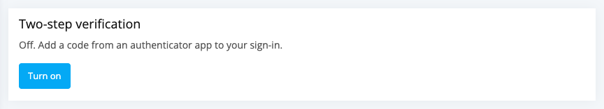
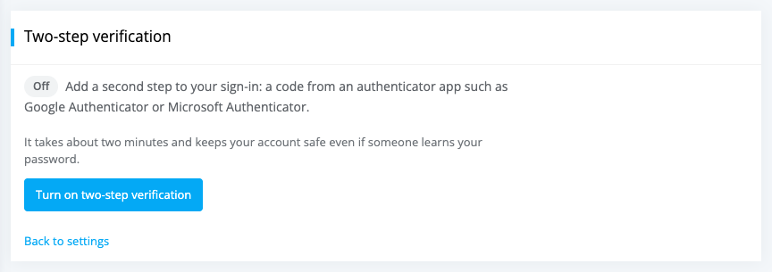
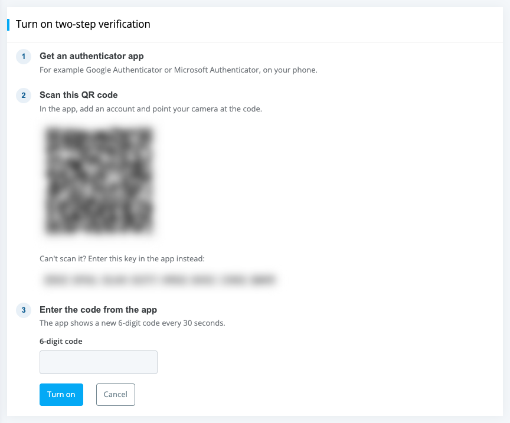
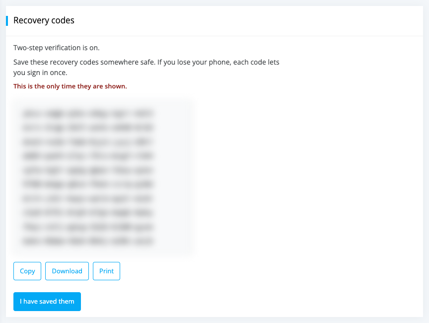
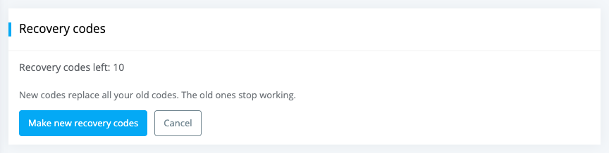
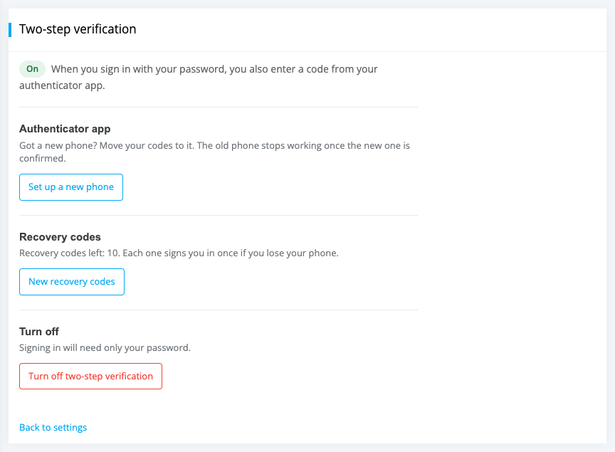
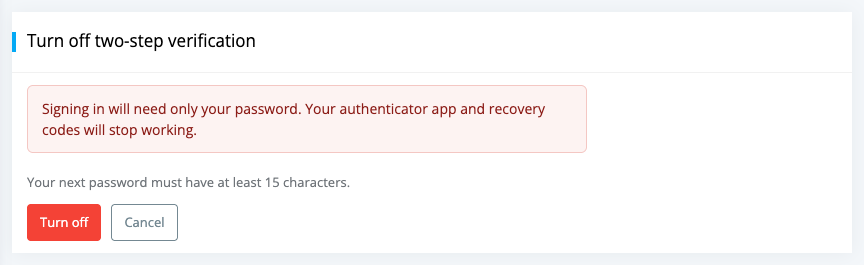

# Two-step verification

**Who this is for:** everyone who signs in with a password: library staff, members and app users.

**What you can do here:** turn two-step verification on or off, sign in with a code, keep your recovery codes, and move to a new phone.

Two-step verification adds a second step to signing in with your password. After your password, you enter a **6-digit code** from an **authenticator app** on your phone. The code changes every 30 seconds.

It keeps your account safe **even if someone learns your password**: without your phone they can't sign in.

### What you need

An authenticator app on your phone, for example **Google Authenticator**, **Microsoft Authenticator** or **1Password**. Most authenticator apps work. The app works without an internet connection and doesn't need your phone number.

### Turn on two-step verification

1. Open your settings: members click `My Account` > `Account Settings`; staff click the settings menu (gear icon) > `Settings`.
2. Find **Two-step verification** and click `Turn on`.

	

3. Click `Turn on two-step verification`.

	

4. Librarika may ask you to [confirm it's you](signing-in.md#confirm-its-you) first.
5. Follow the three steps on the page:
	* **Get an authenticator app** on your phone.
	* **Scan this QR code**: in the app, add an account and point your camera at the code. Can't scan it? Type the key shown under the code into the app instead.
	* **Enter the code from the app** in the **6-digit code** field and click `Turn on`.

	

	If you see *"That code is not right. Please check the time on your phone and try again."*, wait for the next code. Make sure your phone's date and time are set automatically.

6. Save your **10 recovery codes** (see below), then click `I have saved them`.

When two-step verification is turned on (or off), you get an email, and your other browsers and phones are signed out.

### Recovery codes

Recovery codes let you sign in if you lose your phone. You get **10 codes**, and **each one works once**.

* The codes are shown **only once**. Click `Copy`, `Download` or `Print` and keep them somewhere safe, such as a password manager or a printed sheet at home. Don't keep them only on the phone that has your authenticator app.
* To use one, type it into the code field when you sign in, instead of the 6-digit code.
* When you use a recovery code, you get an email about it.
* The two-step verification page shows how many codes you have left.

To get new codes, open the **Two-step verification** page, click `New recovery codes`, then `Make new recovery codes`. New codes replace all your old codes; the old ones stop working.

### Signing in with two-step verification

1. Sign in with your username (email) and password as usual.
2. On **Enter your code**, open your authenticator app and type the 6-digit code it shows for Librarika into **Code**.
3. If this is your own computer or phone, tick **Don't ask again on this device for 30 days**. Don't tick it on a shared or public computer.
4. Click `Verify`.

**Lost your phone?** Type one of your recovery codes into the same **Code** field.

Good to know:

* If you enter too many wrong codes, you see *"Too many wrong codes. Please sign in again."* After many wrong codes you have to wait: *"Too many wrong codes. Please try again in an hour."*
* Signing in with **Google**, **Apple** or your library's **SSO** usually doesn't ask for the code, because those services have their own checks. Your library (or Librarika) can choose to ask for the code after those sign-ins too.
* Changing your password, or turning two-step verification off, makes every device ask for the code again.

### Manage two-step verification

When two-step verification is on, the section in your settings shows **On** and how many recovery codes you have left. Click `Manage`.

* **Set up a new phone** -- move your codes to a new phone. Scan the new QR code with the new phone and enter its code, then click `Use this phone`. Your current phone keeps working until you confirm the new one; after that, the old phone's codes stop working.
* **New recovery codes** -- replace your recovery codes (see above).
* **Turn off two-step verification** -- see below.

### Turn off two-step verification

1. On the **Two-step verification** page, click `Turn off two-step verification`.
2. [Confirm it's you](signing-in.md#confirm-its-you) with your password and a code.
3. Click `Turn off`.

After that, signing in needs only your password, and your authenticator app and recovery codes stop working. Your **next** password must have at least **15 characters**; the password you have now keeps working.

If your library requires two-step verification, the page says *"Two-step verification is required for your account and cannot be turned off."*

### When your library requires it

A library can require two-step verification for its staff, or for staff and members. If you need it and haven't set it up yet, Librarika asks you after you sign in with your password: **Set up two-step verification** -- *"Your account needs it to finish signing in."* Follow the same three steps as above, save your recovery codes and click `I have saved them, continue`.

If you belong to several libraries and **any** of them requires it, you need it for your whole account.

---

## Lost your phone?

* **You still have your recovery codes:** sign in with a recovery code instead of the 6-digit code. Then open **Two-step verification** and click `Set up a new phone`.
* **You still have your old phone** but are getting a new one: use `Set up a new phone` before you reset or give away the old phone.
* **You have neither your phone nor your recovery codes:** contact your library or [Librarika support](https://librarika.com/spages/contact). Librarika support can turn off two-step verification for your account **after checking who you are**. When they do, you are signed out everywhere, you get an email, and at your next sign-in you [choose a new password](passwords.md#choose-a-new-password). Then turn two-step verification on again.

Your library's staff can't turn off two-step verification for you, but they can help you contact Librarika support.

If your phone was lost or stolen, also [sign it out](sign-in-activity.md#sign-out-a-device) in **Where you are signed in**.

---

## FAQ

**Do I need two-step verification?**

It is optional unless your library requires it. We recommend it for everyone, and especially for library staff: it protects your account even if someone learns your password.

**Which authenticator app should I use?**

Any common authenticator app works, for example Google Authenticator, Microsoft Authenticator or 1Password.

**Where are my recovery codes?**

Librarika shows them only once, when you turn on two-step verification or make new ones. If you didn't save them, open **Two-step verification** and click `New recovery codes` to make a new set; the old ones stop working.

**I got a new phone. How do I move my codes?**

Before you reset the old phone, open **Two-step verification**, click `Set up a new phone` and scan the new QR code with the new phone. The old phone keeps working until you confirm the new one.

**My code is always "not right". Why?**

The codes depend on your phone's clock. Set your phone's date and time to update automatically, then try the newest code.

**Why can't I turn off two-step verification?**

Your library (or one of your libraries) requires it. The page says *"Two-step verification is required for your account and cannot be turned off."*

**Does signing in with Google, Apple or SSO ask for my code?**

Usually not, because those services have their own checks. Your library can choose to ask for the code after those sign-ins too.
