# Users & roles

**Who this is for:** library admins.

**What you can do here:** add staff, choose their roles and branch access, re-send invitations, and see when staff were last active.

Users are those who can administer or manage all the activities of your library depending on their role. They can sign in to the library dashboard and do regular managerial activities. They can also add or remove a user from the library.

**Users vs Members:** Users and Members are different concepts in Librarika. Users are staff accounts with access to the library dashboard for managerial activities. Members are library-specific records for people who borrow items. A person can be both a user and a member. For more details on members, see the [Members](members.md) page.

**Editing user information:** User accounts are independent and can be linked to multiple libraries in Librarika. As a library admin, you can change a user's role and permissions, but you cannot directly edit their personal details (name, email, etc.). Users manage their own personal information through their Account Settings by clicking on their profile icon.

## List users

Users is the section where you can see all the list of users based on their roles. They have access to the library and can do all the regular managerial workings of the library. 

To view list admin or stuff users, please follow the below steps:

* First, sign in to your library.
* Go to `Manage` > `Users`.

	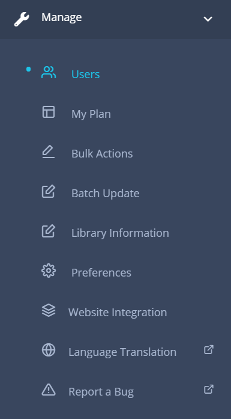

* Click on `Users` and a page will be appeared like below. Here you can see all the users of your library.

	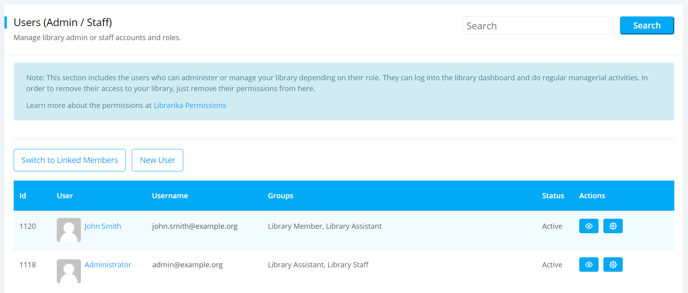

* If you click on the `View` icon next to any user then you can see all the information of that specific user like below.

	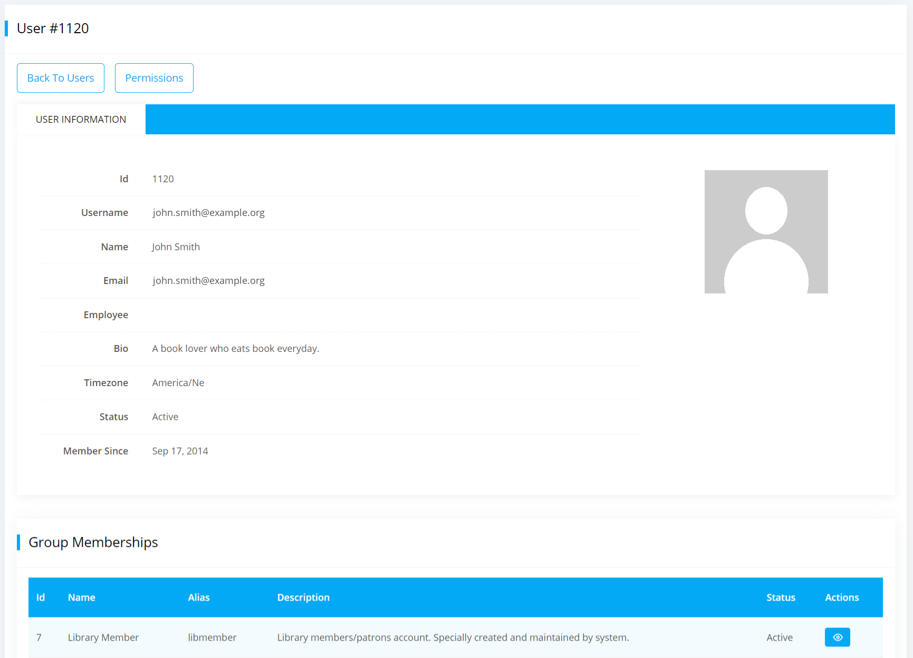

* Here you can also see the group information of that user, if you click on the view icon from the **Group Memberships** table.

	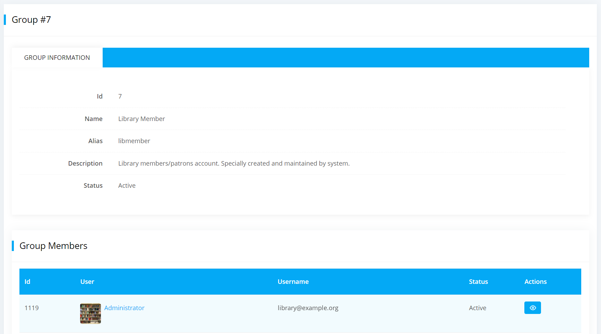

* Now you can also view all the related members of that group.

### Last active

The **Last active** column shows, for each user, when they last signed in to your library or opened it in the Librarika app (never counting Librarika support).

* A dash (`—`) means the user hasn't signed in to your library since this was introduced.
* Only their own sign-ins count. A visit by Librarika support never does.
* You can't see a user's sign-in history, devices or addresses. Each user sees their own in [Sign-in activity](sign-in-activity.md#sign-in-activity).

## Add user

User with library admin privileges can add a new user and give them access to the library for managerial activities.

To add a user, please follow the below steps:

* Please go to the `Users` section from the `Manage` dropdown menu.
* Click on `New User` button and a create user form will be appeared like below.

	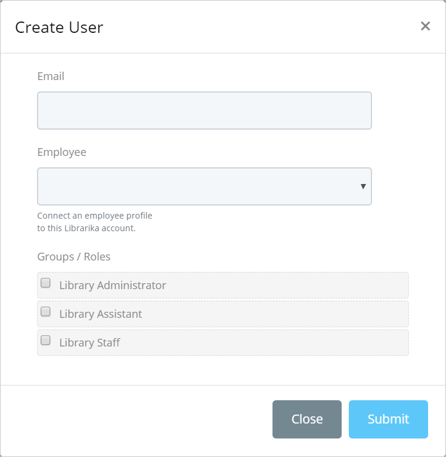

* Enter the user's **Email** and tick one or more **Groups / Roles**:
	* **Library Administrator** -- full access to all library settings and management features, including users, preferences and sign-in security.
	* **Library Assistant** and **Library Staff** -- day-to-day library work such as circulation and cataloging. The form links to the **Librarika Permissions** page, which lists what each role can do.
* If the email isn't already one of your library's accounts, a **Name** field appears; it's used only if the email has no Librarika account yet. Enter the person's name.

	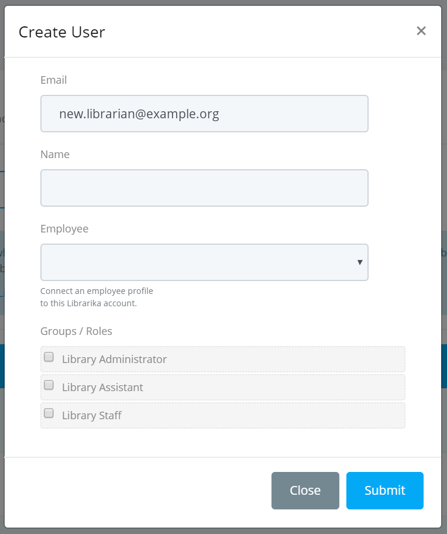

* **Employee** (optional): link an employee profile from `Others` > `Employees` to this account.

* Click `Submit`.
	* **The email already has a Librarika account:** Librarika emails the account's owner an invitation, and you see *"This email already has a Librarika account. We sent its owner an invitation; the account is added when they accept it."* The person isn't added to your library until they accept (see [Accept a staff invitation](#accept-a-staff-invitation)). Being staff puts their account under your library's sign-in rules, so the owner decides.
	* **A new account:** Librarika sends an invitation email, and the user shows as **Invited** until they accept it (see [Accept a staff invitation](#accept-a-staff-invitation)).

	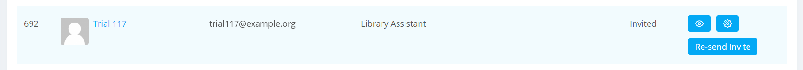

### Accept a staff invitation

This is what the person you invited does. **A new account:**

1. Open the invitation email from Librarika and click the link.
2. On **Set up your account** (*"Enter your name and choose a password to finish setting up your Librarika account."*), enter your name and choose a password: at least 15 characters (see [Passwords](passwords.md#what-makes-a-good-password)).
3. Click `Save and log in`. You are signed in to the library.

The link works for **30 days**. If it has expired, you see *"This link has expired. Please request a new one."*: ask the library to send it again with `Re-send Invite` (see [Resend invitation](#resend-invitation)).

**You already have a Librarika account?** The email asks you to join the library's staff instead:

1. Click the link in the email. If you aren't signed in, sign in first with **the account the email was sent to**.
2. The **Join the library staff** page shows the library and the roles it offers. Click `Accept the invitation`. You see *"You have joined the library staff."*, and the library appears under **My Libraries**.

This invitation works **once, for one week**. If it has expired or was already used, you see *"This invitation is invalid or has expired. Please ask the library to invite you again."* If your account isn't activated yet, you see *"Please activate your account first, then open this invitation link again."*: activate it from your activation email, then open the invitation link again while it is still valid.

**Limits:** a library can send only a limited number of these invitations a day. Over the limit, the library sees *"Too many invitations were sent today. Please try again tomorrow."*

## Resend invitation

When you will create a new user an invitation email will automatically send to the users email account for joining your library. That time if the user can not join the library for some reason then you can send the joining request again by clicking on re-send invite option.  

To do so, please follow the below steps:

* Please go to the `Users` section.
* Locate that user whom you want to send the invitation email again from users section and click on the `Re-send Invite` button on the right to that user.

	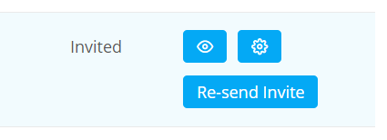

* Click on it and the invitation email will be send to the users email account for joining your library.
* If an user click on the joining request, then that user will be able to join the library.
* Now the status of this new user will be turned into **Active** from **Invited**.

## Add / update permission

You can change the groups or roles of a user by setting permissions for the users.

To set permissions, please follow the below steps:

* Click on `Change Permissions` icon from the users section.
* A form will be appeared like below.

	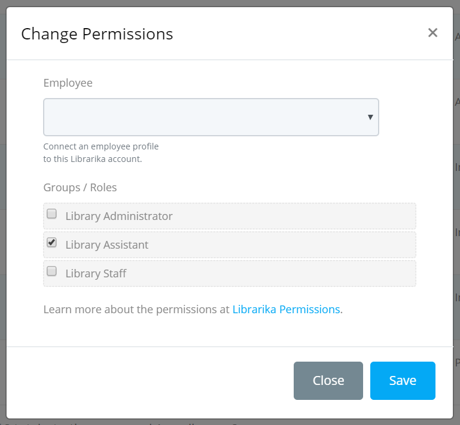

	When your library can limit users to branches, the dialog also has a **Branch Access** section below the roles (not shown here; see [Branch access](#branch-access)).

* Here you can change the groups or roles of a user from the previous one by changing permissions. You can also give a staff role to an account that isn't staff in your library yet (for example a linked member): Librarika then emails the account's owner an invitation, and you see *"We sent the account owner an invitation; the staff role is added when they accept it."* (see [Accept a staff invitation](#accept-a-staff-invitation)).
* Also you can select multiple groups or roles for a user when you will either add or update permission.
* Click on `Save` button when you are done and your permissions will be saved.

## Branch access

On plans that include branch access, and when your library has more than one branch, you can limit a user to some branches.

* Click `Change Permissions` for the user.
* Under **Branch Access**, untick **Full Access (All Branches)** and tick the branches they may work in (*"Restrict this user to specific branches. Leave "Full Access" checked for unrestricted access."*).
* Click `Save`.

The user then sees and changes only the copies, loans and holds of those branches, and the Users list shows **Branch Restricted** next to their name. Library Administrators always have every branch (*"Library Administrators always have full access to all branches."*). To give the user every branch again, tick **Full Access (All Branches)**.

The same **Branch Access** section is on a member's edit page, for members who use self-service.

## Remove permission

You can also remove the permissions that you have given to the users for your library.

To remove the permissions, please follow the below steps:

* Click on `Change Permissions` icon like before from the users section.
* Now the `Change Permissions` form will be appeared same as the **Add / Update Permission** section mentioned above.
* In the `Change Permissions` form you have to uncheck the gruops or roles options and click on **Save** button.

	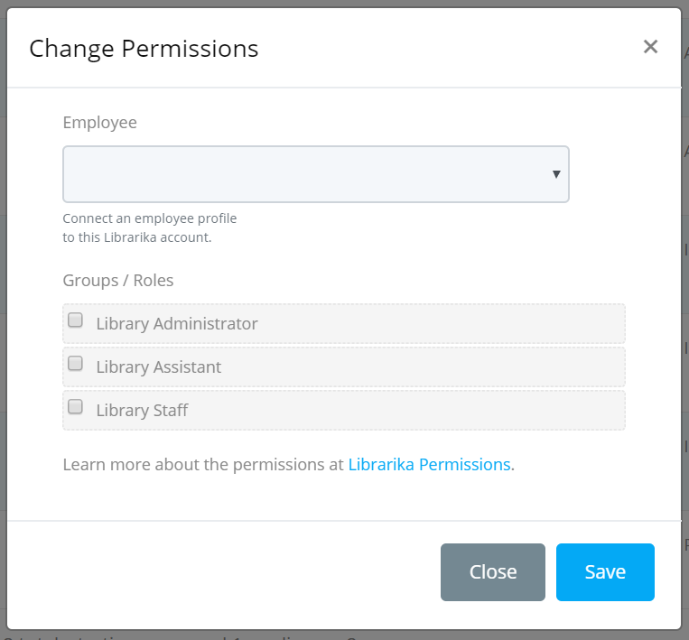

* Now the permissions will be removed for the users.

## Linked members

Linked members is the section where you can see the list of users who have access to the members area section of your library. They are the members who can sign in.

To view the list of linked members, please follow the below steps:

* Click on `Switch to Linked Members` button from the top of the users section.

	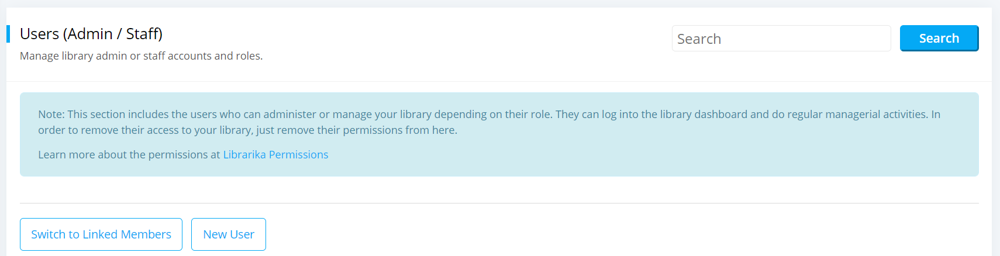

* Now click on the switch to linked members button and the `Linked Members` page will be appeared like below.

	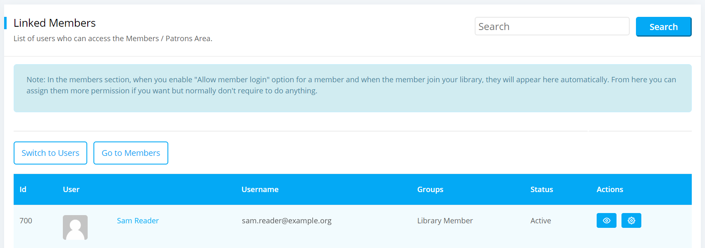

* All the member accounts are listed here. These users can not access admin dashboard by default. 
* However, you can give them a staff role with `Change Permissions` if you want them to be a part of your library management staff. The role is added only when they accept the invitation Librarika emails them (see [Add / update permission](#add-update-permission)).

---

## FAQ

**What does the Last active column show?**

For each user, when they last signed in to your library or opened it in the Librarika app (never counting Librarika support). See [Last active](#last-active).

**Can I change a staff member's name, email or password?**

No. Each person manages their own account in their settings. You can change their role or remove their permission (see [Add / Update Permission](#add-update-permission) and [Remove Permission](#remove-permission)).

**An invited user didn't receive the email. What can I do?**

Use [Resend Invitation](#resend-invitation), and ask them to check their spam folder.

**Which password does an invited user choose?**

A new password for Librarika, separate from their email and their organisation's SSO password. The invitation page explains this. See [Your Librarika password and your organisation's password](signing-in.md#your-librarika-password-and-your-organisations-password).

**A staff member lost their phone. How do they sign it out?**

They open their [Sign-in activity](sign-in-activity.md#sign-in-activity) and click `Sign out` next to the phone, or change their password, which signs out every other session. If the phone had their authenticator app, they sign in with a recovery code and use `Set up a new phone`. See [Lost your phone?](two-step-verification.md#lost-your-phone).

**Can I turn off a staff member's two-step verification or reset their password?**

No. They reset their own password with `Forgot password?`. If they lost their phone and their recovery codes, they contact Librarika support, who can turn off two-step verification after checking who they are. See [Helping people who can't sign in](helping-people-sign-in.md).

**Can I require two-step verification for staff?**

Yes, on the Gold, Platinum, Diamond, Enterprise and Unlimited plans, in **Preferences** > `Sign-in security`. See [Library sign-in security](library-sign-in-security.md).

**What does "Branch Restricted" mean in the Users list?**

The user can work only in some of your branches. See [Branch access](#branch-access).

**How do I stop someone from managing my library?**

Remove their permission (see [Remove Permission](#remove-permission)). Their Librarika account stays, but they can no longer open your library's dashboard.
