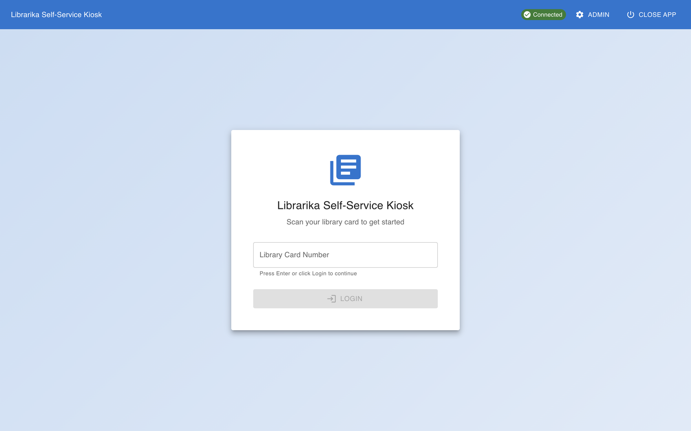
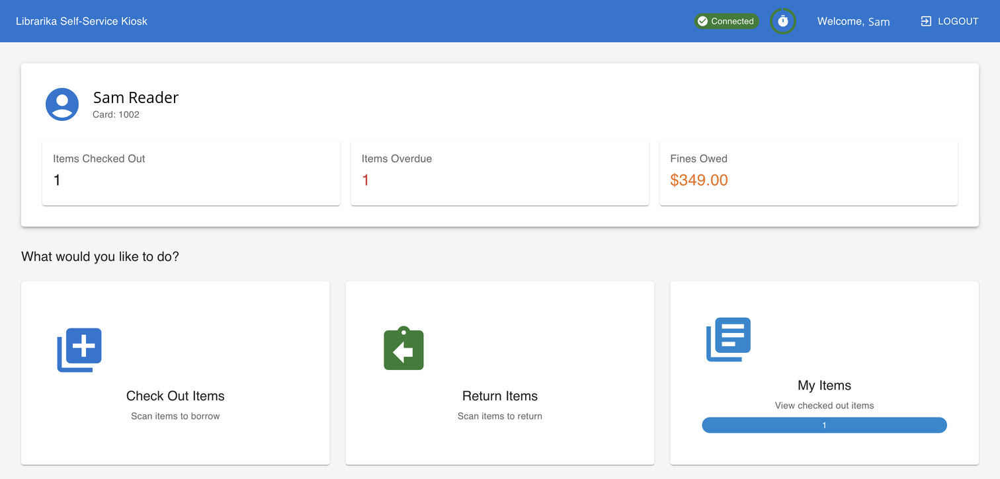

# Using a kiosk

**Who this is for:** members of a library that has a Librarika self-checkout kiosk.

**What you can do here:** learn how to borrow, return and renew items at the kiosk, see your holds, and what to do if the kiosk refuses.

---

## Sign in with your card

1. On the kiosk's start screen (*"Scan your library card to get started"*), scan the barcode on your library card (your member number). You can also type your card number in **Library Card Number** and click `Login`.

	

2. If the library has terms of use, read them and click `I Accept` (or `Decline` to stop). If the library asks, scroll to the end before `I Accept` becomes active. The library may have renamed the button.

You don't need a password at the kiosk: your card is enough. Keep your card safe.

You then see your card number, **Items Checked Out**, **Items Overdue** and **Fines Owed**, and your choices under *"What would you like to do?"*: `Check Out Items`, `Return Items`, `My Items` and, if your library uses holds, `My Holds`.

This picture is from an older version: when your library uses holds, the menu also has `My Holds`.

## Borrow items

1. Click `Check Out Items`.
2. Scan each item's barcode (or type it in **Item Barcode** and click `Check Out`).
3. Each item shows *"Item … checked out successfully!"* and its due date under **Checked Out Items**.

The due date follows your library's usual time for self-checkout. If you scan an item you already have, the kiosk doesn't lend it again: it shows **Already yours** and *"You already have this item, due …"*. If your library allows renewals, it asks *"Do you want to renew it?"*: click `Renew` to renew it, or `No, keep it` to leave the loan as it is. Nothing is renewed unless you choose `Renew`.

## Return items

1. Click `Return Items`.
2. Scan each item's barcode and click `Return Item` if needed.
3. Each item shows *"Item … returned successfully!"*

If another member has a hold on the item, the kiosk shows **Another member is waiting for this item** and tells you what to do with it, for example *"Please give it to library staff, or leave it where your library asks for held items."* Please don't put it back on the shelf.

## See your items

Click `My Items` to see what you have borrowed, with the due date of each item and how many days are left, or how many days it is overdue. Overdue items are listed first. Click `Back to Menu` to go back.

## Renew items

If your library allows renewals, `My Items` has a `Renew` button on each item, and `Renew all` to renew everything you can.

1. Click `My Items`.
2. Click `Renew` on an item, or `Renew all`.
3. A renewed item shows **Renewed** and *"Now due …"* with its new due date. An item that can't be renewed shows *"Not renewed: …"* with the reason, for example *"Another member is waiting for this item."* or *"This item has been renewed the maximum number of times."* After `Renew all`, the kiosk shows how many items were renewed and how many were not.
4. Click `Done` when you have finished.

The kiosk follows the same renewal rules as [renewing in the member area](member-area.md#renew-your-loans). On an overdue item the kiosk says *"Renewing adds the late fee so far to your account."* Overdue items can be renewed only if your library allows it; otherwise the kiosk says *"Overdue items can't be renewed."* and you should return the item.

If the connection drops while you renew, the kiosk can't tell whether the renewal went through. It says *"We could not confirm whether … was renewed. It may have gone through: please check its due date in My Items, or ask library staff."* Check the due date in `My Items` before you try again.

## See your holds

If your library uses holds, click `My Holds` to see the items you are waiting for. The menu shows how many holds are ready, for example **2 ready**.

* **Ready for pickup**: the item is waiting for you, with the date to collect it by. *"Collect it at the desk."* If your library has more than one branch, the kiosk says which one, for example **Ready for pickup at Main Library**.
* **Waiting**: your place in the queue, for example *"You are 2nd in the queue."*, and the branch to collect it at.
* **Suspended**: a hold you have paused, and until when.

You can't place, suspend or cancel holds at the kiosk. Use the [Member area](member-area.md#my-holds), the Librarika app (see [Get the app & sign in](mobile-app.md)) or ask at the desk.

## Receipts

If the library prints receipts, you get a receipt when you click `Print Receipt`, or by itself when you leave the checkout, return or `My Items` screen if the library prints receipts automatically. A renewal receipt shows each item's new due date. `Print My Items` prints the list of everything you have borrowed. Every receipt ends with the library's contact details when the library includes them. Receipts are printed only; the kiosk doesn't email them.

Your card number is partly hidden on receipts. If the kiosk signs you out because you left it alone, it doesn't print a receipt, so nothing is left in the printer for the next person.

## Finish

Near closing time you may see **Library Closing Soon**: click `I Understand` and finish your loans.

Click `Logout` at the top when you are done. If you leave the kiosk alone, it signs you out by itself: you see **Session Timeout Warning** shortly before; touch the screen or click `Continue Session` to keep going.

## What the kiosk can't do

You can't place holds or pay fees at the kiosk. To place a hold, use the [Member area](member-area.md#my-holds), the Librarika app (see [Get the app & sign in](mobile-app.md)) or ask at the desk. To pay, contact the library. If `Renew` or `My Holds` doesn't appear, your library doesn't offer renewals or holds at its kiosks; ask at the desk.

---

## If the kiosk refuses

| Message | What to do |
|---|---|
| *"Your account is blocked. Please see library staff."* | Ask at the desk. Your card may not be recognised, your membership may be inactive, or the kiosk itself may have a problem. |
| *"This card number matches more than one account. Please ask at the desk."* | Your card number belongs to more than one member. Staff need to fix it before you can use the kiosk. |
| *"This item is already checked out to another patron."* (the kiosk says *patron* for member) | The kiosk can't lend this item to you right now. It may be on loan or on hold for someone else, not for loan, or you may have reached your borrowing limit. Take it to the desk. |
| *"Member inactive or invalid."* | Your membership isn't active. Ask at the desk. |
| *"Your account cannot complete this action. Please see library staff."* | Ask at the desk. |
| *"This item could not be checked out. Please try again or ask library staff for help."* | Try once more, then take the item to the desk. |
| *"Item was not checked out."* (when returning) | This item wasn't on loan. Give it to staff. |
| *"Item not found in the system. Please check the barcode."* (when returning) | Scan again, or take the item to the desk. |
| *"This item could not be returned. Please try again or ask library staff for help."* | Try once more, then give the item to staff. |
| **Library Closed** | The kiosk only works during opening hours. |
| **Unable to Connect to Library Server** | The kiosk is offline. Ask at the desk. |
| *"Connection lost. Please check with library staff …"* | The connection dropped during your loan or return. Ask staff to check that the item was recorded. |
| *"We could not confirm whether … was renewed. …"* or *"We could not confirm which items were renewed. …"* | The renewal may have gone through. Check the due dates in `My Items`, or ask staff. |
| *"No items could be renewed. Please ask library staff for help."* | None of your items could be renewed. Ask at the desk, or return the items. |
