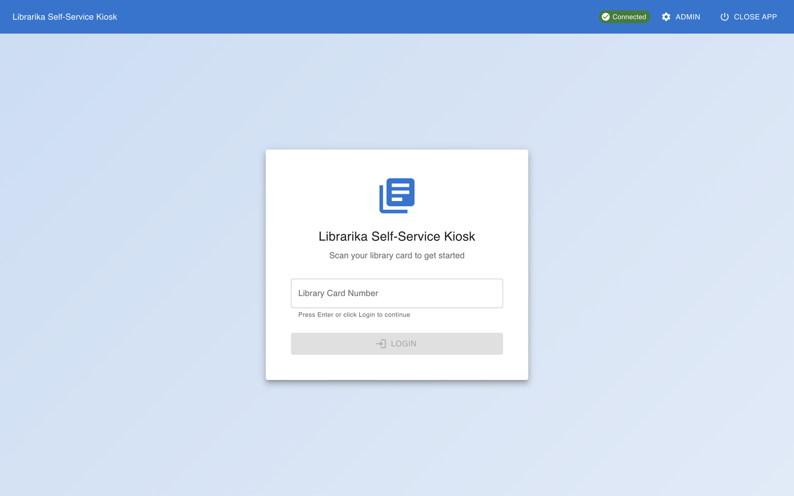
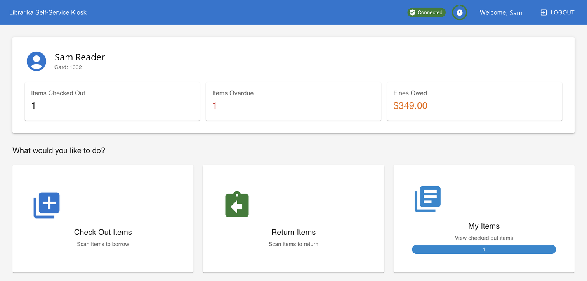

# Using a kiosk

**Who this is for:** members of a library that has a Librarika self-checkout kiosk.

**What you can do here:** learn how to borrow and return items at the kiosk, and what to do if it refuses.

---

## Sign in with your card

1. On the kiosk's start screen (*"Scan your library card to get started"*), scan the barcode on your library card (your member number). You can also type your card number in **Library Card Number** and click `Login`.

	

2. If the library has terms of use, read them and click `I Accept` (or `Decline` to stop). If the library asks, scroll to the end before `I Accept` becomes active. The library may have renamed the button.

You don't need a password at the kiosk: your card is enough. Keep your card safe.

You then see your card number, **Items Checked Out**, **Items Overdue** and **Fines Owed**, and three choices under *"What would you like to do?"*

## Borrow items

1. Click `Check Out Items`.
2. Scan each item's barcode (or type it in **Item Barcode** and click `Check Out`).
3. Each item shows *"Item … checked out successfully!"* and its due date under **Checked Out Items**.

## Return items

1. Click `Return Items`.
2. Scan each item's barcode and click `Return Item` if needed.
3. Each item shows *"Item … returned successfully!"*

## See your items

Click `My Items` to see what you have borrowed, with **Overdue**, **Due today** or the days remaining for each item. Click `Back to Menu` to go back.

## Receipts

If the library has turned on receipts, the kiosk prints a receipt after each loan or return. Receipts are printed only; the kiosk doesn't email them.

## Finish

Near closing time you may see **Library Closing Soon**: click `I Understand` and finish your loans.

Click `Logout` at the top when you are done. If you leave the kiosk alone, it signs you out by itself: you see **Session Timeout Warning** shortly before; touch the screen or click `Continue Session` to keep going.

## What the kiosk can't do

You can't renew items, place holds or pay fines at the kiosk. Use the [Member area](member-area.md), the Librarika app (see [Get the app & sign in](mobile-app.md)) or ask at the desk.

---

## If the kiosk refuses

| Message | What to do |
|---|---|
| *"Your account is blocked. Please see library staff."* | Ask at the desk. Your card may not be recognised, your membership may be inactive, or the kiosk itself may have a problem. |
| *"This item is already checked out to another patron."* (the kiosk says *patron* for member) | The kiosk can't lend this item to you right now. It may be on loan or on hold for someone else, not for loan, or you may have reached your borrowing limit. Take it to the desk. |
| *"Member inactive or invalid."* | Your membership isn't active. Ask at the desk. |
| *"Your account cannot complete this action. Please see library staff."* | Ask at the desk. |
| *"This item could not be checked out. Please try again or ask library staff for help."* | Try once more, then take the item to the desk. |
| *"Item was not checked out."* (when returning) | This item wasn't on loan. Give it to staff. |
| *"Item not found in the system. Please check the barcode."* (when returning) | Scan again, or take the item to the desk. |
| *"This item could not be returned. Please try again or ask library staff for help."* | Try once more, then give the item to staff. |
| **Library Closed** | The kiosk only works during opening hours. |
| **Unable to Connect to Library Server** | The kiosk is offline. Ask at the desk. |
| *"Connection lost. Please check with library staff …"* | The connection dropped during your loan or return. Ask staff to check that the item was recorded. |
